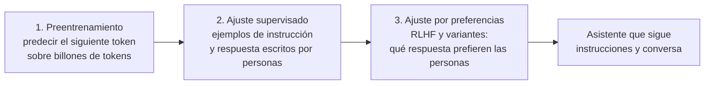

# Apunte — Clase 1: Fundamentos prácticos de aplicaciones con LLMs

> **Cómo usar este apunte.** Es el marco teórico de la clase: la presentación (`clase-01.ipynb`) muestra las ideas; este documento las desarrolla y dice de dónde sale cada una. Las referencias entre corchetes remiten a la sección **Fuentes**, que está a continuación y explica qué contiene cada fuente y por qué se usa. 📄 = PDF descargable con `bibliography/descargar.sh` (ver [`bibliography/README.md`](../bibliography/README.md)).
>
> **Lectura obligatoria antes de la segunda clase:** *The Illustrated Transformer* [21] y el capítulo de modelos de lenguaje con transformers de [1].
> **Lectura recomendada:** [6] (el paper del Transformer, §1–3), [14] (Chinchilla, §1–3) y [15] (InstructGPT, §1–3).
>
> **Correspondencia con la presentación** (`clase-01.ipynb`):
>
> | Presentación | Apunte |
> |---|---|
> | ¿Qué es un modelo de lenguaje? | §1 |
> | Capacidades y limitaciones | §2 |
> | De RNN a Transformers | §3 |
> | Arquitectura Transformer (referencia y por bloques) | §4 |
> | Self-attention (intuición y ecuación) | §5 |
> | Tokenización BPE (algoritmo, ejemplo, vista general) | §6 |
> | Tokens y ventana de contexto | §7 |
> | Generación probabilística y temperatura | §8 |
> | Generación vs. embeddings vs. reranking; coseno; bi- vs. cross-encoder | §9 |
> | Propietarios vs. abiertos; costo, latencia y privacidad; criterios; specs | §10 |

---

## Fuentes

Esta clase cubre en tres horas lo que un curso universitario de procesamiento de lenguaje cubre en un cuatrimestre, así que el apunte se apoya en: (a) un **libro de texto** de referencia, gratuito, para todo lo que se quiera profundizar; (b) los **papers fundacionales** de cada pieza (modelos de lenguaje neuronales, atención, Transformer, tokenización); (c) los papers que explican cómo se **entrenan y escalan** los LLM actuales; (d) papers de ingeniería de **inferencia** para entender costo y latencia; y (e) material didáctico y documentación de proveedores. 📄 = PDF descargable con `bibliography/descargar.sh`.

### Libro de texto

**[1] 📄 Jurafsky, D. & Martin, J. H. (2025). *Speech and Language Processing* (3.ª ed., borrador online).** https://web.stanford.edu/~jurafsky/slp3/ — `2025_jurafsky-martin_speech-and-language-processing-3ed.pdf`
- *Qué contiene:* el libro de texto estándar de procesamiento de lenguaje natural: modelos de lenguaje n-grama, entropía y perplejidad, embeddings, redes recurrentes, el Transformer, los modelos de lenguaje grandes, su entrenamiento y su alineamiento.
- *Por qué está:* es la referencia para profundizar **cualquier** tema de esta clase con rigor y gratis. Cada sección del apunte remite implícitamente a él.

### Modelos de lenguaje antes del Transformer

**[2] Shannon, C. E. (1948). *A Mathematical Theory of Communication*. Bell System Technical Journal, 27, 379–423 y 623–656.**
- *Qué contiene:* funda la teoría de la información (entropía) y, como ejemplo, construye aproximaciones al inglés con modelos que predicen la siguiente letra o palabra a partir de las anteriores (n-gramas).
- *Por qué está:* es el origen de la idea de "modelo de lenguaje como predictor del siguiente símbolo" y de la entropía, base de la función de pérdida de los LLM (§1).

**[3] 📄 Bengio, Y., Ducharme, R., Vincent, P. & Jauvin, C. (2003). *A Neural Probabilistic Language Model*. Journal of Machine Learning Research, 3, 1137–1155.** — `2003_bengio_neural-probabilistic-language-model.pdf`
- *Qué contiene:* el primer modelo de lenguaje neuronal: aprende a la vez una representación vectorial para cada palabra y la probabilidad del siguiente token, generalizando a secuencias nunca vistas por la similitud entre esos vectores.
- *Por qué está:* introduce los dos ingredientes de todo LLM: **embeddings** aprendidos y **predicción neuronal** del siguiente token (§1).

**[4] Hochreiter, S. & Schmidhuber, J. (1997). *Long Short-Term Memory*. Neural Computation, 9(8), 1735–1780.**
- *Qué contiene:* la arquitectura LSTM, una red recurrente con compuertas que mitiga el problema del gradiente que se desvanece y permite recordar información a más largo plazo.
- *Por qué está:* es la red recurrente que dominó el área hasta 2017; entender sus límites explica por qué ganó el Transformer (§3).

**[5] 📄 Bahdanau, D., Cho, K. & Bengio, Y. (2015). *Neural Machine Translation by Jointly Learning to Align and Translate*. ICLR 2015. arXiv:1409.0473.** — `2014_bahdanau_1409.0473.pdf`
- *Qué contiene:* introduce el mecanismo de **atención** en traducción automática: en lugar de comprimir toda la oración en un solo vector, el decodificador "mira" todas las posiciones de la entrada con pesos aprendidos.
- *Por qué está:* es el origen de la atención, la pieza que el Transformer convierte en el bloque central (§3).

### El Transformer y la tokenización

**[6] 📄 Vaswani, A. et al. (2017). *Attention Is All You Need*. NeurIPS 2017. arXiv:1706.03762.** — `2017_vaswani_1706.03762.pdf`
- *Qué contiene:* el Transformer: una arquitectura basada **solo** en atención (sin recurrencia), con atención multi-cabeza, codificación posicional, bloques feed-forward, conexiones residuales y normalización; entrenable en paralelo.
- *Por qué está:* es la arquitectura de todos los LLM actuales (§4, §5). Lectura recomendada (§1–3).

**[7] 📄 Su, J. et al. (2024). *RoFormer: Enhanced Transformer with Rotary Position Embedding*. Neurocomputing. arXiv:2104.09864.** — `2021_su_2104.09864.pdf`
- *Qué contiene:* RoPE: codifica la posición **rotando** los vectores de query y key en un ángulo proporcional a la posición, de modo que su producto punto depende de la distancia relativa entre tokens.
- *Por qué está:* es la codificación posicional que usan la mayoría de los LLM actuales, en lugar de las senoidales del paper original (§4.2).

**[8] 📄 Sennrich, R., Haddow, B. & Birch, A. (2016). *Neural Machine Translation of Rare Words with Subword Units*. ACL 2016. arXiv:1508.07909.** — `2015_sennrich_1508.07909.pdf`
- *Qué contiene:* adapta el algoritmo de compresión **Byte Pair Encoding** (Gage, 1994) para segmentar palabras en subpalabras, resolviendo el problema del vocabulario abierto (palabras raras o nuevas).
- *Por qué está:* es el algoritmo de tokenización de casi todos los LLM y la fuente del ejemplo de la presentación (§6).

**[9] 📄 Kudo, T. & Richardson, J. (2018). *SentencePiece: A simple and language independent subword tokenizer and detokenizer for Neural Text Processing*. EMNLP 2018 (demo). arXiv:1808.06226.** — `2018_kudo_1808.06226.pdf`
- *Qué contiene:* un tokenizador que trabaja sobre el texto crudo sin pre-segmentar en palabras (trata el espacio como un símbolo más), independiente del idioma.
- *Por qué está:* muestra cómo se aplica la tokenización por subpalabras a idiomas sin espacios y por qué los tokens suelen incluir el espacio previo (§6).

**[10] 📄 Petrov, A., La Malfa, E., Torr, P. H. S. & Bibi, A. (2023). *Language Model Tokenizers Introduce Unfairness Between Languages*. NeurIPS 2023. arXiv:2305.15425.** — `2023_petrov_2305.15425.pdf`
- *Qué contiene:* el mismo texto traducido a distintos idiomas puede ocupar cantidades de tokens muy distintas (hasta 15 veces), lo que encarece y limita a los hablantes de esos idiomas.
- *Por qué está:* tokenizar no es neutral: afecta costo, latencia y contexto disponible según el idioma (§6.4).

### Entrenamiento, escala y alineamiento

**[11] 📄 Radford, A., Wu, J., Child, R., Luan, D., Amodei, D. & Sutskever, I. (2019). *Language Models are Unsupervised Multitask Learners*. OpenAI.** — `2019_radford_gpt2-language-models-unsupervised-multitask.pdf`
- *Qué contiene:* GPT-2: un Transformer decodificador entrenado solo para predecir el siguiente token sobre un corpus web grande, que realiza tareas (traducción, resumen, preguntas) sin entrenamiento específico.
- *Por qué está:* muestra que la predicción del siguiente token, a escala, produce capacidades generales: la idea central de los LLM (§1, §4.3).

**[12] 📄 Devlin, J., Chang, M.-W., Lee, K. & Toutanova, K. (2019). *BERT: Pre-training of Deep Bidirectional Transformers for Language Understanding*. NAACL 2019. arXiv:1810.04805.** — `2018_devlin_1810.04805.pdf`
- *Qué contiene:* un Transformer **solo codificador** preentrenado prediciendo palabras enmascaradas con contexto de los dos lados.
- *Por qué está:* es la otra rama de la familia: los codificadores son la base de los modelos de embeddings y de reranking (§4.1, §9).

**[13] 📄 Kaplan, J. et al. (2020). *Scaling Laws for Neural Language Models*. arXiv:2001.08361.** — `2020_kaplan_2001.08361.pdf`
- *Qué contiene:* la pérdida de un modelo de lenguaje sigue una **ley de potencia** en el tamaño del modelo, de los datos y del cómputo, con tendencias que abarcan más de siete órdenes de magnitud; los detalles de arquitectura importan mucho menos.
- *Por qué está:* explica por qué la industria apostó a escalar (§4.3).

**[14] 📄 Hoffmann, J. et al. (2022). *Training Compute-Optimal Large Language Models*. NeurIPS 2022. arXiv:2203.15556.** — `2022_hoffmann_2203.15556.pdf`
- *Qué contiene:* con más de 400 modelos entrenados, muestra que para un presupuesto de cómputo fijo el tamaño del modelo y la cantidad de tokens deben escalar **por igual**, y que los modelos de la época estaban sub-entrenados; Chinchilla (70.000 millones de parámetros, 4 veces más datos que Gopher) supera a modelos mucho más grandes.
- *Por qué está:* corrige a [13] y explica por qué los modelos actuales se entrenan con muchísimos más datos por parámetro (§4.3).

**[15] 📄 Ouyang, L. et al. (2022). *Training language models to follow instructions with human feedback*. NeurIPS 2022. arXiv:2203.02155.** — `2022_ouyang_2203.02155.pdf`
- *Qué contiene:* el proceso que convierte un modelo preentrenado en un asistente: ajuste supervisado con demostraciones, un modelo de recompensa entrenado con preferencias humanas y aprendizaje por refuerzo (RLHF); el modelo de 1.300 millones de parámetros resultante se prefiere al GPT-3 de 175.000 millones.
- *Por qué está:* explica las etapas de entrenamiento de un LLM conversacional y por qué "sigue instrucciones" (§4.4). Lectura recomendada.

**[16] 📄 Bommasani, R. et al. (2021). *On the Opportunities and Risks of Foundation Models*. arXiv:2108.07258.** — `2021_bommasani_2108.07258.pdf`
- *Qué contiene:* introduce el término **modelo fundacional** (*foundation model*): un modelo entrenado a escala que se adapta a muchas tareas; analiza la **homogeneización** (muchos sistemas sobre pocos modelos) y la **emergencia** de capacidades, con sus riesgos.
- *Por qué está:* da el marco para entender por qué una aplicación "se construye sobre" un modelo de terceros y qué implica (§10).

**[17] 📄 Touvron, H. et al. (2023). *Llama 2: Open Foundation and Fine-Tuned Chat Models*. arXiv:2307.09288.** — `2023_touvron_2307.09288.pdf`
- *Qué contiene:* el informe técnico de una familia de modelos de pesos abiertos, que documenta en detalle el preentrenamiento, el ajuste supervisado y el RLHF de la versión conversacional.
- *Por qué está:* es de los pocos informes que describen con detalle el pipeline completo de un LLM conversacional, y un ejemplo de modelo de pesos abiertos (§4.4, §10).

### Inferencia: costo y latencia

**[18] 📄 Pope, R. et al. (2022). *Efficiently Scaling Transformer Inference*. MLSys 2023. arXiv:2211.05102.** — `2022_pope_2211.05102.pdf`
- *Qué contiene:* análisis de la inferencia de Transformers grandes: la fase de **procesamiento del prompt** (paralela) frente a la de **generación** (secuencial), el papel de la **caché de keys y values** y los compromisos entre latencia y costo.
- *Por qué está:* explica de dónde salen el costo y la latencia de una llamada (§7).

**[19] 📄 Kwon, W. et al. (2023). *Efficient Memory Management for Large Language Model Serving with PagedAttention*. SOSP 2023. arXiv:2309.06180.** — `2023_kwon_2309.06180.pdf`
- *Qué contiene:* muestra que la memoria de la caché KV de cada pedido es enorme y variable, y propone gestionarla en páginas, como la memoria virtual de un sistema operativo (vLLM).
- *Por qué está:* hace concreto por qué el contexto largo es caro para quien sirve el modelo (§7.3).

### Limitaciones

**[20] 📄 Huang, L. et al. (2023). *A Survey on Hallucination in Large Language Models*. ACM TOIS. arXiv:2311.05232.** — `2023_huang_2311.05232.pdf`
- *Qué contiene:* (ver apunte de la Clase 6) taxonomía, causas, detección y mitigación de alucinaciones.
- *Por qué está:* fundamenta la discusión de limitaciones (§2).

### Material didáctico y documentación

**[21] Alammar, J. (2018). *The Illustrated Transformer*.** https://jalammar.github.io/illustrated-transformer/
- *Qué contiene:* explicación visual, paso a paso, del Transformer y de la atención.
- *Por qué está:* es la mejor introducción visual; se recomienda leerla antes del paper [6]. Lectura obligatoria.

**[22] Hugging Face. *LLM Course — Byte-Pair Encoding tokenization*.** https://huggingface.co/learn/llm-course/chapter6/5
- *Qué contiene:* el algoritmo BPE explicado con código, incluyendo el entrenamiento del tokenizador y la tokenización de texto nuevo.
- *Por qué está:* complementa el ejemplo de la presentación con una implementación que se puede correr (§6).

**[23] Anthropic. *Models overview*.** https://docs.anthropic.com/en/docs/about-claude/models/overview
- *Qué contiene:* las especificaciones vigentes de cada modelo: ventana de contexto, salida máxima, precios.
- *Por qué está:* fuente de las especificaciones de la presentación (§10). Las especificaciones cambian: siempre verificar la versión vigente, y en la ficha de la plataforma que se use (Bedrock puede tener límites distintos).

---

## 1. ¿Qué es un modelo de lenguaje?

### 1.1 Probabilidad de secuencias

Un **modelo de lenguaje** asigna probabilidades a secuencias de tokens. Por la regla de la cadena, la probabilidad de una secuencia se factoriza en predicciones del **siguiente token**:

$$
P(w_1, w_2, \dots, w_n) = \prod_{t=1}^{n} P(w_t \mid w_1, \dots, w_{t-1})
$$

Un modelo **autorregresivo** aprende exactamente ese factor: dado el prefijo, una distribución sobre el siguiente token. Generar texto es aplicarlo una y otra vez: elegir un token, agregarlo al prefijo, repetir.

La idea es antigua. Shannon [2] la usó en 1948 para aproximar el inglés con modelos que predicen la siguiente letra o palabra a partir de las $n-1$ anteriores (**n-gramas**). Su problema es que no generalizan: una secuencia nunca vista tiene probabilidad cero. Bengio et al. [3] lo resolvieron en 2003 con el primer modelo **neuronal**: cada palabra se representa con un vector aprendido (un *embedding*), y palabras con vectores parecidos reciben predicciones parecidas, aunque la combinación exacta nunca se haya visto.

### 1.2 Cómo se entrena: entropía cruzada y perplejidad

El modelo se entrena para maximizar la probabilidad del texto real, o equivalentemente minimizar la **entropía cruzada** (el promedio de "sorpresa" ante el token correcto):

$$
\mathcal{L} = -\frac{1}{n} \sum_{t=1}^{n} \log P_\theta(w_t \mid w_{<t})
$$

La métrica clásica es la **perplejidad**, $\text{PPL} = e^{\mathcal{L}}$: intuitivamente, entre cuántos tokens equiprobables "duda" el modelo en cada paso. Un modelo con perplejidad 10 está, en promedio, tan inseguro como si eligiera entre 10 opciones igualmente probables.

### 1.3 Lo que esto implica

Un LLM **no consulta una base de datos de hechos**: produce la continuación más plausible según lo que vio al entrenarse. GPT-2 [11] mostró que, a escala suficiente, esa sola tarea produce capacidades generales (traducir, resumir, responder) sin entrenamiento específico. Pero el objetivo de entrenamiento premia lo **plausible**, no lo **verdadero**: esa es la raíz de las alucinaciones (§2).

---

## 2. Capacidades y limitaciones

| Capacidades | Limitaciones |
|---|---|
| Seguir instrucciones en lenguaje natural (por el ajuste de §4.4) | **Alucinaciones**: afirmaciones plausibles pero falsas [20] |
| Generar y transformar texto y código | **Fecha de corte**: no sabe nada posterior a sus datos de entrenamiento |
| Producir salidas estructuradas (JSON, Clase 3) | **Ventana de contexto finita** (§7) |
| Razonar en varios pasos (con limitaciones) | **Sensibilidad al prompt**: cambios menores cambian resultados (Clase 2) |
| Usar herramientas (Clase 9) | **No determinismo**: la misma pregunta puede dar respuestas distintas (§8) |

Huang et al. [20] distinguen dos tipos de alucinación: de **factualidad** (contradice el mundo) y de **fidelidad** (contradice el contexto o las instrucciones dadas). La mayor parte del curso — RAG, citas, abstención, evaluación — existe para controlar la segunda y reducir la primera.

---

## 3. De las redes recurrentes al Transformer

Una **red recurrente** (RNN) procesa el texto token por token y resume todo lo leído en un estado oculto: $h_t = f(h_{t-1}, x_t)$. Dos problemas:

1. **Secuencialidad**: para calcular $h_t$ hace falta $h_{t-1}$. No se puede paralelizar a lo largo de la secuencia, y el entrenamiento a gran escala es lento.
2. **Memoria lejana**: al propagar el error hacia atrás por muchos pasos, el gradiente se desvanece y la red "olvida". La LSTM [4] lo mitigó con compuertas, pero no lo resolvió del todo.

La **atención** [5] nació para traducción: en lugar de comprimir toda la oración de entrada en un solo vector, el decodificador consulta **todas** las posiciones de la entrada con pesos aprendidos. El **Transformer** [6] dio el paso radical: eliminar la recurrencia y usar **solo** atención. Cada token se relaciona directamente con todos los demás, a distancia 1, y todas las posiciones se procesan **en paralelo** durante el entrenamiento. Eso habilitó entrenar modelos mucho más grandes con mucho más texto.

---

## 4. La arquitectura Transformer

### 4.1 Tres familias

| Familia | Atención | Entrenamiento típico | Ejemplos | Uso en el curso |
|---|---|---|---|---|
| **Solo codificador** | Bidireccional (cada token ve todos) | Predecir palabras enmascaradas [12] | BERT | Modelos de embeddings y reranking (Clases 4, 8) |
| **Solo decodificador** | Causal (cada token ve solo los anteriores) | Predecir el siguiente token [11] | GPT, Claude, Llama | Generación (todo el curso) |
| **Codificador-decodificador** | Ambas + atención cruzada | Traducción, reconstrucción | El Transformer original [6], T5 | — |

### 4.2 Un bloque decodificador

Cada capa aplica, con conexiones residuales y normalización:
1. **Atención multi-cabeza enmascarada** (§5): cada token incorpora información de los anteriores.
2. **Red feed-forward** aplicada a cada posición por separado: donde se cree que se almacena buena parte del "conocimiento".

Antes de la primera capa, cada token se convierte en un vector (embedding) y se le agrega información de **posición**. Esto es necesario porque la atención, por sí sola, es **invariante a permutaciones**: si se reordenan los tokens, los resultados se reordenan igual, sin "notar" el orden. El paper original sumaba funciones senoidales de la posición; la mayoría de los LLM actuales usa **RoPE** [7], que rota los vectores de query y key según su posición, de modo que su producto punto depende de la **distancia relativa** entre tokens.

Al final, una proyección lineal y un softmax dan la distribución sobre el vocabulario del siguiente token.

### 4.3 Escala

Kaplan et al. [13] encontraron que la pérdida baja como una **ley de potencia** al aumentar parámetros, datos y cómputo, con tendencias regulares a lo largo de más de siete órdenes de magnitud. Eso hizo predecible (y por lo tanto financiable) escalar. Hoffmann et al. [14] corrigieron la receta: para un cómputo fijo, parámetros y tokens de entrenamiento deben crecer **en la misma proporción**; Chinchilla, con 70.000 millones de parámetros y 4 veces más datos que Gopher, superó a modelos de hasta 530.000 millones. Por eso los modelos actuales se entrenan con muchísimos más tokens por parámetro que los de 2020.

### 4.4 Tres etapas de entrenamiento

Un LLM conversacional no sale del preentrenamiento [15][17]:

El preentrenamiento da el conocimiento y las capacidades; las etapas 2 y 3 dan el **comportamiento**: seguir instrucciones, el formato de conversación con roles (Clase 2), negarse a ciertos pedidos. InstructGPT [15] mostró el peso de estas etapas: las personas preferían las respuestas de un modelo ajustado de 1.300 millones de parámetros a las de GPT-3 con 175.000 millones.

---

## 5. Self-attention

### 5.1 La ecuación

Cada token se proyecta en tres vectores con matrices aprendidas: **query** ($q$: qué busca), **key** ($k$: qué ofrece) y **value** ($v$: qué aporta). Para todos los tokens a la vez, en matrices $Q$, $K$, $V$:

$$
\text{Attention}(Q, K, V) = \text{softmax}\!\left(\frac{QK^\top}{\sqrt{d_k}} + M\right) V
$$

- $QK^\top$ es una matriz $n \times n$: el producto punto de cada query con cada key mide cuánto se relaciona cada token con cada otro.
- **Por qué $\sqrt{d_k}$:** si las componentes de $q$ y $k$ son independientes con varianza 1, su producto punto tiene varianza $d_k$. Con $d_k$ grande, los scores son enormes, el softmax se **satura** (casi todo el peso en un token) y los gradientes casi se anulan. Dividir por $\sqrt{d_k}$ devuelve la varianza a 1 [6].
- $M$ es la **máscara causal** de los decodificadores: $-\infty$ en las posiciones futuras, que el softmax convierte en peso 0. Así cada token solo atiende a los anteriores, que es lo que permite entrenar prediciendo el siguiente token en todas las posiciones a la vez.
- El softmax se aplica **por fila**: para cada query, los pesos sobre todas las keys suman 1.
- El resultado, para cada token, es un **promedio ponderado** de los values.

### 5.2 Multi-cabeza

En lugar de una atención, se calculan $h$ en paralelo ("cabezas"), cada una con sus propias proyecciones, y sus resultados se concatenan y pasan por una proyección final $W^O$ [6]. Cada cabeza puede especializarse en un tipo de relación (sintáctica, de referencia, de posición).

### 5.3 El costo cuadrático

La matriz $QK^\top$ tiene $n^2$ elementos: el cómputo de la atención crece **cuadráticamente** con la longitud del contexto. Duplicar el contexto cuadruplica ese costo. Es una de las razones por las que el contexto largo es caro (§7).

---

## 6. Tokenización

### 6.1 Por qué subpalabras

Un modelo trabaja sobre un vocabulario finito. Con palabras completas, el vocabulario es enorme y siempre aparecen palabras nuevas. Con caracteres, las secuencias son larguísimas y cada token aporta poco. Las **subpalabras** son el punto medio: las palabras frecuentes son un token, las raras se arman con pedazos.

### 6.2 Byte Pair Encoding

BPE nació como algoritmo de **compresión** (Gage, 1994) y Sennrich et al. [8] lo adaptaron a la tokenización:

1. Empezar con los caracteres (o bytes) como vocabulario.
2. Contar los pares de símbolos adyacentes en el corpus, ponderados por la frecuencia de cada palabra.
3. Fusionar el par más frecuente en un símbolo nuevo; resolver empates con un criterio fijo.
4. Repetir hasta alcanzar el tamaño de vocabulario deseado.

El vocabulario resultante depende del corpus de entrenamiento del tokenizador. Los tokenizadores actuales trabajan a nivel de **bytes**: parten de los 256 bytes posibles, de modo que cualquier texto (cualquier idioma, emojis, código) se puede tokenizar sin un token "desconocido". Los vocabularios actuales van de unas decenas a unos cientos de miles de tokens. SentencePiece [9] trata el espacio como un símbolo más, por eso muchos tokens incluyen el espacio previo (" casa" y "casa" son tokens distintos).

### 6.3 Por qué importa en una aplicación

Todo se mide en tokens: el **precio** (por millón de tokens), la **ventana de contexto**, el **límite de salida** y la **latencia** (un token por paso de generación). Contar caracteres o palabras es solo una aproximación (Clase 4).

### 6.4 La tokenización no es neutral

Como los tokenizadores se entrenan con corpus dominados por el inglés, el mismo contenido en otros idiomas ocupa **más tokens**: hasta 15 veces más en algunos casos [10]. En castellano la diferencia es moderada (en el notebook de la Clase 4, la misma oración ocupa 45 tokens en castellano y 38 en inglés), pero existe: más costo, más latencia y menos contenido por ventana. Algunos comportamientos extraños de los LLM (contar letras de una palabra, aritmética con números largos) también se explican porque el modelo no ve letras ni dígitos, sino tokens.

---

## 7. Tokens, ventana de contexto y costo de inferencia

### 7.1 La ventana

La **ventana de contexto** es el máximo de tokens que el modelo procesa en una llamada, **entrada y salida juntas**. Todo lo que el modelo "sabe" de la conversación tiene que entrar ahí: instrucciones, historial, documentos recuperados (Clase 6), resultados de herramientas (Clase 9).

### 7.2 Dos fases con costos distintos

Una llamada tiene dos fases [18]:

1. **Procesamiento del prompt** (*prefill*): todos los tokens de entrada se procesan **en paralelo**. Determina el tiempo hasta el primer token.
2. **Generación** (*decode*): un token por vez, cada uno esperando al anterior. Es secuencial por definición (§1.1).

Por eso los tokens de salida suelen costar varias veces más que los de entrada, y la latencia depende sobre todo de **cuánto se genera** (Clase 3, §6).

### 7.3 La caché de keys y values

Para no recalcular la atención de todo el prefijo en cada paso de generación, el servidor guarda las keys y los values de los tokens ya procesados: la **caché KV**. Su tamaño crece **linealmente** con la longitud del contexto, por cada capa y cada cabeza:

$$
\text{memoria KV} \approx 2 \times n_{\text{capas}} \times d_{\text{modelo}} \times n_{\text{tokens}} \times \text{bytes por número}
$$

(el 2 es por keys y values). Para modelos grandes y contextos largos son gigabytes **por pedido**, y gestionar esa memoria es uno de los problemas centrales de servir LLM [19]. Es la razón física de que el contexto largo cueste más, se cobre por token de entrada, y tenga límites.

Además de costar más, el contexto largo **no se usa uniformemente**: los modelos aprovechan peor la información en el medio del contexto que en los extremos (Clase 7, *Lost in the Middle*).

---

## 8. Generación probabilística

En cada paso, el modelo produce un puntaje (*logit*) $z_i$ por token del vocabulario y un softmax con **temperatura** $T$ lo convierte en probabilidades:

$$
P(\text{token}_i) = \frac{\exp(z_i / T)}{\sum_j \exp(z_j / T)}
$$

Con $T \to 0$ se elige siempre el más probable (decodificación voraz); con $T = 1$ se usa la distribución aprendida; con $T > 1$ se aplana. **Top-k** muestrea solo entre los $k$ más probables; **top-p** (muestreo de núcleo) entre el conjunto más chico que acumula probabilidad $p$. El desarrollo completo, con los papers de origen, está en el apunte de la Clase 2 (§7).

Ni siquiera con $T = 0$ la salida de un servicio real está garantizada idéntica entre llamadas: hay fuentes de no determinismo numérico en el cómputo en paralelo. Las aplicaciones tienen que estar diseñadas para tolerar variación (Clases 8 y 9: evaluar con repeticiones).

---

## 9. Generación, embeddings y reranking

Las tres familias de modelos que usa el curso resuelven tareas distintas:

| | Entrada | Salida | Arquitectura típica | Clase |
|---|---|---|---|---|
| **Generación** | Un prompt | Texto, token a token | Solo decodificador | Todo el curso |
| **Embeddings** | Un texto | Un vector que representa su significado | Codificador (bi-encoder) | 4, 5 |
| **Reranking** | Una consulta y un documento, **juntos** | Un puntaje de relevancia | Codificador (cross-encoder) | 8 |

La similitud entre embeddings se mide con el coseno, que va de −1 a 1. En la práctica, con modelos reales, hasta textos sin relación dan valores positivos: lo interpretable es el orden relativo (Clase 4, §2.4).

**Bi-encoder vs. cross-encoder.** Un *bi-encoder* codifica consulta y documento **por separado**: los vectores de los documentos se calculan una vez y se indexan, y buscar es comparar vectores (rápido, escala a millones). Un *cross-encoder* lee consulta y documento **juntos**, con atención entre ambos (más preciso, pero una pasada del modelo por cada par). Por eso se combinan en cascada: el bi-encoder recupera candidatos y el cross-encoder los reordena (Clases 4 y 8).

---

## 10. Elegir un modelo

### 10.1 Modelos fundacionales

Bommasani et al. [16] llamaron **modelos fundacionales** a los modelos entrenados a escala que se adaptan a muchas tareas. Señalan dos fenómenos con consecuencias para quien construye aplicaciones: la **emergencia** (capacidades que no se programaron explícitamente) y la **homogeneización** (muchísimas aplicaciones construidas sobre unos pocos modelos, que heredan sus fallas). Una aplicación con LLM depende de un componente que no controla: por eso el curso insiste en abstraer el proveedor (Clase 3) y en evaluar (Clase 8).

### 10.2 Propietarios vs. de pesos abiertos

| | Propietarios (vía API) | De pesos abiertos (*open-weights*) |
|---|---|---|
| Ejemplos | Claude, GPT, Gemini | Llama [17], Mistral, Qwen |
| Calidad de punta | Generalmente mayor | Cerca, con cierto retraso |
| Infraestructura | Ninguna | Propia (GPU, servicio, escalado) |
| Costo | Por token, variable | Fijo de infraestructura |
| Datos | Viajan al proveedor (revisar políticas) | Quedan en la propia infraestructura |
| Licencia | Términos de servicio | Licencia de cada modelo (no siempre "open source") |

"De pesos abiertos" es más preciso que "abiertos": se publican los pesos, no necesariamente los datos ni el código de entrenamiento, y cada modelo tiene su licencia con sus restricciones.

### 10.3 Criterios de selección

Calidad **en la tarea propia** (no en un benchmark genérico), costo por millón de tokens de entrada y salida, latencia, ventana de contexto, funciones disponibles (herramientas, salidas estructuradas, visión), requisitos de privacidad y cumplimiento, y disponibilidad en la plataforma que se usa. Las especificaciones cambian cada pocos meses [23]: la decisión se revisa periódicamente y el código tiene que permitir cambiar de modelo sin reescribirse.

---

## Preguntas de repaso

1. Escribí la factorización de la probabilidad de una secuencia y explicá por qué generar texto es necesariamente secuencial.
2. ¿Qué es la perplejidad? Si un modelo tiene perplejidad 1, ¿qué significa?
3. ¿Qué dos problemas de las redes recurrentes resuelve el Transformer, y cómo?
4. Explicá por qué la atención se divide por $\sqrt{d_k}$. ¿Qué pasaría sin esa división con $d_k = 128$?
5. ¿Para qué sirve la máscara causal? ¿Por qué permite entrenar en paralelo?
6. ¿Por qué hace falta codificación posicional? ¿Qué propone RoPE?
7. Explicá las tres etapas de entrenamiento de un LLM conversacional. ¿Cuál explica que el modelo siga instrucciones?
8. Según [14], ¿qué estaba mal en la forma de escalar modelos antes de Chinchilla?
9. ¿Por qué un token de salida suele costar más que uno de entrada? Usá las dos fases de la inferencia.
10. ¿Por qué el mismo texto puede costar distinto según el idioma?
11. Explicá la diferencia entre un bi-encoder y un cross-encoder y por qué se usan en cascada.
