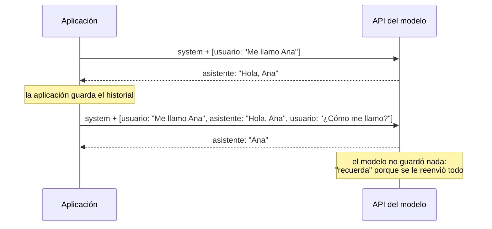

# Apunte — Clase 2: APIs, prompting y configuración

> **Cómo usar este apunte.** Es el marco teórico de la clase: el notebook muestra *cómo* se implementa; este documento explica *por qué* y de dónde sale cada idea. Las referencias entre corchetes remiten a la sección **Fuentes**, que está a continuación y explica qué contiene cada fuente y por qué se usa. 📄 = PDF descargable con `bibliography/descargar.sh` (ver [`bibliography/README.md`](../bibliography/README.md)).
>
> **Lectura obligatoria antes de la clase:** la guía de prompt engineering de tu proveedor ([16], [17] o [18]) y §1–2 de [1] (GPT-3: qué es el aprendizaje en contexto).
> **Lectura recomendada después:** [3] (qué hace funcionar a los ejemplos), [6] (sensibilidad al formato) y [9] (The Prompt Report, como índice).
>
> **Correspondencia con el notebook** (`clase-02.ipynb`): las secciones 1 a 9 del notebook corresponden a los §1 a §9 de este apunte, con el mismo número.

---

## Fuentes

"Prompting" suele enseñarse como un recetario de trucos. Este apunte lo trata como lo que es: una forma de **condicionar una distribución de probabilidad**, con resultados empíricos sobre qué funciona, cuánto y por qué. Las fuentes son: (a) los papers que definieron el aprendizaje en contexto y el ajuste por instrucciones; (b) estudios empíricos sobre la sensibilidad de los modelos al prompt; (c) los papers de las estrategias de muestreo que exponen las APIs; (d) la literatura de seguridad sobre inyección; y (e) documentación de proveedores e ingeniería de software. 📄 = PDF descargable con `bibliography/descargar.sh`.

### Aprendizaje en contexto y modelos de instrucciones

**[1] 📄 Brown, T. B. et al. (2020). *Language Models are Few-Shot Learners*. NeurIPS 2020. arXiv:2005.14165.** — `2020_brown_2005.14165.pdf`
- *Qué contiene:* presenta GPT-3 (175.000 millones de parámetros) y muestra que un modelo suficientemente grande puede resolver tareas nuevas **sin actualizar sus pesos**, solo condicionado por una descripción de la tarea y unos pocos ejemplos en el prompt; define los regímenes *zero-shot*, *one-shot* y *few-shot*.
- *Por qué está:* es la fuente del concepto de **aprendizaje en contexto** (*in-context learning*) en el que se apoya todo el §5. Lectura obligatoria (§1–2).

**[2] 📄 Ouyang, L. et al. (2022). *Training language models to follow instructions with human feedback*. NeurIPS 2022. arXiv:2203.02155.** — `2022_ouyang_2203.02155.pdf`
- *Qué contiene:* InstructGPT: un modelo preentrenado se ajusta con demostraciones humanas (ajuste supervisado) y luego con aprendizaje por refuerzo a partir de preferencias humanas (RLHF); las salidas del modelo de 1.300 millones de parámetros se prefieren a las de GPT-3 de 175.000 millones, con 100 veces menos parámetros.
- *Por qué está:* explica por qué los modelos actuales **siguen instrucciones** y aceptan roles (sistema, usuario, asistente): no es una propiedad del preentrenamiento, es del ajuste posterior (§4).

**[3] 📄 Min, S. et al. (2022). *Rethinking the Role of Demonstrations: What Makes In-Context Learning Work?* EMNLP 2022. arXiv:2202.12837.** — `2022_min_2202.12837.pdf`
- *Qué contiene:* muestra que, en tareas de clasificación y opción múltiple, reemplazar al azar las etiquetas de los ejemplos **casi no afecta** el desempeño; lo que importa es que los ejemplos muestren el **espacio de etiquetas**, la **distribución del texto de entrada** y el **formato**.
- *Por qué está:* cambia la intuición de qué "enseñan" los ejemplos few-shot (§5.2). Lectura recomendada.

**[4] 📄 Zhao, T. Z., Wallace, E., Feng, S., Klein, D. & Singh, S. (2021). *Calibrate Before Use: Improving Few-Shot Performance of Language Models*. ICML 2021. arXiv:2102.09690.** — `2021_zhao_2102.09690.pdf`
- *Qué contiene:* muestra que el formato, la elección de ejemplos y hasta su **orden** pueden llevar la exactitud de cerca del azar a cerca del estado del arte, y que se debe a sesgos del modelo (hacia etiquetas frecuentes, recientes o comunes en el preentrenamiento); propone una calibración.
- *Por qué está:* cuantifica la inestabilidad del few-shot y nombra sus causas (§5.3).

**[5] 📄 Lu, Y., Bartolo, M., Moore, A., Riedel, S. & Stenetorp, P. (2022). *Fantastically Ordered Prompts and Where to Find Them: Overcoming Few-Shot Prompt Order Sensitivity*. ACL 2022. arXiv:2104.08786.** — `2021_lu_2104.08786.pdf`
- *Qué contiene:* el orden de los mismos ejemplos puede hacer la diferencia entre un desempeño cercano al estado del arte y uno aleatorio, en todos los tamaños de modelo.
- *Por qué está:* evidencia específica sobre el orden de los ejemplos (§5.3).

**[6] 📄 Sclar, M., Choi, Y., Tsvetkov, Y. & Suhr, A. (2024). *Quantifying Language Models' Sensitivity to Spurious Features in Prompt Design*. ICLR 2024. arXiv:2310.11324.** — `2023_sclar_2310.11324.pdf`
- *Qué contiene:* cambios de **formato** sin cambio de significado (separadores, mayúsculas, espacios) producen diferencias de hasta 76 puntos de exactitud en un modelo abierto, y la sensibilidad persiste al aumentar el tamaño o con ajuste por instrucciones; recomienda reportar un rango de desempeño sobre formatos.
- *Por qué está:* es el argumento más fuerte para **evaluar** los prompts en vez de confiar en uno (§5.3, §6). Lectura recomendada.

**[7] 📄 Wei, J. et al. (2022). *Chain-of-Thought Prompting Elicits Reasoning in Large Language Models*. NeurIPS 2022. arXiv:2201.11903.** — `2022_wei_2201.11903.pdf`
- *Qué contiene:* incluir en los ejemplos los **pasos de razonamiento** intermedios mejora mucho el desempeño en aritmética, sentido común y razonamiento simbólico; con ocho ejemplos, un modelo de 540.000 millones de parámetros alcanzó el estado del arte en GSM8K.
- *Por qué está:* es la fuente de *chain-of-thought* (§5.4).

**[8] 📄 Kojima, T., Gu, S. S., Reid, M., Matsuo, Y. & Iwasawa, Y. (2022). *Large Language Models are Zero-Shot Reasoners*. NeurIPS 2022. arXiv:2205.11916.** — `2022_kojima_2205.11916.pdf`
- *Qué contiene:* agregar "Pensemos paso a paso" (*Let's think step by step*) antes de la respuesta, sin ningún ejemplo, sube la exactitud en MultiArith de 17,7% a 78,7% y en GSM8K de 10,4% a 40,7% con un modelo de instrucciones.
- *Por qué está:* muestra que el razonamiento paso a paso se puede inducir en zero-shot (§5.4).

**[9] 📄 Schulhoff, S. et al. (2024). *The Prompt Report: A Systematic Survey of Prompt Engineering Techniques*. arXiv:2406.06608.** — `2024_schulhoff_2406.06608.pdf`
- *Qué contiene:* revisión sistemática que establece un vocabulario de 33 términos y una taxonomía de 58 técnicas de prompting para texto, con buenas prácticas.
- *Por qué está:* sirve de **índice** del área: cualquier técnica que aparezca en un blog está clasificada ahí, con sus referencias (§5).

### Muestreo

**[10] 📄 Holtzman, A., Buys, J., Du, L., Forbes, M. & Choi, Y. (2020). *The Curious Case of Neural Text Degeneration*. ICLR 2020. arXiv:1904.09751.** — `2019_holtzman_1904.09751.pdf`
- *Qué contiene:* muestra que decodificar por máxima probabilidad produce texto repetitivo y degenerado, que muestrear de toda la distribución produce incoherencias, y propone el **muestreo de núcleo** (*nucleus sampling*, top-p): muestrear del conjunto más chico de tokens que acumula una probabilidad $p$.
- *Por qué está:* es la fuente primaria del parámetro `topP` (§7).

**[11] 📄 Fan, A., Lewis, M. & Dauphin, Y. (2018). *Hierarchical Neural Story Generation*. ACL 2018. arXiv:1805.04833.** — `2018_fan_1805.04833.pdf`
- *Qué contiene:* un modelo jerárquico de generación de historias; popularizó el **muestreo top-k** (muestrear entre los $k$ tokens más probables).
- *Por qué está:* es la referencia habitual del parámetro `top_k` (§7).

**[12] von Platen, P. (2020). *How to generate text: using different decoding methods for language generation with Transformers*. Hugging Face Blog.** https://huggingface.co/blog/how-to-generate
- *Qué contiene:* explicación visual y con código de búsqueda voraz, *beam search*, muestreo, temperatura, top-k y top-p.
- *Por qué está:* es la mejor explicación accesible de los parámetros de muestreo, complementaria a [10] y [11] (§7).

### Roles, inyección y jerarquía de instrucciones

**[13] Hugging Face. *Chat templates* (documentación de Transformers).** https://huggingface.co/docs/transformers/main/en/chat_templating
- *Qué contiene:* cómo una conversación con roles (sistema, usuario, asistente) se convierte en **una sola secuencia de tokens** con marcadores especiales antes de entrar al modelo.
- *Por qué está:* desmitifica los "roles": para el modelo, la conversación es texto con delimitadores aprendidos en el ajuste por instrucciones (§4).

**[14] 📄 Perez, F. & Ribeiro, I. (2022). *Ignore Previous Prompt: Attack Techniques For Language Models*. NeurIPS ML Safety Workshop. arXiv:2211.09527.** — `2022_perez_2211.09527.pdf`
- *Qué contiene:* estudia dos ataques por texto del usuario: **secuestro del objetivo** (*goal hijacking*: que el modelo haga otra cosa) y **filtración del prompt** (*prompt leaking*: que revele sus instrucciones), y muestra que entradas simples alcanzan.
- *Por qué está:* es el primer análisis sistemático de la inyección de prompts directa (§6).

**[15] 📄 Wallace, E. et al. (2024). *The Instruction Hierarchy: Training LLMs to Prioritize Privileged Instructions*. arXiv:2404.13208.** — `2024_wallace_2404.13208.pdf`
- *Qué contiene:* (ver apunte de la Clase 6) propone entrenar a los modelos para priorizar instrucciones del sistema sobre las del usuario y las de datos de terceros.
- *Por qué está:* explica por qué el system prompt tiene más peso que el mensaje del usuario, y por qué eso no es una garantía (§4, §6).

### Documentación de proveedores

**[16] Anthropic. *Prompt engineering overview*.** https://docs.anthropic.com/en/docs/build-with-claude/prompt-engineering/overview
**[17] OpenAI. *Prompt engineering*.** https://platform.openai.com/docs/guides/prompt-engineering
**[18] Google. *Prompt design strategies* (Gemini API).** https://ai.google.dev/gemini-api/docs/prompting-strategies
- *Qué contienen:* las recomendaciones de cada proveedor para sus modelos: instrucciones claras y específicas, ejemplos, delimitadores (Anthropic recomienda etiquetas XML), asignar un rol, pedir razonamiento, dar formato de salida.
- *Por qué están:* los modelos se entrenan con convenciones distintas; la documentación del proveedor que uses es la referencia práctica (§4–6). Lectura obligatoria: la de tu proveedor.

**[19] DAIR.AI. *Prompt Engineering Guide*.** https://www.promptingguide.ai/
- *Qué contiene:* guía abierta y mantenida con las técnicas de prompting explicadas con ejemplos y enlaces a los papers.
- *Por qué está:* puerta de entrada amigable a las técnicas que [9] cataloga (§5).

**[20] AWS. *Converse API* (Amazon Bedrock).** https://docs.aws.amazon.com/bedrock/latest/userguide/conversation-inference.html
- *Qué contiene:* el formato de mensajes, `system`, `inferenceConfig` (temperatura, topP, maxTokens, secuencias de parada), `additionalModelRequestFields`, y la estructura de la respuesta (`output`, `stopReason`, `usage`, `metrics`).
- *Por qué está:* es la API que usa el notebook (§3, §7).

### Ingeniería de software

**[21] Wiggins, A. (2011). *The Twelve-Factor App — III. Config*.** https://12factor.net/config
- *Qué contiene:* la configuración que cambia entre entornos (credenciales, URLs, nombres de modelos) va en **variables de entorno**, separada estrictamente del código.
- *Por qué está:* es el principio detrás del `.env` del curso (§1).

**[22] Python Software Foundation. *asyncio — Asynchronous I/O* y *concurrent.futures*.** https://docs.python.org/3/library/asyncio.html
- *Qué contiene:* los modelos de concurrencia de Python: hilos (`ThreadPoolExecutor`) y corrutinas (`async`/`await`).
- *Por qué está:* fuente del §9.

---

## 1. Configuración del entorno

Tres prácticas que se aplican a todo el curso:

1. **Entorno aislado** (venv o conda) con versiones fijadas: el comportamiento de los SDK cambia entre versiones.
2. **Configuración fuera del código** [21]: credenciales, región y nombres de modelos van en variables de entorno (`.env`, que nunca se versiona). El mismo código corre en otra máquina, con otro proveedor u otro modelo, cambiando solo el entorno.
3. **Nunca credenciales en el código ni en el repositorio.** Un repositorio público con una clave es una clave filtrada.

Un caso concreto de (2): los modelos vigentes de cada proveedor cambian cada pocos meses. El curso no fija nombres de modelos de otros proveedores en el código: se configuran en el `.env`.

---

## 2. Tu proveedor

Todas las APIs de chat comparten el mismo modelo conceptual (mensajes con roles, parámetros de muestreo, una respuesta con texto y uso de tokens) con distinta sintaxis. Esa diferencia de sintaxis sobre un concepto común es exactamente el problema que la Clase 3 resuelve con una interfaz `LLMProvider`.

---

## 3. Primer cliente: la anatomía de una respuesta

Una respuesta de la Converse API [20] tiene cuatro partes:

| Campo | Qué es | Para qué sirve |
|---|---|---|
| `output.message.content` | **Lista** de bloques (texto, llamadas a herramientas, …) | El resultado. No asumir que el primer bloque es texto |
| `stopReason` | Por qué terminó: `end_turn`, `max_tokens`, `stop_sequence`, `tool_use` | Detectar respuestas **cortadas** (`max_tokens`) |
| `usage` | Tokens de entrada y de salida | Costo (Clase 3) |
| `metrics.latencyMs` | Latencia del lado del servidor | Rendimiento (Clase 3) |

---

## 4. Mensajes de sistema, usuario y asistente

### 4.1 Qué son los roles

Un modelo de lenguaje predice el siguiente token dado un texto (Clase 1). Una "conversación con roles" es una convención: antes de entrar al modelo, los mensajes se concatenan en **una sola secuencia** con marcadores especiales que indican dónde empieza cada rol (una **plantilla de chat**) [13]. El modelo "entiende" los roles porque fue **ajustado** con muchísimas conversaciones en ese formato: primero con demostraciones y después con retroalimentación humana [2]. InstructGPT [2] mostró cuánto importa ese ajuste: un modelo 100 veces más chico, pero entrenado para seguir instrucciones, era preferido por las personas.

### 4.2 El system prompt

El *system prompt* fija el rol, las reglas y el formato para toda la conversación. Va en un **campo separado** de los mensajes y, como la API no tiene estado, **se reenvía en cada llamada**. Los modelos actuales se entrenan para darle **más prioridad** que a los mensajes del usuario: es una **jerarquía de instrucciones** [15]. Esa prioridad reduce, pero no elimina, la posibilidad de que un usuario la contradiga (§6).

### 4.3 El modelo no tiene memoria

La API es **sin estado**: cada llamada es independiente. Para que el modelo "recuerde" una conversación, hay que reenviar todo el historial en cada llamada.

Tres consecuencias:

- el **costo** de una conversación crece con su largo (cada turno reenvía todos los anteriores);
- la conversación está limitada por la **ventana de contexto** (Clase 1);
- la "memoria" es responsabilidad de la aplicación: qué guardar, qué resumir, qué descartar (Clase 10).

---

## 5. Zero-shot y few-shot: el aprendizaje en contexto

### 5.1 La idea

Brown et al. [1] mostraron que un modelo suficientemente grande puede resolver una tarea nueva **sin cambiar sus pesos**, solo a partir del prompt:

| Régimen [1] | El prompt contiene |
|---|---|
| **Zero-shot** | Solo la descripción de la tarea |
| **One-shot** | La descripción + un ejemplo resuelto |
| **Few-shot** | La descripción + unos pocos ejemplos resueltos |

Formalmente, el modelo calcula $p(y \mid \text{instrucción}, (x_1, y_1), \dots, (x_k, y_k), x)$: los ejemplos son parte del **condicionamiento**, no del entrenamiento.

### 5.2 ¿Qué enseñan los ejemplos?

La intuición dice "los ejemplos le enseñan la tarea al modelo". Min et al. [3] encontraron algo distinto: en tareas de clasificación, **reemplazar al azar las respuestas** de los ejemplos casi no cambia el desempeño. Lo que los ejemplos aportan es:

1. el **espacio de respuestas** posibles (qué etiquetas existen),
2. la **distribución del texto de entrada** (cómo son los casos),
3. el **formato** de la salida.

Para el uso práctico: los ejemplos son, sobre todo, una forma muy efectiva de **especificar formato y criterio**. Igual conviene que sean correctos, porque en tareas más complejas sí importan.

### 5.3 Sensibilidad: el prompt es un hiperparámetro

Detalles que parecen irrelevantes cambian mucho el resultado:

- el **orden** de los ejemplos puede llevar el desempeño de cerca del azar a cerca del estado del arte [4][5];
- los modelos tienden a favorecer etiquetas que aparecen **al final** o con más frecuencia en los ejemplos [4];
- cambios de **formato** sin cambio de significado (separadores, mayúsculas) producen diferencias de hasta 76 puntos de exactitud en un modelo abierto, y la sensibilidad no desaparece con modelos más grandes ni ajustados por instrucciones [6].

La consecuencia metodológica es la de la Clase 8: **un prompt no se valida probándolo una vez**. Se evalúa sobre un conjunto de casos y, si importa, sobre variantes de formato.

### 5.4 Pedir el razonamiento

Wei et al. [7] mostraron que si los ejemplos incluyen los **pasos de razonamiento** (*chain-of-thought*), el modelo los imita y acierta mucho más en problemas de varios pasos. Kojima et al. [8] mostraron que ni siquiera hacen falta ejemplos: agregar "Pensemos paso a paso" llevó la exactitud de un modelo en un benchmark de aritmética de 17,7% a 78,7%. Los modelos actuales razonan mejor de entrada (muchos tienen un modo de razonamiento explícito), pero la idea sigue vigente: **darle lugar al razonamiento antes de la respuesta** (Clase 3, §2.3).

The Prompt Report [9] cataloga 58 técnicas de prompting; casi todas son variaciones de tres ideas: dar **contexto**, dar **ejemplos** y pedir **razonamiento**.

---

## 6. Delimitación de instrucciones y contexto

### 6.1 El problema: todo es texto

El modelo recibe una sola secuencia de tokens. Si el prompt mezcla instrucciones ("resumí este texto") con datos ("el texto: …"), y los datos contienen algo que parece una instrucción ("ignorá lo anterior y …"), el modelo puede obedecerlo. Perez & Ribeiro [14] mostraron que entradas simples alcanzan para dos ataques:

- **secuestro del objetivo**: que el modelo haga otra cosa que la pedida;
- **filtración del prompt**: que revele sus instrucciones.

### 6.2 Delimitar

La mitigación básica es **separar sin ambigüedad** instrucciones de datos: etiquetas XML (recomendadas por Anthropic [16]), bloques con delimitadores, y una instrucción explícita de tratar lo delimitado como datos. Combinada con la jerarquía de instrucciones [15] (reglas en el system prompt, datos en el mensaje del usuario), reduce mucho el riesgo.

**No lo elimina.** Ninguna técnica de prompt garantiza que el modelo no obedezca texto malicioso. Por eso, cuando el sistema lee documentos de terceros (RAG, Clase 6) o ejecuta acciones (Clase 9), la seguridad tiene que estar **en el código**: qué herramientas existen, con qué permisos y con qué validación.

### 6.3 Permitir "no sé"

Un modelo entrenado para ser útil tiende a responder aunque no sepa. Autorizar explícitamente la respuesta "no tengo esa información" es una de las recomendaciones más efectivas para reducir alucinaciones, y es la base de la abstención en RAG (Clase 6).

---

## 7. Parámetros de generación

### 7.1 Temperatura

En cada paso, el modelo produce *logits* $z_i$ para cada token del vocabulario, y la probabilidad se obtiene con un softmax con **temperatura** $T$ (Clase 1):

$$
p_i = \frac{\exp(z_i / T)}{\sum_j \exp(z_j / T)}
$$

Con $T \to 0$ la distribución se concentra en el token más probable (decodificación voraz); con $T = 1$ es la distribución del modelo; con $T > 1$ se aplana. El **rango permitido depende del proveedor** [20]: en Bedrock con Claude es $[0, 1]$; otros proveedores aceptan hasta 2.

**Temperatura 0 no garantiza salidas idénticas** entre llamadas: en un servicio real hay fuentes de no determinismo numérico (orden de operaciones en paralelo, agrupación de pedidos).

### 7.2 Recortar la cola: top-k y top-p

Muestrear de **toda** la distribución tiene un problema: la cola larga de tokens poco probables, sumada, tiene una probabilidad no despreciable, y elegir uno de esos tokens descarrila el texto. Decodificar siempre el más probable tiene el problema opuesto: texto repetitivo y degenerado [10]. Dos soluciones:

- **Top-k** [11]: muestrear solo entre los $k$ tokens más probables. El problema es que $k$ es fijo: a veces hay 2 opciones razonables y a veces 200.
- **Top-p o muestreo de núcleo** [10]: ordenar los tokens de mayor a menor probabilidad y quedarse con el **conjunto más chico** cuya probabilidad acumulada llega a $p$; renormalizar y muestrear de ahí. El tamaño del conjunto se adapta a la incertidumbre del modelo.

$$
V^{(p)} = \text{el menor } V' \subseteq V \text{ tal que } \sum_{t \in V'} p(t) \ge p
$$

Con Claude Sonnet 4.6 en Bedrock, `temperature` y `topP` **no se pueden mandar juntos**: la API devuelve un error y hay que elegir uno. La recomendación habitual de los proveedores es ajustar uno solo.

### 7.3 Límites y paradas

- `maxTokens` corta la generación; si se alcanza, `stopReason` vale `max_tokens` y la respuesta está **incompleta** (crítico para JSON, Clase 3).
- `stopSequences` termina la generación cuando aparece una cadena dada (`stopReason == "stop_sequence"`). No puede ser solo espacios o saltos de línea.

### 7.4 Qué usar para qué

| Tarea | Temperatura sugerida | Por qué |
|---|---|---|
| Extracción, clasificación, JSON | Baja (0–0,2) | Se quiere la respuesta más probable, consistente |
| Respuesta con RAG | Baja | Fidelidad a la evidencia |
| Redacción, ideas, variantes | Media–alta (0,7–1) | Se quiere diversidad |

---

## 8. Manejo básico de errores

Una llamada a una API externa puede fallar de formas distintas, y la respuesta correcta depende del tipo:

| Tipo | Ejemplos | Qué hacer |
|---|---|---|
| **Inválido en el cliente** | `ParamValidationError` (boto3 detecta `maxTokens` negativo antes de enviar) | Corregir el request; no reintentar |
| **Inválido en el servidor** | `ValidationException` (temperatura fuera de rango, parámetros incompatibles) | Corregir el request; no reintentar |
| **Permisos** | `AccessDeniedException` | Revisar credenciales y acceso al modelo |
| **Transitorio** | `ThrottlingException`, `ServiceUnavailableException`, timeouts de red | Reintentar con backoff exponencial y jitter |

Dos detalles que el notebook muestra: `ParamValidationError` **no** es un `ClientError` (hay que atraparlo aparte), y boto3 ya reintenta algunos errores por su cuenta, así que reintentar también en el código multiplica los intentos. La Clase 3 apaga los reintentos del SDK y la Clase 9 desarrolla la teoría completa (backoff con jitter, un solo punto de reintento, idempotencia).

---

## 9. Síncrono vs. concurrente

Una llamada a un LLM es una operación **ligada a E/S** (*I/O-bound*): el programa pasa casi todo el tiempo **esperando** la red, no calculando. Con $n$ llamadas independientes:

- **en secuencia**, el tiempo total es la **suma** de los tiempos;
- **en forma concurrente**, el tiempo total se acerca al de la **más lenta**.

Hay dos formas de concurrencia en Python [22]: **hilos** (`ThreadPoolExecutor`: mientras un hilo espera la red, otro manda su pedido) y **corrutinas** (`async`/`await`: un solo hilo que alterna entre tareas en sus puntos de espera). Para llamadas de red, las dos sirven. Ninguna es **paralelismo de cómputo**: la ganancia viene de no esperar de a una respuesta.

El límite real es el **rate limit** del proveedor: disparar 100 llamadas concurrentes termina en `ThrottlingException`. Por eso se acota la concurrencia (`max_workers`) y se combina con reintentos.

---

## Preguntas de repaso

1. ¿Qué es el aprendizaje en contexto? ¿En qué se diferencia de un ajuste fino?
2. Según [3], ¿qué aportan realmente los ejemplos few-shot? ¿Por qué igual conviene que sean correctos?
3. Un compañero prueba un prompt una vez, le da bien, y lo pone en producción. Usá [5] y [6] para explicar el riesgo.
4. ¿Por qué el modelo "entiende" la diferencia entre el system prompt y el mensaje del usuario? Citá [2] y [13].
5. Explicá top-p con un ejemplo: si las probabilidades de los 4 tokens más probables son 0,5; 0,3; 0,1; 0,05, ¿qué tokens quedan con $p = 0{,}85$?
6. ¿Por qué temperatura 0 no garantiza la misma salida? ¿Por qué no se pueden ajustar `temperature` y `topP` a la vez en Claude Sonnet 4.6?
7. ¿Delimitar con etiquetas XML evita la inyección de prompts? ¿Qué la evita de verdad?
8. Diez llamadas de 2 segundos cada una: ¿cuánto tardan en secuencia y cuánto con 5 hilos? ¿Qué límite real aparece si subís a 100 hilos?
