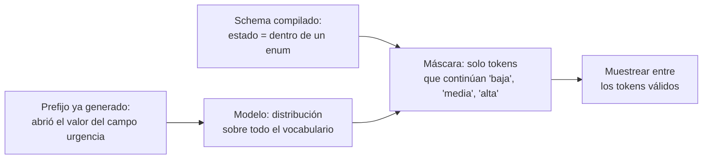
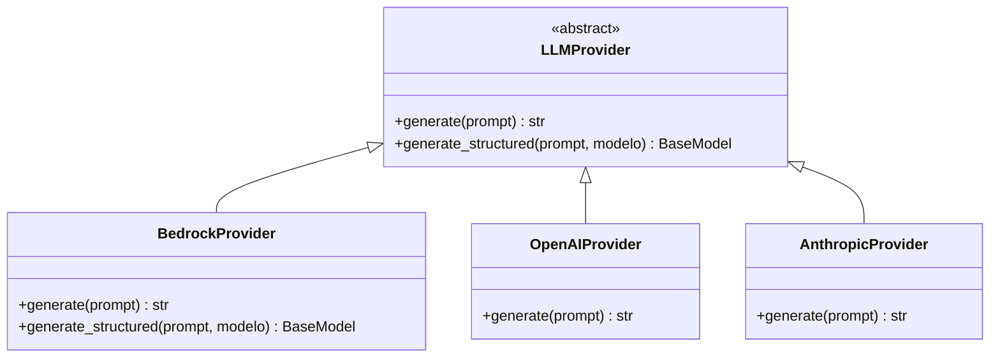

# Apunte — Clase 3: Salidas estructuradas y aplicaciones robustas

> **Cómo usar este apunte.** Es el marco teórico de la clase: el notebook muestra *cómo* se implementa; este documento explica *por qué* y de dónde sale cada idea. Las referencias entre corchetes remiten a la sección **Fuentes**, que está a continuación y explica qué contiene cada fuente y por qué se usa. 📄 = PDF descargable con `bibliography/descargar.sh` (ver [`bibliography/README.md`](../bibliography/README.md)).
>
> **Lectura obligatoria antes de la clase:** el anuncio de structured outputs de OpenAI [7] (explica *constrained decoding* sin fórmulas) y la página de structured outputs de Bedrock [8].
> **Lectura recomendada después:** [3] (Outlines, §1–3), y el par [5]–[6] leído como debate.
>
> **Correspondencia con el notebook** (`clase-03.ipynb`): las secciones 1 a 8 del notebook corresponden a los §1 a §8 de este apunte, con el mismo número.

---

## Fuentes

Esta clase convierte un modelo que produce texto en un componente de software confiable. Las fuentes son de tres tipos: (a) **estándares y documentación** (JSON Schema, Pydantic, las APIs de los proveedores), que definen los contratos; (b) **papers sobre generación restringida**, que explican cómo un proveedor puede *garantizar* un formato y qué cuesta eso; y (c) **literatura de ingeniería** (patrones de diseño, confiabilidad, rendimiento de inferencia) para la mitad "robusta" de la clase. 📄 = PDF descargable con `bibliography/descargar.sh`.

### Contratos de datos

**[1] JSON Schema. *Specification* (draft 2020-12).** https://json-schema.org/specification
- *Qué contiene:* el vocabulario estándar para describir la forma de un documento JSON: tipos, propiedades, campos obligatorios (`required`), valores permitidos (`enum`), restricciones (`minLength`, `maximum`…), composición (`anyOf`, `$ref`, `$defs`) y `additionalProperties`.
- *Por qué está:* es el lenguaje en el que todos los proveedores reciben el formato esperado de la salida y de los argumentos de las herramientas (§1, §2, §4).

**[2] Pydantic. *Documentación* (v2).** https://docs.pydantic.dev/latest/
- *Qué contiene:* definir modelos de datos como clases de Python con tipos, validarlos (`model_validate`, `model_validate_json`), generar su JSON Schema (`model_json_schema`) y configurar el comportamiento (por ejemplo `extra="forbid"`, modo estricto).
- *Por qué está:* es la herramienta que une el contrato (JSON Schema) con el código (§1, §3). Su comportamiento por defecto importa: **ignora campos extra** salvo que se configure lo contrario.

### Generación restringida

**[3] 📄 Willard, B. T. & Louf, R. (2023). *Efficient Guided Generation for Large Language Models*. arXiv:2307.09702.** — `2023_willard_2307.09702.pdf`
- *Qué contiene:* formula la generación guiada como transiciones de una **máquina de estados finitos** que, en cada paso, determina qué tokens del vocabulario son válidos según una expresión regular o una gramática; precomputa un índice sobre el vocabulario para que el costo por token sea constante. Es la base de la librería Outlines.
- *Por qué está:* explica *cómo* un proveedor puede garantizar que la salida cumpla un schema: no es un pedido al modelo, es una restricción del muestreo (§2.2).

**[4] 📄 Geng, S., Josifoski, M., Peyrard, M. & West, R. (2023). *Grammar-Constrained Decoding for Structured NLP Tasks without Finetuning*. EMNLP 2023. arXiv:2305.13971.** — `2023_geng_2305.13971.pdf`
- *Qué contiene:* muestra que gramáticas formales pueden describir la salida de muchas tareas estructuradas, y que restringir la decodificación a esas gramáticas mejora a modelos sin ajuste fino.
- *Por qué está:* generaliza la idea de [3] de expresiones regulares a gramáticas, que es lo que hace falta para JSON anidado (§2.2).

**[5] 📄 Tam, Z. R. et al. (2024). *Let Me Speak Freely? A Study on the Impact of Format Restrictions on Performance of Large Language Models*. EMNLP 2024 (Industry). arXiv:2408.02442.** — `2024_tam_2408.02442.pdf`
- *Qué contiene:* compara el desempeño de LLMs cuando se los restringe a formatos (JSON, XML, YAML) contra respuestas libres; reporta una caída significativa en tareas de **razonamiento**, mayor cuanto más estricta la restricción.
- *Por qué está:* plantea el costo potencial de forzar un formato (§2.3). Se lee junto con [6].

**[6] Kurt, W. (2024). *Say What You Mean: A Response to 'Let Me Speak Freely'*. .txt (dottxt) Blog.** https://blog.dottxt.co/say-what-you-mean.html
- *Qué contiene:* respuesta de los autores de Outlines a [5]: sostienen que la caída se debe a problemas de diseño del experimento (prompts y extracción de respuestas) y muestran que, corregidos, la generación estructurada iguala o supera a la libre.
- *Por qué está:* muestra que el costo de restringir el formato es una **pregunta abierta y empírica**, no un hecho establecido. La conclusión práctica de ambos es la misma: dejar lugar al razonamiento dentro del formato (§2.3). Advertencia: es un blog de una empresa que vende generación estructurada; vale por su argumento y sus datos, no por su autoridad.

**[7] OpenAI (2024). *Introducing Structured Outputs in the API*.** https://openai.com/index/introducing-structured-outputs-in-the-api/
- *Qué contiene:* explica la técnica (*constrained decoding*: en cada paso solo se permiten los tokens válidos según el schema, convertido en una gramática) y reporta que con ella el cumplimiento de schemas complejos pasa de menos del 40% (prompting solo, modelo anterior) al 100%.
- *Por qué está:* es la explicación más clara para empezar, con un número que justifica usar el mecanismo nativo (§2). Lectura obligatoria.

**[8] AWS. *Structured outputs* (Amazon Bedrock).** https://docs.aws.amazon.com/bedrock/latest/userguide/structured-output.html
- *Qué contiene:* cómo usar `outputConfig.textFormat` con un JSON Schema en Converse; qué partes de JSON Schema **no** se soportan (esquemas recursivos, `$ref` externos, `minimum`/`maximum`/`multipleOf`, `minLength`/`maxLength`); que **todo objeto** debe declarar `additionalProperties: false`; y que si se alcanza `maxTokens` el JSON vuelve incompleto.
- *Por qué está:* es el contrato real del mecanismo que usa el notebook y la fuente de sus límites (§2.4). Lectura obligatoria.

**[9] Anthropic. *Structured outputs*.** https://docs.anthropic.com/en/docs/build-with-claude/structured-outputs
- *Qué contiene:* la versión de Anthropic: garantiza respuestas que cumplen el schema mediante *constrained decoding*; los SDK transforman los schemas quitando restricciones no soportadas (`minimum`, `maxLength`, etc.), anotándolas en la descripción y agregando `additionalProperties: false`.
- *Por qué está:* muestra que el problema y la solución son los mismos entre proveedores, y es el modelo de la función `preparar_schema_bedrock` del notebook (§2.4).

### Herramientas

**[10] 📄 Schick, T. et al. (2023). *Toolformer: Language Models Can Teach Themselves to Use Tools*. NeurIPS 2023. arXiv:2302.04761.** — `2023_schick_2302.04761.pdf`
- *Qué contiene:* (ver apunte de la Clase 9) un modelo que aprende cuándo y cómo llamar a APIs.
- *Por qué está:* es el antecedente de investigación del tool calling que se introduce en §4.

**[11] AWS. *Tool use* (Converse API) y *Carry out a conversation with the Converse API operations*.** https://docs.aws.amazon.com/bedrock/latest/userguide/tool-use.html — https://docs.aws.amazon.com/bedrock/latest/userguide/conversation-inference.html
- *Qué contiene:* el formato de `toolConfig`, `toolUse` y `toolResult`, y el protocolo de ida y vuelta.
- *Por qué está:* fuente primaria del protocolo del §4.

### Confiabilidad, rendimiento y diseño

**[12] Brooker, M. (2015). *Exponential Backoff And Jitter*. AWS Architecture Blog.** https://aws.amazon.com/blogs/architecture/exponential-backoff-and-jitter/
- *Qué contiene:* (ver apunte de la Clase 9) por qué el backoff exponencial necesita aleatoriedad ("full jitter").
- *Por qué está:* fuente de la estrategia de reintentos del §5.

**[13] Brooker, M. (2019). *Timeouts, retries, and backoff with jitter*. Amazon Builders' Library.** https://aws.amazon.com/builders-library/timeouts-retries-and-backoff-with-jitter/
- *Qué contiene:* cómo elegir timeouts, por qué reintentar en un solo punto, amplificación de reintentos.
- *Por qué está:* justifica apagar los reintentos del SDK y controlarlos en un solo lugar (§5).

**[14] Databricks (2023). *LLM Inference Performance Engineering: Best Practices*.** https://www.databricks.com/blog/llm-inference-performance-engineering-best-practices
- *Qué contiene:* las métricas de rendimiento de un servicio de LLM: **TTFT** (tiempo hasta el primer token, dominado por el procesamiento del prompt), **TPOT** (tiempo por token de salida), latencia total y throughput, y cómo se relacionan con el hardware y el tamaño de lote.
- *Por qué está:* da el vocabulario y el modelo de latencia de §6 y §7.

**[15] 📄 Pope, R. et al. (2022). *Efficiently Scaling Transformer Inference*. MLSys 2023. arXiv:2211.05102.** — `2022_pope_2211.05102.pdf`
- *Qué contiene:* análisis de ingeniería de la inferencia de transformers grandes: la fase de **procesamiento del prompt** (paralela) y la de **generación** (secuencial, token a token), sus cuellos de botella distintos y los compromisos entre latencia y throughput.
- *Por qué está:* explica *por qué* la latencia tiene dos componentes (TTFT y TPOT) y por qué el streaming mejora la percepción sin cambiar el costo (§6, §7).

**[16] WHATWG. *HTML Living Standard — Server-sent events*.** https://html.spec.whatwg.org/multipage/server-sent-events.html
- *Qué contiene:* el estándar de *server-sent events* (SSE): una respuesta HTTP que el servidor mantiene abierta y por la que envía eventos de texto a medida que ocurren.
- *Por qué está:* es el mecanismo de transporte del streaming en las APIs de OpenAI y Anthropic (Bedrock usa su propio formato de eventos, con la misma idea) (§7).

**[17] Gamma, E., Helm, R., Johnson, R. & Vlissides, J. (1994). *Design Patterns: Elements of Reusable Object-Oriented Software*. Addison-Wesley.** — Libro comercial.
- *Qué contiene:* el catálogo clásico de patrones de diseño, entre ellos **Adapter**, **Strategy**, **Template Method** y **Factory Method**.
- *Por qué está:* la abstracción `LLMProvider` del §8 combina exactamente esos cuatro patrones; nombrarlos permite razonar sobre el diseño con vocabulario estándar.

---

## 1. JSON Schema y Pydantic

### 1.1 El problema

La salida de un LLM es texto. Una aplicación necesita **datos**: un campo `urgencia` con uno de tres valores, no un párrafo que "más o menos" dice que es urgente. Hacen falta dos cosas: un **contrato** que diga qué forma tienen los datos, y un **validador** que verifique que una salida concreta lo cumple.

### 1.2 JSON Schema: el contrato

JSON Schema [1] describe la forma de un documento JSON con un vocabulario estándar:

| Palabra clave | Qué restringe | Ejemplo |
|---|---|---|
| `type` | Tipo del valor | `"string"`, `"integer"`, `"object"`, `"array"` |
| `properties`, `required` | Campos de un objeto y cuáles son obligatorios | `"required": ["categoria"]` |
| `enum` | Valores permitidos | `["baja", "media", "alta"]` |
| `minLength`, `maxLength`, `minimum`, `maximum` | Rangos | `"maxLength": 200` |
| `additionalProperties` | Si se admiten campos no declarados | `false` |
| `$defs`, `$ref` | Definiciones reusables (objetos anidados) | `"$ref": "#/$defs/Direccion"` |

Es el lenguaje común: los proveedores lo reciben para el formato de salida (§2) y para los argumentos de las herramientas (§4).

### 1.3 Pydantic: el contrato como código

Pydantic [2] define el contrato como una clase de Python, **genera** el JSON Schema a partir de ella (`model_json_schema()`) y **valida** datos contra ella (`model_validate_json()`), devolviendo un objeto tipado o un `ValidationError` que dice exactamente qué falló. Así el contrato se escribe una sola vez.

Un detalle con consecuencias: **por defecto Pydantic ignora los campos extra** que no están en el modelo. Si una herramienta no debe aceptar argumentos no declarados (Clase 9), hay que configurarlo: `model_config = ConfigDict(extra="forbid")`.

### 1.4 Tres niveles de validación

| Nivel | Pregunta | Quién lo verifica |
|---|---|---|
| **Sintáctico** | ¿Es JSON válido? | El parser (o el constrained decoding) |
| **Estructural** | ¿Cumple el schema (tipos, campos, enums)? | JSON Schema / Pydantic |
| **Semántico** | ¿Tiene sentido? (el ticket existe, la fecha es futura, los campos son coherentes entre sí) | Código de dominio, validadores de Pydantic |

Los mecanismos nativos de los proveedores cubren, como mucho, los dos primeros. El tercero siempre es responsabilidad de la aplicación.

---

## 2. Structured outputs

### 2.1 Pedir no es garantizar

Pedir "devolveme JSON" en el prompt funciona casi siempre, pero no siempre: el modelo puede agregar texto alrededor, usar comillas simples, omitir un campo. OpenAI reportó que con prompting solo, un modelo de 2023 cumplía schemas complejos menos del 40% de las veces, y con *constrained decoding* el 100% [7].

### 2.2 Cómo se garantiza: decodificación restringida

En cada paso, el modelo calcula una distribución de probabilidad sobre todo el vocabulario (Clase 1). La **decodificación restringida** (*constrained decoding*) [3][4][7] interviene en el muestreo: dado el texto generado hasta el momento, calcula qué tokens mantienen la salida válida según el schema y **anula la probabilidad del resto**:

$$
p'(t \mid \text{prefijo}) =
\begin{cases}
\dfrac{p(t \mid \text{prefijo})}{\sum_{t' \in V_{\text{válidos}}} p(t' \mid \text{prefijo})} & \text{si } t \in V_{\text{válidos}}(\text{estado}) \\[2ex]
0 & \text{si no}
\end{cases}
$$

Para saber cuáles son los tokens válidos, el schema se compila en una **máquina de estados** (para formatos regulares) o en una **gramática** (para JSON anidado) [3][4]. La dificultad técnica es que los tokens no coinciden con los símbolos de la gramática (un token puede contener `"}, "` entero), y Willard & Louf [3] la resolvieron precomputando, para cada estado, qué tokens del vocabulario son compatibles, con costo constante por paso.

El resultado es **sintácticamente** válido por construcción. Lo que **no** garantiza es que el **contenido** sea correcto: un modelo restringido a `["baja", "media", "alta"]` igual puede elegir mal.

### 2.3 ¿Restringir el formato empeora el razonamiento?

Tam et al. [5] reportaron que forzar formatos estructurados degrada el desempeño en tareas de razonamiento, más cuanto más estricta la restricción. Los autores de Outlines respondieron [6] que la caída se debía al diseño del experimento y que, corregido, la generación estructurada iguala o mejora a la libre. El debate sigue abierto, pero ambos lados coinciden en una recomendación práctica: **si la tarea requiere razonar, darle lugar al razonamiento antes de la respuesta**, por ejemplo con un campo `razonamiento` declarado **antes** que el campo de la respuesta en el schema (el modelo genera los campos en orden), o en dos pasos: primero razonar en texto libre, después extraer a JSON.

### 2.4 Los límites del mecanismo de Bedrock

La documentación de Bedrock [8] marca tres límites que el notebook maneja explícitamente:

1. **No todo JSON Schema se soporta.** Quedan afuera, entre otros, `minLength`/`maxLength` y `minimum`/`maximum`. Bedrock acepta un schema que los incluya, pero **no los impone** al generar. Anthropic documenta lo mismo y sus SDK mueven esas restricciones a la descripción del campo [9]; el notebook hace lo mismo con `preparar_schema_bedrock`. Esas reglas las sigue imponiendo **Pydantic** al validar.
2. **`additionalProperties: false` en todos los objetos**, también en los anidados (`$defs`). Agregarlo solo en la raíz falla con modelos que tienen sub-objetos.
3. **Un JSON cortado no es un JSON válido.** Si la respuesta llega a `maxTokens`, se corta (`stopReason == "max_tokens"`) aunque haya structured outputs. Hay que chequear `stopReason` y dimensionar `maxTokens`.

---

## 3. Manejo de respuestas inválidas

Aun con mecanismos nativos, hace falta una red de seguridad: proveedores o modelos sin soporte, soporte parcial del schema (§2.4), reglas semánticas (§1.4). El patrón universal es **generar → validar → si falla, reintentar con el error como feedback**. Es la idea de Reflexion (Clase 9): el mensaje de error es información que el modelo usa para corregirse.

Tres detalles de implementación que importan:

- **El modelo no tiene memoria** (Clase 2): para que corrija su respuesta, hay que **mostrársela** junto con el error, no solo describir el error.
- **El schema va como JSON**, no como la representación de un diccionario de Python (`json.dumps`, no `str(dict)`): se le está pidiendo JSON al modelo.
- **Temperatura baja y un número máximo de intentos**: el objetivo es formato consistente, y un loop sin límite es un loop infinito potencial.

---

## 4. Tool calling

Tool calling es una aplicación directa de las salidas estructuradas: en lugar de un objeto con datos, el modelo produce un objeto que dice **qué función llamar y con qué argumentos**, según un JSON Schema por herramienta [11]. El protocolo (desarrollado en la Clase 9):

1. La aplicación declara las herramientas (nombre, descripción, schema de argumentos).
2. El modelo responde con `stopReason == "tool_use"` y uno **o varios** bloques `toolUse`, cada uno con un id.
3. La aplicación **valida y ejecuta** las funciones — el modelo nunca ejecuta nada — y devuelve **todos** los `toolResult` en **un único** mensaje, cada uno con su id.
4. Se repite hasta que el modelo responde con texto, con un límite de vueltas.

Toolformer [10] es el antecedente de investigación: mostró que un modelo puede aprender a decidir **cuándo** una herramienta le sirve.

---

## 5. Timeouts, reintentos y backoff

Una llamada a una API remota puede fallar de formas que no existen en una función local. Las decisiones de diseño, desarrolladas en la Clase 9 (apunte §7):

- **Timeouts explícitos.** Sin timeout, una llamada colgada bloquea para siempre. El de lectura debe contemplar que Converse sin streaming responde recién al **terminar** de generar: con respuestas largas, 15 segundos es poco.
- **Reintentar solo lo transitorio** (throttling, servicio no disponible, timeouts de red), nunca lo permanente (request inválido, permisos).
- **Backoff exponencial con jitter** [12]: esperar un tiempo aleatorio entre 0 y $\min(\text{tope}, \text{base} \cdot 2^{n})$.
- **Un solo punto de reintento** [13]: si se reintenta en el código, se apagan los reintentos automáticos del SDK; si no, se multiplican.

---

## 6. Observabilidad básica: tokens, costo y latencia

### 6.1 Costo

El costo de una llamada es lineal en los tokens, con precios distintos para entrada y salida:

$$
\text{costo} = \frac{T_{\text{in}}}{10^6}\, P_{\text{in}} + \frac{T_{\text{out}}}{10^6}\, P_{\text{out}}
$$

con $P$ en dólares por millón de tokens. Los tokens de salida suelen costar varias veces más que los de entrada, y en un RAG la entrada (el contexto recuperado) suele ser la mayor parte (Clase 6).

### 6.2 Latencia: dos componentes

La inferencia tiene dos fases con costos distintos [15]:

- **Procesamiento del prompt** (*prefill*): todos los tokens de entrada se procesan en paralelo. Determina el **tiempo hasta el primer token** (TTFT) [14].
- **Generación** (*decode*): un token por vez, cada uno esperando al anterior. Su ritmo es el **tiempo por token de salida** (TPOT) [14].

$$
\text{latencia} \approx \text{TTFT} + \text{TPOT} \times (T_{\text{out}} - 1)
$$

Consecuencias: la latencia crece con la **longitud de la respuesta** mucho más que con la del prompt, y limitar `maxTokens` (o pedir respuestas breves) es la palanca más efectiva para bajarla.

### 6.3 Qué latencia medir

La métrica `latencyMs` que devuelve Bedrock es la del **servidor** para el último intento. El usuario percibe otra: red, más esperas de backoff, más reintentos. El notebook registra ambas. Y, como se ve en la Clase 8, la latencia se reporta con **percentiles** (p50, p95), no con el promedio.

---

## 7. Streaming

El streaming no cambia el costo ni el tiempo total: cambia **cuándo** empieza a ver algo el usuario. Sin streaming, la respuesta llega toda junta al final ($\text{TTFT} + \text{TPOT} \times T_{\text{out}}$); con streaming, el primer fragmento llega después de solo el TTFT. Para respuestas largas en una interfaz interactiva, la diferencia percibida es enorme.

En el transporte, las APIs de OpenAI y Anthropic usan *server-sent events* [16]: una respuesta HTTP que queda abierta y por la que llegan eventos de texto. Bedrock usa su propio formato binario de eventos, con la misma idea. Cada evento trae un **fragmento** de texto, que no necesariamente coincide con un token.

---

## 8. Abstracción de proveedores

La clase `LLMProvider` del notebook es una combinación de cuatro patrones de diseño clásicos [17]:

| Patrón [17] | Dónde aparece | Para qué |
|---|---|---|
| **Adapter** | Cada `BedrockProvider`, `OpenAIProvider`, … | Traduce una API distinta a una interfaz común (`generate`) |
| **Strategy** | El resto del sistema recibe "un `LLMProvider`" | Cambiar de proveedor sin cambiar el código que lo usa |
| **Template Method** | `generate_structured` en la clase base usa `generate` | Un algoritmo general (generar → validar → reintentar) con un paso que cada subclase implementa |
| **Factory Method** | `get_provider()` | Elegir la clase concreta según la configuración |

`BedrockProvider` **sobrescribe** `generate_structured` para usar el mecanismo nativo (§2): la clase base da una implementación correcta para todos, y cada proveedor puede dar una mejor.

**Una nota sobre los nombres de modelos.** Los modelos vigentes de cada proveedor cambian cada pocos meses. El código del curso no fija nombres de modelos de otros proveedores: los lee del `.env`, y avisa con un error claro si faltan.

---

## Preguntas de repaso

1. Nombrá los tres niveles de validación y qué herramienta cubre cada uno.
2. Explicá con la fórmula de §2.2 por qué el constrained decoding garantiza JSON válido pero no una clasificación correcta.
3. ¿Qué pasa si se manda a Bedrock un schema con `maxLength: 200`? ¿Quién impone entonces ese límite?
4. Un modelo con structured outputs devuelve un JSON que no parsea. ¿Qué es lo primero que revisarías?
5. Resumí el debate entre [5] y [6]. ¿Qué harías en un schema para una tarea que requiere razonar?
6. ¿Por qué el reintento con feedback tiene que incluir la respuesta anterior del modelo?
7. Con TTFT = 0,5 s y TPOT = 20 ms, ¿cuánto tarda una respuesta de 500 tokens? ¿Cuándo ve el primer texto el usuario con y sin streaming?
8. ¿Qué patrón de diseño permite que `generate_structured` funcione para un proveedor nuevo sin escribir código extra?
