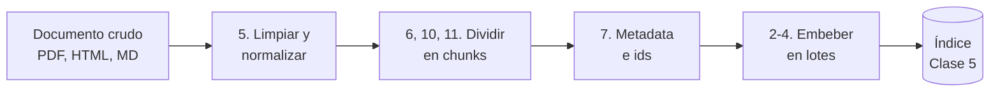

# Apunte — Clase 4: Embeddings e ingesta documental

> **Cómo usar este apunte.** Es el marco teórico de la clase: el notebook muestra *cómo* se implementa; este documento explica *por qué* y de dónde sale cada idea. Las referencias entre corchetes remiten a la sección **Fuentes**, que está a continuación y explica qué contiene cada fuente y por qué se usa. 📄 = PDF descargable con `bibliography/descargar.sh` (ver [`bibliography/README.md`](../bibliography/README.md)).
>
> **Lectura obligatoria antes de la clase:** §1–3 de [4] (Sentence-BERT) y el informe de Chroma sobre chunking [15].
> **Lectura recomendada después:** [7] (alineación y uniformidad), [10] (Matryoshka, §1–3) y [14] (Contextual Retrieval).
>
> **Correspondencia con el notebook** (`clase-04.ipynb`): las secciones 1 a 11 del notebook corresponden a los §1 a §11 de este apunte, con el mismo número.

---

## Fuentes

La clase tiene dos mitades con tradiciones distintas. **Embeddings** (§1–4): la idea viene de la lingüística de los años 50 (hipótesis distribucional), se volvió práctica con word2vec y se convirtió en la tecnología actual de embeddings de oraciones gracias al **aprendizaje contrastivo**; las fuentes son los papers que marcan cada paso. **Ingesta** (§5–11): hay mucha menos teoría formal y mucha práctica; el apunte usa estándares (Unicode), evaluaciones empíricas recientes del chunking y documentación de herramientas. 📄 = PDF descargable con `bibliography/descargar.sh`.

### De la hipótesis distribucional a los embeddings de oraciones

**[1] Harris, Z. S. (1954). *Distributional Structure*. Word, 10(2–3), 146–162.**
- *Qué contiene:* propone que el significado de las palabras puede estudiarse a partir de su **distribución**: palabras que aparecen en contextos parecidos tienden a tener significados parecidos.
- *Por qué está:* es la **hipótesis distribucional**, el fundamento teórico de todos los embeddings (§2.1).

**[2] Firth, J. R. (1957). *A synopsis of linguistic theory, 1930–1955*. En *Studies in Linguistic Analysis*, 1–32. Blackwell.**
- *Qué contiene:* la formulación más citada de la misma idea: "conocerás una palabra por la compañía que tiene" (*you shall know a word by the company it keeps*).
- *Por qué está:* es la frase con la que se suele presentar la hipótesis distribucional (§2.1).

**[3] 📄 Mikolov, T., Chen, K., Corrado, G. & Dean, J. (2013). *Efficient Estimation of Word Representations in Vector Space*. arXiv:1301.3781.** — `2013_mikolov_1301.3781.pdf`
- *Qué contiene:* word2vec: dos arquitecturas simples (CBOW y skip-gram) que aprenden vectores de palabras prediciendo el contexto; con menos de un día de entrenamiento sobre 1.600 millones de palabras obtiene vectores que capturan relaciones semánticas y sintácticas.
- *Por qué está:* es el paso que volvió práctica la hipótesis distribucional y popularizó la idea de "significado como geometría" (§2.1).

**[4] 📄 Reimers, N. & Gurevych, I. (2019). *Sentence-BERT: Sentence Embeddings using Siamese BERT-Networks*. EMNLP 2019. arXiv:1908.10084.** — `2019_reimers_1908.10084.pdf`
- *Qué contiene:* muestra que comparar pares de oraciones con BERT como *cross-encoder* es inviable para búsqueda (encontrar el par más parecido entre 10.000 oraciones requiere ~50 millones de inferencias, unas 65 horas) y propone entrenar BERT en estructura **siamesa** para producir un vector por oración comparable con coseno, bajando ese tiempo a unos 5 segundos.
- *Por qué está:* es el origen de los embeddings de oraciones tal como los usamos (un vector por texto, comparado con coseno) y explica la diferencia bi-encoder vs. cross-encoder de la Clase 1 (§2.2). Lectura obligatoria (§1–3).

### Aprendizaje contrastivo

**[5] 📄 van den Oord, A., Li, Y. & Vinyals, O. (2018). *Representation Learning with Contrastive Predictive Coding*. arXiv:1807.03748.** — `2018_oord_1807.03748.pdf`
- *Qué contiene:* propone aprender representaciones prediciendo el futuro en un espacio latente, con una pérdida contrastiva probabilística (**InfoNCE**) que distingue el ejemplo positivo entre muchos negativos.
- *Por qué está:* es la fuente de la función de pérdida InfoNCE, que con variantes entrena casi todos los modelos de embeddings actuales (§2.3).

**[6] 📄 Gao, T., Yao, X. & Chen, D. (2021). *SimCSE: Simple Contrastive Learning of Sentence Embeddings*. EMNLP 2021. arXiv:2104.08821.** — `2021_gao_2104.08821.pdf`
- *Qué contiene:* aprendizaje contrastivo de oraciones en su forma más simple: el positivo de una oración es **ella misma** con distinto *dropout*; los negativos son las demás oraciones del lote. Sin dropout la representación colapsa. Una versión supervisada usa pares de inferencia lingüística.
- *Por qué está:* muestra con claridad la mecánica de positivos, negativos dentro del lote y colapso (§2.3).

**[7] 📄 Wang, T. & Isola, P. (2020). *Understanding Contrastive Representation Learning through Alignment and Uniformity on the Hypersphere*. ICML 2020. arXiv:2005.10242.** — `2020_wang_2005.10242.pdf`
- *Qué contiene:* demuestra que la pérdida contrastiva optimiza, asintóticamente, dos propiedades: **alineación** (los pares positivos quedan cerca) y **uniformidad** (los vectores se reparten uniformemente sobre la hiperesfera); ambas correlacionan con el desempeño.
- *Por qué está:* da la explicación teórica de *por qué* el aprendizaje contrastivo produce una buena geometría (§2.3). Lectura recomendada.

**[8] 📄 Izacard, G. et al. (2022). *Unsupervised Dense Information Retrieval with Contrastive Learning*. TMLR. arXiv:2112.09118.** — `2021_izacard_2112.09118.pdf`
- *Qué contiene:* Contriever: un recuperador denso entrenado con aprendizaje contrastivo **sin datos etiquetados**, que supera a BM25 en 11 de 15 datasets de BEIR (Recall@100) y mejora como preentrenamiento antes de un ajuste fino.
- *Por qué está:* muestra que el aprendizaje contrastivo funciona para recuperación aun sin pares anotados (§2.3).

**[9] 📄 Wang, L. et al. (2022). *Text Embeddings by Weakly-Supervised Contrastive Pre-training*. arXiv:2212.03533.** — `2022_wang_2212.03533.pdf`
- *Qué contiene:* E5: preentrenamiento contrastivo con supervisión débil sobre un gran corpus de pares de texto curado (CCPairs); es el primer modelo que supera a BM25 en BEIR sin datos etiquetados, y tras ajuste fino supera en MTEB a modelos 40 veces más grandes. Usa prefijos `query:` / `passage:` para distinguir consultas de documentos.
- *Por qué está:* representa la receta de los modelos de embeddings comerciales actuales (preentrenamiento contrastivo masivo + ajuste fino) y la **asimetría consulta–documento** (§2.3, §3).

### Dimensión, geometría y benchmarks

**[10] 📄 Kusupati, A. et al. (2022). *Matryoshka Representation Learning*. NeurIPS 2022. arXiv:2205.13147.** — `2022_kusupati_2205.13147.pdf`
- *Qué contiene:* entrena una representación para que sus primeras $m$ dimensiones sean útiles por sí solas, para varios $m$ anidados; no agrega costo de inferencia y obtiene representaciones tan buenas como modelos entrenados independientemente en cada dimensión, con reducciones de hasta 14× en tamaño.
- *Por qué está:* es la técnica detrás de `output_dimension` en Cohere Embed v4 (§4). Lectura recomendada (§1–3).

**[11] 📄 Ethayarajh, K. (2019). *How Contextual are Contextualized Word Representations?* EMNLP 2019. arXiv:1909.00512.** — `2019_ethayarajh_1909.00512.pdf`
- *Qué contiene:* muestra que las representaciones de BERT, ELMo y GPT-2 son **anisotrópicas**: ocupan un cono estrecho del espacio, en todas las capas.
- *Por qué está:* explica por qué textos no relacionados dan similitud coseno claramente mayor que 0 con modelos reales (§2.4).

**[12] 📄 Muennighoff, N. et al. (2023). *MTEB: Massive Text Embedding Benchmark*. EACL 2023. arXiv:2210.07316.** — `2022_muennighoff_2210.07316.pdf`
- *Qué contiene:* (ver apunte de la Clase 5) benchmark de 58 datasets; ningún modelo domina en todo.
- *Por qué está:* referencia para comparar proveedores (§3).

### Chunking

**[13] 📄 Günther, M., Mohr, I., Williams, D. J., Wang, B. & Xiao, H. (2024). *Late Chunking: Contextual Chunk Embeddings Using Long-Context Embedding Models*. arXiv:2409.04701.** — `2024_gunther_2409.04701.pdf`
- *Qué contiene:* en lugar de embeber cada chunk por separado (perdiendo el contexto del documento), procesa el documento entero con un modelo de contexto largo y recién **después** divide en chunks, justo antes del *pooling*; los embeddings de los chunks conservan información del contexto y mejoran la recuperación sin entrenamiento adicional.
- *Por qué está:* ataca el problema central del chunking — el chunk pierde el contexto — desde el modelo (§11.3).

**[14] Anthropic (2024). *Introducing Contextual Retrieval*.** https://www.anthropic.com/news/contextual-retrieval
- *Qué contiene:* (ver apunte de la Clase 7) anteponer a cada chunk un contexto generado por un LLM antes de embeberlo e indexarlo; reduce las fallas de recuperación 49% (67% con reranking).
- *Por qué está:* ataca el mismo problema que [13] desde la ingesta, sin cambiar de modelo (§11.3). Lectura recomendada.

**[15] Smith, B. & Troynikov, A. (2024). *Evaluating Chunking Strategies for Retrieval*. Chroma Technical Report.** https://research.trychroma.com/evaluating-chunking
- *Qué contiene:* una evaluación que mide la relevancia a nivel de **tokens** (no de documentos enteros) para comparar estrategias de chunking populares; encuentra diferencias de hasta 9% en recall entre estrategias y propone algunas nuevas.
- *Por qué está:* es la evidencia empírica de que el chunking importa y de que no hay una estrategia universal (§6, §9). Lectura obligatoria.

**[16] Kamradt, G. (2024). *5 Levels of Text Splitting* (notebook).** https://github.com/FullStackRetrieval-com/RetrievalTutorials/blob/main/tutorials/LevelsOfTextSplitting/5_Levels_Of_Text_Splitting.ipynb
- *Qué contiene:* recorrido práctico por niveles de chunking: por caracteres, recursivo, por tipo de documento, **semántico** (corte donde la distancia entre oraciones consecutivas supera un **percentil**) y agéntico.
- *Por qué está:* es la referencia práctica más citada del chunking semántico, y de donde sale el criterio de umbral por percentil del notebook (§11).

### Normalización y tokenización

**[17] Unicode Consortium. *Unicode Standard Annex #15: Unicode Normalization Forms*.** https://unicode.org/reports/tr15/
- *Qué contiene:* define las cuatro formas de normalización (NFC, NFD, NFKC, NFKD): la equivalencia **canónica** (mismo carácter escrito de dos formas, como "é" precompuesta vs. "e" + acento combinante) y la equivalencia de **compatibilidad** (variantes de presentación, como ligaduras "fi" o superíndices "²").
- *Por qué está:* es la fuente normativa de qué hace (y qué **no** hace) `unicodedata.normalize` en la limpieza (§5).

**[18] Speer, R. *ftfy: fixes text for you* (documentación).** https://ftfy.readthedocs.io/
- *Qué contiene:* una librería que repara *mojibake* (texto mal decodificado, como "é" en lugar de "é") y otros problemas de codificación.
- *Por qué está:* la normalización Unicode no repara mojibake; esta es la herramienta estándar para hacerlo (§5).

**[19] OpenAI. *tiktoken*.** https://github.com/openai/tiktoken
- *Qué contiene:* el tokenizador BPE de los modelos de OpenAI, con codificaciones como `cl100k_base` y `o200k_base`.
- *Por qué está:* es la herramienta del notebook para contar tokens; hay que saber que es el tokenizador **de OpenAI** y que otros proveedores tokenizan distinto (§10).

**[20] 📄 Petrov, A., La Malfa, E., Torr, P. H. S. & Bibi, A. (2023). *Language Model Tokenizers Introduce Unfairness Between Languages*. NeurIPS 2023. arXiv:2305.15425.** — `2023_petrov_2305.15425.pdf`
- *Qué contiene:* el mismo texto traducido a distintos idiomas puede ocupar cantidades de tokens muy distintas (hasta 15 veces), lo que afecta costo, latencia y contexto disponible.
- *Por qué está:* explica por qué la regla "4 caracteres por token" (pensada para inglés) no se puede trasladar al castellano ni al código (§10).

### Documentación de proveedores

**[21] AWS. *Cohere Embed v4* en Amazon Bedrock.** https://docs.aws.amazon.com/bedrock/latest/userguide/model-parameters-embed-v4.html
- *Qué contiene:* `input_type` (`search_document`, `search_query`, `classification`, `clustering`), `output_dimension` (256, 512, 1024, 1536), tipos de embedding, hasta 96 textos por llamada, contexto de ~128k tokens.
- *Por qué está:* es el contrato de la API que usa el notebook (§3, §4).

**[22] Google. *Embeddings* (Gemini API).** https://ai.google.dev/gemini-api/docs/embeddings
- *Qué contiene:* el modelo `gemini-embedding-001` y el parámetro `task_type` (`RETRIEVAL_DOCUMENT`, `RETRIEVAL_QUERY`, etc.).
- *Por qué está:* muestra que la asimetría consulta–documento existe en varios proveedores, con distintos nombres (§3).

---

## 1. Información estructurada vs. no estructurada

Los datos **estructurados** (tablas con columnas tipadas) se consultan con lenguajes exactos: SQL, filtros. El texto libre — documentación, mails, tickets — no tiene columnas: la información está en el significado. Para buscar en él "por significado" hace falta una **representación** que convierta texto en algo comparable. La ingesta de esta clase construye esa representación; la Clase 5 la consulta.

---

## 2. Embeddings y similitud semántica

### 2.1 La hipótesis distribucional

Harris [1] propuso en 1954 que palabras que aparecen en contextos parecidos tienen significados parecidos; Firth [2] lo resumió en "conocerás una palabra por la compañía que tiene". Si el significado se refleja en la distribución, se puede **aprender** un vector por palabra a partir de mucho texto, de modo que palabras con contextos parecidos queden cerca. word2vec [3] lo hizo práctico en 2013: vectores entrenados en menos de un día capturaban relaciones como "rey − hombre + mujer ≈ reina".

### 2.2 De palabras a textos: bi-encoder vs. cross-encoder

Para buscar documentos no alcanza con vectores de palabras: hace falta un vector por **texto**. Un modelo como BERT puede comparar dos oraciones leyéndolas **juntas** (*cross-encoder*), pero eso obliga a una inferencia por cada par: encontrar el par más parecido entre 10.000 oraciones toma ~65 horas [4]. Sentence-BERT [4] entrenó la red en estructura **siamesa**: cada texto se codifica **por separado** en un vector, y los vectores se comparan con coseno; el mismo problema baja a ~5 segundos. Es el modelo *bi-encoder* que usan todos los embeddings de este curso (y el motivo por el que el reranking con cross-encoder de la Clase 8 se aplica solo a pocos candidatos).

La similitud entre dos embeddings se mide con el **coseno**:

$$
\cos(\vec a, \vec b) = \frac{\vec a \cdot \vec b}{\lVert \vec a \rVert\,\lVert \vec b \rVert} \in [-1, 1]
$$

### 2.3 ¿De dónde sale la geometría? Aprendizaje contrastivo

Un modelo de embeddings aprende la geometría con **aprendizaje contrastivo**. Para cada texto ancla $q$ hay un **positivo** $d^+$ (un texto que debería quedar cerca: su respuesta, su traducción, una paráfrasis) y varios **negativos** $d^-_j$. La pérdida más usada, **InfoNCE** [5], es una clasificación: "entre todos estos candidatos, ¿cuál es el positivo?":

$$
\mathcal{L} = -\log \frac{\exp\big(\cos(q, d^+)/\tau\big)}{\exp\big(\cos(q, d^+)/\tau\big) + \sum_{j} \exp\big(\cos(q, d^-_j)/\tau\big)}
$$

donde $\tau$ es una **temperatura** que controla cuán "dura" es la comparación. Dos detalles prácticos importan:

- **Negativos dentro del lote** (*in-batch negatives*): los positivos de los otros ejemplos del lote hacen de negativos, lo que da muchos negativos gratis [6]. Por eso estos modelos se entrenan con lotes grandes.
- **Negativos difíciles** (*hard negatives*): textos parecidos en la superficie pero no relevantes (por ejemplo, recuperados por BM25). Enseñan las distinciones finas.

Wang & Isola [7] explicaron por qué funciona: la pérdida optimiza **alineación** (los positivos quedan cerca) y **uniformidad** (los vectores se reparten sobre toda la esfera, sin colapsar en un punto). SimCSE [6] muestra el colapso cuando falta la señal: sin *dropout* como ruido, todos los vectores terminan iguales.

La receta de los modelos actuales es **preentrenamiento contrastivo masivo** con pares débilmente supervisados (títulos y cuerpos, preguntas y respuestas de foros) y luego **ajuste fino** con pares de calidad. Contriever [8] y E5 [9] mostraron que así los recuperadores densos superan a BM25 incluso sin datos etiquetados.

**Consecuencia práctica:** cada modelo aprende **su propia** geometría. Los vectores de dos modelos (o de dos versiones del mismo) **no son comparables** y nunca deben mezclarse en un mismo índice.

### 2.4 Los valores absolutos engañan

En teoría, coseno ≈ 0 significa "sin relación". En la práctica, los modelos son **anisotrópicos** [11]: los vectores ocupan un cono estrecho, y hasta textos sin relación dan similitudes claramente positivas. Lo interpretable es el **orden relativo** (A se parece más a B que a C), no el número. Esto vuelve en la Clase 5 (umbrales) y en el chunking semántico de §11.

---

## 3. Tu proveedor: asimetría consulta–documento

Una consulta ("¿cómo comparo objetos?") y el documento que la responde son textos de naturaleza distinta: corta e interrogativa vs. larga y declarativa. Muchos modelos se entrenan **asimétricamente** y piden que se indique qué es cada texto:

| Proveedor / modelo | Cómo se indica | Consulta | Documento |
|---|---|---|---|
| Cohere Embed v4 (Bedrock) [21] | `input_type` | `search_query` | `search_document` |
| Gemini `gemini-embedding-001` [22] | `task_type` | `RETRIEVAL_QUERY` | `RETRIEVAL_DOCUMENT` |
| E5 [9] | prefijo en el texto | `query: ` | `passage: ` |
| nomic-embed-text (Ollama) | prefijo en el texto | `search_query: ` | `search_document: ` |
| OpenAI `text-embedding-3-*` | (simétrico) | — | — |

**Omitir la indicación no da error: solo degrada la recuperación.** Para comparar modelos de distintos proveedores, MTEB [12] es el punto de partida (Clase 5, §6).

---

## 4. Dimensión de los embeddings: Matryoshka

Un embedding convencional reparte la información entre todas sus dimensiones sin orden: truncarlo lo rompe. **Matryoshka Representation Learning** [10] entrena el vector para que sus primeras $m$ dimensiones sean un buen embedding por sí solas, para varios $m$ anidados (como las muñecas rusas): la pérdida suma los errores de las versiones truncadas a 256, 512, 1024, … dimensiones. Resultado: se puede elegir la dimensión después de entrenar, con una degradación gradual de la calidad, y obtener representaciones tan buenas como modelos entrenados aparte para cada tamaño [10].

Dos cuidados:

- **Re-normalizar al truncar a mano.** Si se corta el vector manualmente (en vez de pedir `output_dimension`), deja de tener norma 1. Con coseno no importa (divide por las normas), pero con producto interno o distancia L2 sí (Clase 5, §2).
- **La dimensión es parte del índice.** Vectores de 256 y de 1536 dimensiones no se mezclan, aunque vengan del mismo modelo.

El costo que se ahorra es lineal en la dimensión: memoria $= N \times d \times$ bytes por componente (Clase 5, §6.2).

---

## 5. Limpieza y normalización

### 5.1 Qué limpiar

- **Espacios y saltos de línea** redundantes (comunes al extraer de PDF o HTML).
- **Boilerplate** repetido (encabezados, "Página X de Y", menús): si aparece en todos los chunks, los hace parecerse entre sí y crea *hubs* (Clase 5, §7.2).
- **Mayúsculas:** no bajar a minúsculas por defecto. Los modelos modernos son robustos a mayúsculas y bajarlas destruye información en código e identificadores (`API_KEY` ≠ `api_key`).

### 5.2 Normalización Unicode: qué hace y qué no

El estándar Unicode [17] permite escribir "el mismo" texto de varias formas. Define dos tipos de equivalencia:

| Equivalencia | Ejemplo | NFC | NFKC |
|---|---|---|---|
| **Canónica**: mismo carácter, distinta codificación | "é" (1 código) vs. "e" + acento combinante (2 códigos) | Unifica | Unifica |
| **De compatibilidad**: variante de presentación | ligadura "fi" → "fi"; ancho completo "Ａ" → "A"; espacio duro → espacio | No toca | Unifica |
| Compatibilidad con **pérdida** de significado | superíndice "x²" → "x2"; fracción "½" → "1⁄2" | No toca | **Cambia** |

Lo que la normalización **no** hace:

- **No** convierte comillas tipográficas (“ ” ‘ ’) en comillas rectas: no son caracteres de compatibilidad. Si importa, se mapean explícitamente.
- **No** repara *mojibake* ("é" en lugar de "é", efecto de decodificar con la codificación equivocada). Para eso existe `ftfy` [18].

Regla práctica: **NFC** es seguro para cualquier corpus; **NFKC** es útil para texto con ligaduras o caracteres de ancho completo (PDFs, texto de origen asiático), pero en un corpus con fórmulas o código puede alterar el significado.

---

## 6. Estrategias de chunking y solapamiento

### 6.1 Por qué dividir

Hay tres razones para dividir los documentos:

1. **Precisión del embedding.** Un vector resume todo el texto; si el texto trata cinco temas, el vector es un promedio borroso de los cinco (Clase 7, §5.1).
2. **Límite de entrada** del modelo de embeddings.
3. **Presupuesto de contexto** del generador (Clase 6, §5): se recuperan $k$ chunks, no documentos enteros.

### 6.2 El compromiso del tamaño

| Chunks chicos | Chunks grandes |
|---|---|
| Embedding preciso (un tema) | Embedding promediado (varios temas) |
| Poco contexto para generar | Mucho contexto |
| Más chunks: índice más grande | Menos chunks |
| Bueno para preguntas puntuales | Bueno para preguntas de síntesis |

El **solapamiento** (que el final de un chunk se repita al principio del siguiente) evita que una idea quede partida justo en el borde; cuesta redundancia (Clase 5, §7.3). Valores típicos: 10–20% del tamaño.

No hay un tamaño correcto universal: el informe de Chroma [15] encontró diferencias de hasta 9% en recall entre estrategias populares sobre los mismos datos. **El tamaño es un hiperparámetro que se elige midiendo** (Clase 8).

---

## 7. Metadata, identificadores y trazabilidad

Cada chunk viaja con metadata: documento de origen, posición, fuente (URL), fecha de ingesta. Sin ella no hay citas (Clase 6) ni diagnóstico (Clase 7).

El **identificador** del chunk merece cuidado, porque determina qué pasa al re-ingestar:

| Diseño del id | Re-ingestar sin cambios | Editar el principio del documento |
|---|---|---|
| Aleatorio (UUID) | Duplica todo | Duplica todo |
| `documento + posición` | Idempotente | Los ids "corren": el chunk 5 viejo y el 5 nuevo tienen el mismo id con distinto texto |
| `documento + posición + hash del contenido` (el del notebook) | Idempotente | Cambian los ids desde la edición en adelante; los chunks no editados **antes** de la edición conservan su id |
| Solo hash del contenido | Idempotente | Solo cambian los chunks editados, pero dos chunks idénticos colisionan |

Con ids determinísticos, re-ingestar con `upsert` (Clase 5) es idempotente: la misma idea que la idempotencia de la Clase 9.

---

## 8. Separación entre ingesta y consulta

| | Ingesta (offline) | Consulta (online) |
|---|---|---|
| Cuándo corre | Al cambiar el corpus | En cada pregunta |
| Qué optimiza | Throughput: procesar en **lotes** | Latencia: responder rápido |
| Embeddings | `input_type = documento`, lotes (hasta 96 textos por llamada en Cohere/Bedrock [21]) | `input_type = consulta`, uno por pregunta |

Mezclar ambas en una función impide optimizar cada una (embeber en lotes, cachear consultas frecuentes) y es una fuente típica del error de usar el `input_type` equivocado.

---

## 9. Comparación de estrategias

Una comparación honesta de estrategias de chunking mide **recuperación** (Clase 8): para un conjunto de preguntas con la evidencia conocida, ¿qué estrategia la trae al top-k? El informe de Chroma [15] propone medirlo a nivel de tokens (¿qué fracción de los tokens relevantes quedó en los chunks recuperados?), porque los benchmarks tradicionales juzgan documentos enteros. En la clase contamos chunks como aproximación; el laboratorio de la Clase 8 lo mide de verdad.

---

## 10. Chunking por tokens, no por caracteres

Lo que limita (el contexto del generador, la entrada del modelo de embeddings, el costo) se mide en **tokens**, y la relación caracteres/token **no es fija**:

- "~4 caracteres por token" es una heurística para **inglés** con los tokenizadores de OpenAI [19]. En castellano suele haber menos caracteres por token, es decir, más tokens por el mismo contenido: en el notebook, la misma oración ocupa 45 tokens en castellano y 38 en inglés con `cl100k_base` (4,5 vs. 5,3 caracteres por token). En código, la relación cambia todavía más. Lo único confiable es **medirla en el propio corpus**.
- La disparidad entre idiomas puede ser enorme: el mismo texto traducido puede ocupar hasta 15 veces más tokens [20].
- Cada proveedor tiene **su** tokenizador. `cl100k_base` (de `tiktoken`) es el de modelos de OpenAI anteriores; GPT-4o usa `o200k_base`, y Claude y Cohere usan los propios. Contar con `cl100k_base` es una **aproximación**: hay que dejar margen o usar el contador de tokens del proveedor.

**Cómo cortar.** Cortar directamente en posiciones de token y decodificar cada trozo tiene un defecto: los tokenizadores BPE modernos operan sobre **bytes**, y un carácter de varios bytes (como "ñ" o "á" en UTF-8) puede quedar repartido entre dos tokens — con `cl100k_base`, " ñandú" se tokeniza como `[' �', '�', 'and', 'ú']`. Al decodificar un trozo cortado ahí aparece el carácter de reemplazo "�", y además se cortan palabras por la mitad. Lo correcto es **armar los chunks con unidades completas** (palabras u oraciones) y **contar** tokens para decidir dónde cortar. Es lo que hace el notebook.

---

## 11. Chunking semántico

### 11.1 La idea

En lugar de cortar cada $n$ caracteres o tokens, se corta donde **cambia el tema**: se embebe cada oración, se mide la distancia entre oraciones consecutivas, y se corta donde la distancia es inusualmente alta [16].

### 11.2 Umbral relativo, no absoluto

Por la anisotropía (§2.4), un umbral **absoluto** de similitud ("cortar si cos < 0,75") depende del modelo: con un modelo cuyas similitudes típicas rondan 0,3–0,6, cortaría en todas las oraciones. La práctica estándar [16] es un umbral **relativo**: cortar donde la distancia supera un **percentil** de las distancias del propio documento (por ejemplo, el 90). Así el criterio se adapta solo al modelo y al documento. Además conviene un **tope de tamaño**, porque un tema largo puede producir un chunk enorme.

El costo: hay que embeber **cada oración** en la ingesta (muchas más llamadas que embeber los chunks finales).

### 11.3 Más allá: que el chunk no pierda el contexto

El problema de fondo de todo chunking es que el chunk, separado del documento, **pierde contexto** ("este método devuelve un array nuevo": ¿qué método?). Dos soluciones recientes:

- **Contextual Retrieval** [14]: un LLM escribe, para cada chunk, una o dos oraciones de contexto que se anteponen antes de embeber. Cambia la ingesta; sirve con cualquier modelo de embeddings.
- **Late chunking** [13]: se procesa el documento entero con un modelo de embeddings de contexto largo y recién después se divide en chunks, antes del *pooling*: cada embedding de chunk "vio" el documento completo. Cambia el modelo; no requiere llamadas a un LLM.

---

## Preguntas de repaso

1. Enunciá la hipótesis distribucional y explicá cómo se relaciona con el entrenamiento contrastivo de un modelo de embeddings.
2. ¿Por qué Sentence-BERT es viable para búsqueda y un cross-encoder no? Usá los números de [4].
3. Escribí la pérdida InfoNCE y explicá el rol de los negativos dentro del lote y de los negativos difíciles.
4. ¿Qué son la alineación y la uniformidad [7]? ¿Qué pasa si se pierde la uniformidad?
5. Dos frases sin relación dan coseno 0,25 con un modelo. ¿Es un error? ¿Por qué?
6. ¿Qué le pasa a un vector Matryoshka truncado a mano si se lo compara con producto interno?
7. ¿NFKC convierte “comillas” en "comillas"? ¿Qué le hace a "x²"? ¿Qué usarías para reparar "canción"?
8. ¿Por qué cortar en posiciones de token puede producir "�" en texto en castellano?
9. Explicá por qué un umbral de similitud absoluto para chunking semántico depende del modelo, y qué alternativa propone [16].
10. Compará Contextual Retrieval y late chunking: ¿qué problema resuelven, y qué cambia cada una?
