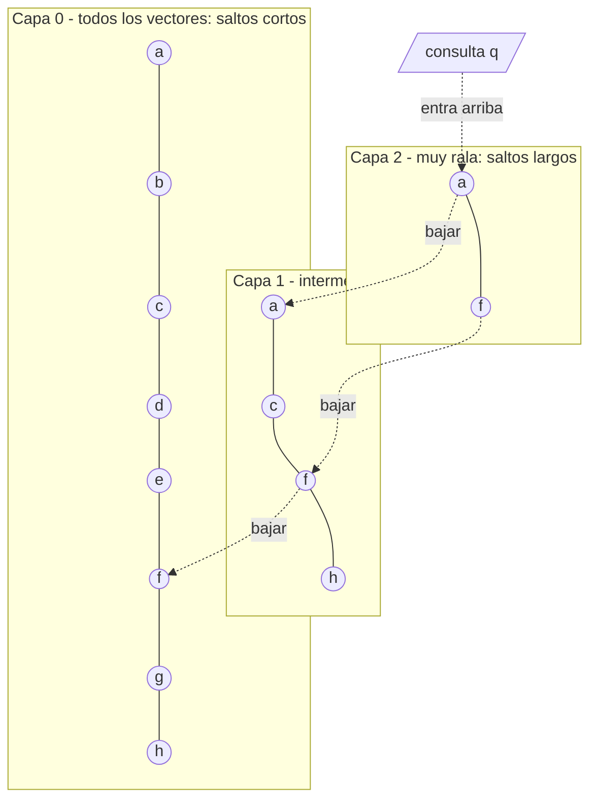

# Apunte — Clase 5: Vector stores y recuperación

> **Cómo usar este apunte.** Es el marco teórico de la clase: el notebook muestra *cómo* se implementa; este documento explica *por qué* y de dónde sale cada idea. Las referencias entre corchetes remiten a la sección **Fuentes**, que está a continuación y explica qué contiene cada fuente y por qué se usa. 📄 = PDF descargable con `bibliography/descargar.sh` (ver [`bibliography/README.md`](../bibliography/README.md)).
>
> **Lectura obligatoria antes de la clase:** §1–4 de [1] (HNSW) y la página de configuración de colecciones de [12].
> **Lectura recomendada después:** [5] (ANN-Benchmarks), [3] (§1–3 de la librería FAISS) y [9] (MTEB).
>
> **Correspondencia con el notebook** (`clase-05.ipynb`): las secciones 1 a 9 del notebook corresponden a los §1 a §9 de este apunte, con el mismo número.

---

## Fuentes

Un vector store resuelve un problema clásico de las ciencias de la computación — **buscar vecinos cercanos en alta dimensión** — que tiene medio siglo de teoría detrás. El apunte usa: (a) los resultados teóricos que explican por qué el problema es difícil (maldición de la dimensionalidad, *hubness*); (b) los papers de los algoritmos que usan las herramientas del curso (HNSW en ChromaDB; Flat, IVF y PQ en FAISS); (c) los benchmarks que permiten compararlos con datos; y (d) la documentación de las herramientas y del modelo de embeddings. 📄 = PDF descargable con `bibliography/descargar.sh`.

### Algoritmos de búsqueda aproximada

**[1] 📄 Malkov, Y. A. & Yashunin, D. A. (2020). *Efficient and robust approximate nearest neighbor search using Hierarchical Navigable Small World graphs*. IEEE TPAMI, 42(4). arXiv:1603.09320.** — `2016_malkov_1603.09320.pdf`
- *Qué contiene:* HNSW, un índice basado en **grafos de proximidad** organizados en capas: cada elemento aparece en las capas inferiores y, con probabilidad que decae exponencialmente, también en capas superiores más ralas. La búsqueda empieza arriba (saltos largos) y desciende (saltos cortos), con complejidad que escala logarítmicamente; una heurística de selección de vecinos mejora el desempeño en alto recall y con datos agrupados.
- *Por qué está:* es el algoritmo que usa ChromaDB por dentro, y sus parámetros (`M`, `ef_construction`, `ef_search`) son los que se configuran en una colección (§1.4, §2). Lectura obligatoria (§1–4).

**[2] 📄 Johnson, J., Douze, M. & Jégou, H. (2019). *Billion-scale similarity search with GPUs*. IEEE Transactions on Big Data. arXiv:1702.08734.** — `2017_johnson_1702.08734.pdf`
- *Qué contiene:* el diseño de FAISS en GPU para búsqueda exacta y aproximada sobre miles de millones de vectores, incluyendo selección k-select en GPU y búsqueda sobre índices cuantizados.
- *Por qué está:* es el paper original de FAISS y muestra a qué escala opera esa librería (§5).

**[3] 📄 Douze, M. et al. (2024). *The Faiss library*. arXiv:2401.08281.** — `2024_douze_2401.08281.pdf`
- *Qué contiene:* describe FAISS como caja de herramientas de búsqueda vectorial: el espacio de compromisos (velocidad, memoria, exactitud), los métodos de indexado (Flat, IVF, HNSW, cuantización por producto y sus combinaciones) y los principios de diseño.
- *Por qué está:* es la referencia más completa y actualizada para entender las opciones de indexado de §1.3 y §5. Lectura recomendada (§1–3).

**[4] 📄 Jégou, H., Douze, M. & Schmid, C. (2011). *Product Quantization for Nearest Neighbor Search*. IEEE TPAMI, 33(1), 117–128.** — `2011_jegou_product-quantization.pdf` (descarga manual, ver `bibliography/README.md`)
- *Qué contiene:* la cuantización por producto (PQ): dividir cada vector en $m$ sub-vectores, cuantizar cada uno con un diccionario pequeño de centroides y representar el vector con $m$ códigos cortos; propone el cálculo asimétrico de distancias y su combinación con un índice invertido (IVFADC).
- *Por qué está:* es la técnica de compresión que hace posible indexar miles de millones de vectores en memoria (§1.3, §6.3).

**[6] Indyk, P. & Motwani, R. (1998). *Approximate Nearest Neighbors: Towards Removing the Curse of Dimensionality*. STOC '98, 604–613.**
- *Qué contiene:* formaliza el problema del vecino cercano **aproximado** y propone el *Locality-Sensitive Hashing* (LSH): funciones de hash que hacen colisionar con más probabilidad a los puntos cercanos, con garantías teóricas sublineales.
- *Por qué está:* es el trabajo que estableció que, en alta dimensión, hay que **resignar exactitud** para ganar velocidad, la idea que justifica toda la búsqueda aproximada (§1.2).

### Teoría de la alta dimensión

**[7] Beyer, K., Goldstein, J., Ramakrishnan, R. & Shaft, U. (1999). *When Is "Nearest Neighbor" Meaningful?* ICDT '99, 217–235.**
- *Qué contiene:* demuestra que, bajo condiciones amplias sobre la distribución de los datos, al crecer la dimensión la distancia al vecino más cercano y al más lejano **se vuelven casi iguales** (su cociente tiende a 1), con lo que "el más cercano" pierde significado.
- *Por qué está:* explica por qué las estructuras clásicas fallan en alta dimensión y por qué los embeddings funcionan igual: los datos reales no están distribuidos uniformemente, sino concentrados cerca de variedades de baja dimensión (§1.1).

**[8] Radovanović, M., Nanopoulos, A. & Ivanović, M. (2010). *Hubs in Space: Popular Nearest Neighbors in High-Dimensional Data*. Journal of Machine Learning Research, 11, 2487–2531.**
- *Qué contiene:* describe la **hubness**: en alta dimensión, unos pocos puntos ("hubs") aparecen en las listas de vecinos más cercanos de muchísimos otros, mientras otros no aparecen nunca.
- *Por qué está:* explica un síntoma que se ve en la práctica: un mismo chunk "genérico" que aparece en el top-k de consultas muy distintas (§7).

**[10] 📄 Ethayarajh, K. (2019). *How Contextual are Contextualized Word Representations?* EMNLP 2019. arXiv:1909.00512.** — `2019_ethayarajh_1909.00512.pdf`
- *Qué contiene:* muestra que las representaciones de modelos como BERT y GPT-2 son **anisotrópicas**: no se distribuyen uniformemente en todas las direcciones, sino que ocupan un cono estrecho, con similitudes coseno altas aun entre palabras no relacionadas.
- *Por qué está:* explica por qué los valores absolutos de similitud dependen del modelo y por qué el umbral se **calibra** en vez de fijarse (§7).

### Búsqueda con filtros y sistemas

**[11] 📄 Patel, L., Kraft, P., Guestrin, C. & Zaharia, M. (2024). *ACORN: Performant and Predicate-Agnostic Search Over Vector Embeddings and Structured Data*. SIGMOD 2024. arXiv:2403.04871.** — `2024_patel_2403.04871.pdf`
- *Qué contiene:* analiza la búsqueda vectorial combinada con filtros sobre atributos estructurados; muestra que los métodos existentes o rinden mal o solo soportan filtros restringidos, y propone un índice basado en HNSW que soporta predicados arbitrarios.
- *Por qué está:* da el marco para entender pre-filtrado vs. post-filtrado y por qué filtrar no es trivial en un índice de grafo (§3).

**[18] 📄 Pan, J. J., Wang, J. & Li, G. (2024). *Survey of Vector Database Management Systems*. The VLDB Journal. arXiv:2310.14021.** — `2023_pan_2310.14021.pdf`
- *Qué contiene:* revisión de los sistemas de gestión de bases vectoriales: técnicas de indexado, compresión, búsqueda con filtros, almacenamiento distribuido y procesamiento de consultas, con una clasificación de los sistemas existentes.
- *Por qué está:* ubica a ChromaDB y FAISS en el panorama completo de "bases de datos vectoriales" (§2, §5).

### Benchmarks y modelos de embeddings

**[5] 📄 Aumüller, M., Bernhardsson, E. & Faithfull, A. (2020). *ANN-Benchmarks: A Benchmarking Tool for Approximate Nearest Neighbor Algorithms*. Information Systems, 87. arXiv:1807.05614.** — `2018_aumuller_1807.05614.pdf` — resultados actualizados: https://ann-benchmarks.com/
- *Qué contiene:* una herramienta estándar para comparar algoritmos ANN sobre los mismos datasets, midiendo la curva **recall vs. consultas por segundo** al barrer los parámetros de cada algoritmo.
- *Por qué está:* enseña la forma correcta de comparar índices: no un número, sino una **curva de compromiso** (§1.2).

**[9] 📄 Muennighoff, N., Tazi, N., Magne, L. & Reimers, N. (2023). *MTEB: Massive Text Embedding Benchmark*. EACL 2023. arXiv:2210.07316.** — `2022_muennighoff_2210.07316.pdf` — leaderboard: https://huggingface.co/spaces/mteb/leaderboard
- *Qué contiene:* un benchmark de 8 tipos de tareas, 58 datasets y 112 idiomas; evaluando 33 modelos encuentra que **ningún método domina en todas las tareas**.
- *Por qué está:* es la referencia para elegir un modelo de embeddings (§6), con la advertencia de que el ranking general no reemplaza evaluar con datos propios.

### Documentación

**[12] Chroma. *Configure collections*.** https://docs.trychroma.com/docs/collections/configure
- *Qué contiene:* las métricas disponibles (`l2`, definida como **L2 al cuadrado** y usada por defecto; `cosine`; `ip`) y los parámetros del índice HNSW (`max_neighbors`, `ef_construction`, `ef_search`), con su efecto en exactitud, memoria y velocidad.
- *Por qué está:* es la fuente primaria de qué devuelve exactamente `query()` y cómo convertirlo en similitud (§2). Lectura obligatoria.

**[13] Meta AI. *Faiss wiki*.** https://github.com/facebookresearch/faiss/wiki
- *Qué contiene:* guía de uso de FAISS: tipos de índices, la sintaxis de `index_factory`, guías para elegir índice según tamaño y memoria, persistencia.
- *Por qué está:* complementa a [3] con la parte práctica (§5).

**[14] UKP Lab / Hugging Face. *Sentence Transformers*.** https://sbert.net/
- *Qué contiene:* la librería de referencia para calcular embeddings con modelos locales, con modelos preentrenados y guías de búsqueda semántica.
- *Por qué está:* es la vía estándar para embeddings locales en Python (§8).

**[15] AWS. *Cohere Embed v4* — parámetros del modelo en Amazon Bedrock.** https://docs.aws.amazon.com/bedrock/latest/userguide/model-parameters-embed-v4.html
- *Qué contiene:* el contrato de la API en Bedrock: `input_type` (`search_document`, `search_query`, `classification`, `clustering`), `embedding_types` (`float`, `int8`, `uint8`, `binary`, `ubinary`), `output_dimension` (256, 512, 1024, 1536), hasta 96 textos por llamada y contexto de ~128k tokens.
- *Por qué está:* es la fuente de los límites prácticos que afectan la ingesta (lotes de 96) y la elección de dimensión y tipo (§6).

**[16] Nomic AI. *nomic-embed-text-v1.5* (ficha del modelo).** https://huggingface.co/nomic-ai/nomic-embed-text-v1.5
- *Qué contiene:* un modelo de embeddings abierto que requiere **prefijos de tarea** (`search_document: ` para documentos, `search_query: ` para consultas) y soporta dimensiones Matryoshka.
- *Por qué está:* es el modelo local que se usa con Ollama en el notebook; sin los prefijos la calidad baja (§8).

---

## 1. Almacenamiento vectorial y recuperación por vecinos cercanos

### 1.1 El problema y por qué es difícil

Dado un conjunto de $N$ vectores en $\mathbb{R}^d$ y una consulta $q$, el problema de los **$k$ vecinos más cercanos** ($k$-NN) pide los $k$ vectores más similares a $q$. La solución exacta por fuerza bruta compara contra todos: costo $O(N \cdot d)$ por consulta. Con $N = 10^6$ y $d = 1536$ son ~1.500 millones de multiplicaciones por consulta.

Las estructuras clásicas de baja dimensión (árboles k-d, árboles R) no ayudan: en alta dimensión su poda deja de funcionar y degeneran en fuerza bruta. La razón es la **maldición de la dimensionalidad**: Beyer et al. [7] demostraron que, para distribuciones amplias, al crecer $d$ el cociente entre la distancia al vecino más lejano y al más cercano tiende a 1. Si todos los puntos están "igual de lejos", no hay estructura que podar.

¿Por qué funcionan entonces los embeddings? Porque los datos reales **no** son uniformes: los textos con significado ocupan una región pequeña y estructurada del espacio. Esa estructura es la que aprovechan los índices aproximados. El notebook lo muestra con una medición: sobre 50.000 vectores de 256 dimensiones, HNSW con `efSearch = 256` recupera solo el 66% de los 10 vecinos verdaderos si los vectores son **aleatorios**, y el 99,8% si están **agrupados** alrededor de "temas", como los embeddings reales.

### 1.2 Resignar exactitud: búsqueda aproximada (ANN)

La salida, formalizada por Indyk & Motwani [6], es aceptar resultados **aproximados**: un índice ANN (*approximate nearest neighbor*) devuelve vecinos que probablemente son los verdaderos, mucho más rápido. La calidad se mide con el **recall@k**:

$$
\text{recall@}k = \frac{\lvert \text{ANN}_k(q) \cap \text{exactos}_k(q) \rvert}{k}
$$

Todo índice ANN expone un **compromiso** entre recall, velocidad (consultas por segundo), memoria y tiempo de construcción, controlado por parámetros. ANN-Benchmarks [5] muestra la forma correcta de comparar: una **curva** recall vs. consultas por segundo para cada algoritmo, no un número.

### 1.3 Las cuatro familias

| Familia | Idea | Ejemplo | Compromiso típico |
|---|---|---|---|
| **Hashing** | Funciones de hash que hacen colisionar puntos cercanos [6] | LSH | Garantías teóricas; en la práctica, superado por grafos |
| **Particionamiento** | Agrupar con k-means; buscar solo en los grupos más cercanos | IVF (`nprobe` grupos) | Rápido; el recall depende de cuántos grupos se visitan |
| **Cuantización** | Comprimir vectores en códigos cortos [4] | PQ, IVF-PQ | Mucho menos memoria; pierde precisión en las distancias |
| **Grafos** | Navegar un grafo de vecinos [1] | HNSW | Recall alto con baja latencia; usa más memoria |

**Cuantización por producto (PQ)** [4], en una línea: se parte cada vector de dimensión $d$ en $m$ trozos, cada trozo se reemplaza por el índice de su centroide más cercano entre 256 posibles (1 byte), y el vector entero queda en $m$ bytes. Un vector de 1536 floats (6.144 bytes) con $m = 96$ ocupa 96 bytes: 64× menos.

### 1.4 HNSW, el índice de ChromaDB

HNSW [1] organiza los vectores en un **grafo de varias capas**. Cada vector está en la capa 0; con probabilidad que decae exponencialmente, también en capas superiores, que quedan cada vez más ralas. La búsqueda empieza en la capa más alta (pocos nodos, conexiones largas: saltos grandes por el espacio) y baja capa por capa refinando (conexiones cortas: ajuste fino), como buscar una dirección pasando de autopista a avenida y a calle.

Sus parámetros (con los nombres de Chroma [12]):

| Parámetro | Qué controla | Subirlo… |
|---|---|---|
| `max_neighbors` (*M* en el paper) | Conexiones por nodo | Más recall, más memoria |
| `ef_construction` | Candidatos al construir | Mejor grafo, construcción más lenta |
| `ef_search` | Candidatos al buscar | Más recall, consultas más lentas |

**HNSW es aproximado**: con un corpus de 6 vectores devuelve los exactos en la práctica, pero en general no garantiza el top-k exacto. El notebook compara un índice exacto con HNSW y mide el recall.

---

## 2. ChromaDB: métricas y qué devuelve `query()`

### 2.1 Tres métricas, una equivalencia

Chroma ofrece tres métricas [12] y **por defecto usa `l2`, que es L2 al cuadrado**:

| `space` | Distancia devuelta | Rango (vectores normalizados) |
|---|---|---|
| `l2` (default) | $d = \sum_i (a_i - b_i)^2 = \lVert a - b \rVert^2$ | $[0, 4]$ |
| `cosine` | $d = 1 - \cos(a, b)$ | $[0, 2]$ |
| `ip` | $d = 1 - a \cdot b$ | $[0, 2]$ |

Si los vectores están **normalizados** ($\lVert a \rVert = \lVert b \rVert = 1$, como los de Cohere Embed v4), las tres ordenan igual, porque

$$
\lVert a - b \rVert^2 = \lVert a \rVert^2 + \lVert b \rVert^2 - 2\,a \cdot b = 2 - 2\cos(a,b)
$$

y entonces $\cos(a,b) = 1 - d_{\ell_2}/2$. Si los vectores **no** están normalizados, L2 y coseno pueden dar rankings distintos: hay que normalizar o usar `cosine`.

**Regla práctica:** antes de fijar un umbral, verificá (1) qué métrica usa la colección y (2) si los vectores están normalizados. Para crear la colección directamente con coseno: `get_or_create_collection(nombre, configuration={"hnsw": {"space": "cosine"}})`.

### 2.2 Qué guarda una colección

Una colección de Chroma guarda, por cada elemento, cuatro cosas: el **id**, el **embedding**, el **documento** (texto) y la **metadata**. Que el texto y la metadata viajen con el vector es lo que diferencia una base vectorial de una librería de índices como FAISS (§5) [18].

---

## 3. Filtrado por metadata

Filtrar ("solo chunks del documento X", "solo versión 2") parece trivial, pero choca con el índice [11]:

| Estrategia | Cómo | Problema |
|---|---|---|
| **Post-filtrado** | Buscar el top-$k'$ y después descartar lo que no cumple | Si el filtro es selectivo, quedan menos de $k$ resultados (o ninguno) |
| **Pre-filtrado** | Seleccionar los que cumplen y buscar solo entre ellos | Con HNSW, el subgrafo de los que cumplen puede quedar desconectado y la navegación falla |
| **Filtrado durante la búsqueda** | Navegar el grafo completo pero solo aceptar los que cumplen | Si casi nada cumple, hay que explorar mucho |

La variable que decide es la **selectividad** del filtro (qué fracción de la colección lo cumple). ACORN [11] propone un índice que mantiene buen desempeño con predicados arbitrarios. En la práctica: con filtros muy selectivos sobre colecciones chicas (el caso del TP), cualquier estrategia funciona; con colecciones grandes, conviene **medir** el recall con y sin filtro.

---

## 4. Persistencia del índice

Persistir el índice separa la ingesta (cara, se hace una vez) de la consulta (barata, se hace siempre). Un índice persistido queda **atado** a tres cosas, y si cambia cualquiera, los vectores viejos dejan de ser comparables con las consultas nuevas:

1. el **modelo** de embeddings (cada modelo aprende su propia geometría; Clase 4),
2. la **dimensión** (y, con Matryoshka, el truncado),
3. la **normalización** y la **métrica**.

El error es **silencioso**: no hay excepción, solo resultados peores. Dos prácticas lo evitan: incluir el modelo y la dimensión en el **nombre de la colección** (o en su metadata), y re-ingestar todo al cambiar de modelo. Con ids determinísticos (Clase 4), re-ingestar con `upsert` es idempotente.

---

## 5. FAISS: una librería, no una base de datos

FAISS [2][3] es una **librería de índices**: hace la búsqueda y nada más. A diferencia de Chroma, no guarda texto ni metadata, devuelve **posiciones** (no ids), y la persistencia y los filtros son responsabilidad de quien la usa. A cambio, ofrece todo el espectro de índices de §1.3 y escala a miles de millones de vectores, incluso en GPU [2].

| Índice FAISS | Familia | Exacto | Nota |
|---|---|---|---|
| `IndexFlatIP` / `IndexFlatL2` | Fuerza bruta | **Sí** | La referencia para medir recall |
| `IndexHNSWFlat` | Grafo | No | El mismo algoritmo que Chroma |
| `IndexIVFFlat` | Particionamiento | No | Requiere entrenamiento (k-means); `nprobe` |
| `IndexIVFPQ` | Partición + cuantización | No | Para colecciones que no entran en memoria sin comprimir |

`IndexFlatIP` con vectores normalizados (`faiss.normalize_L2`) calcula exactamente la similitud coseno: es fuerza bruta, **no** un índice aproximado. Para devolver ids propios en vez de posiciones existe `IndexIDMap`.

---

## 6. Selección de modelos de embeddings

### 6.1 Benchmarks, con cuidado

MTEB [9] evalúa modelos en 8 tipos de tareas y 58 datasets, y su resultado central es que **ningún modelo domina en todas**. Dos cautelas: el promedio general mezcla tareas que pueden no importar (clasificación, clustering) con la que sí importa (recuperación, en el idioma del corpus); y un leaderboard público invita a optimizar contra él (la ley de Goodhart de la Clase 8). El benchmark sirve para **preseleccionar**; la decisión se toma midiendo con preguntas del propio dominio (Clase 8).

### 6.2 El costo de la dimensión

La memoria de un índice sin comprimir es $N \times d \times b$ bytes, con $b$ los bytes por componente:

| Configuración | 1 millón de vectores |
|---|---|
| $d = 1536$, float32 (4 bytes) | 6,1 GB |
| $d = 1536$, float64 (8 bytes, el default de `numpy`) | 12,3 GB |
| $d = 256$, float32 | 1,0 GB |
| $d = 1536$, int8 (1 byte) | 1,5 GB |
| $d = 1536$, binario (1 bit) | 0,19 GB |

(Por eso un `np.random.randn(1_000_000, 1536)` agota la memoria de una notebook: son 12 GB en float64.)

### 6.3 Tres palancas para achicar

1. **Matryoshka** (Clase 4): pedir menos dimensiones al modelo (`output_dimension` en Cohere [15]).
2. **Cuantización escalar**: componentes en `int8` (4× menos) o binarios (32× menos). Cohere Embed v4 los devuelve directamente [15]; un esquema común es buscar con binarios y reordenar los candidatos con los vectores completos.
3. **Cuantización por producto** [4]: compresión mayor, para escalas que no entran en memoria.

---

## 7. Diagnóstico de resultados irrelevantes y redundantes

### 7.1 El top-k siempre devuelve k

Una búsqueda $k$-NN **siempre** devuelve $k$ resultados, haya o no algo relevante. La similitud coseno va de −1 a 1, pero con embeddings reales los valores quedan comprimidos en un rango estrecho y positivo: los modelos son **anisotrópicos** [10], y hasta textos sin relación dan similitudes claramente mayores que cero. Por eso:

- un umbral de similitud es necesario (para poder decir "no encontré nada"),
- su valor **depende del modelo** y se **calibra** con consultas del dominio y fuera de él (en el corpus de la Clase 6, las consultas del dominio quedaron en coseno ≥ 0,29 y una de fuera en ≈ 0,17),
- lo interpretable es el **orden relativo** y la **separación** entre relevantes e irrelevantes, no el número absoluto.

### 7.2 Hubs

En alta dimensión aparecen **hubs** [8]: unos pocos vectores que son "vecino cercano" de muchísimas consultas. En RAG se ven como un chunk genérico (una introducción, un índice, un párrafo de boilerplate) que aparece en el top-k de preguntas que no tienen nada que ver entre sí. Diagnóstico: contar, sobre un lote de consultas, cuántas veces aparece cada chunk en el top-k. Remedios: limpiar el boilerplate en la ingesta (Clase 4) o penalizar los chunks frecuentes.

### 7.3 Redundancia

Chunks casi idénticos (por solapamiento de chunking o por repetición en los documentos) ocupan varios lugares del top-k. Remedios: deduplicar en la ingesta, o diversificar los resultados con MMR (Clase 7, §4.3).

---

## 8. Embeddings locales

Un modelo de embeddings local (Sentence Transformers [14], u Ollama) elimina el costo por llamada y mantiene los datos en la propia infraestructura. Tres cuidados:

1. **Calidad**: verificar en MTEB [9], y sobre todo con preguntas propias, la tarea de recuperación en el idioma del corpus.
2. **Asimetría consulta–documento**: muchos modelos esperan que se les indique si el texto es una consulta o un documento. Cohere lo hace con `input_type` [15]; `nomic-embed-text` con **prefijos** en el texto (`search_query: ` / `search_document: `) [16]. Omitirlos degrada la recuperación sin dar error.
3. **No mezclar modelos** en un mismo índice (§4).

---

## 9. Evaluación manual de consultas

Antes de medir con métricas (Clase 8), una inspección manual sistemática ya enseña mucho: elegir consultas **representativas** (incluidas algunas fuera de dominio), mirar el top-k completo (no solo el top-1) con sus scores, y anotar para cada una si el primer resultado relevante aparece y en qué posición. Esas anotaciones son la semilla de los juicios de relevancia del dataset de evaluación (Clase 8: hit rate, recall@k, MRR).

---

## Preguntas de repaso

1. ¿Por qué la búsqueda por fuerza bruta no escala, y por qué los árboles k-d no la resuelven en alta dimensión? Citá [7].
2. Definí recall@k para un índice ANN. ¿Por qué ANN-Benchmarks [5] reporta curvas y no un número?
3. Explicá con tus palabras cómo busca HNSW. ¿Qué parámetro subirías si el recall es bajo y la latencia te sobra?
4. Una colección de Chroma usa la métrica por defecto y los vectores están normalizados. Una consulta devuelve $d = 1{,}2$. ¿Cuál es la similitud coseno? ¿Y si la colección usara `cosine` y devolviera $d = 0{,}4$?
5. ¿Por qué `IndexFlatIP` no es un ejemplo de índice aproximado? ¿Cuál de FAISS usa el mismo algoritmo que Chroma?
6. Calculá la memoria de 5 millones de vectores de 1024 dimensiones en float32 y en int8.
7. Un chunk con la tabla de contenidos del manual aparece en el top-3 de casi todas las consultas. ¿Cómo se llama el fenómeno y qué harías?
8. Cambiás de modelo de embeddings pero reusás la colección persistida. ¿Qué pasa y por qué no aparece ningún error?
