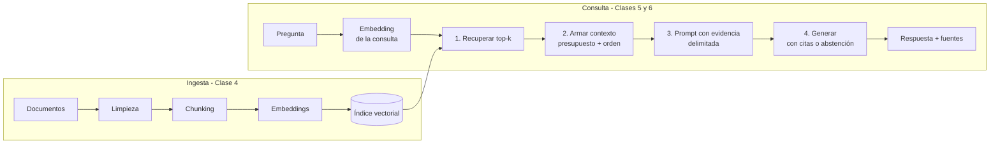
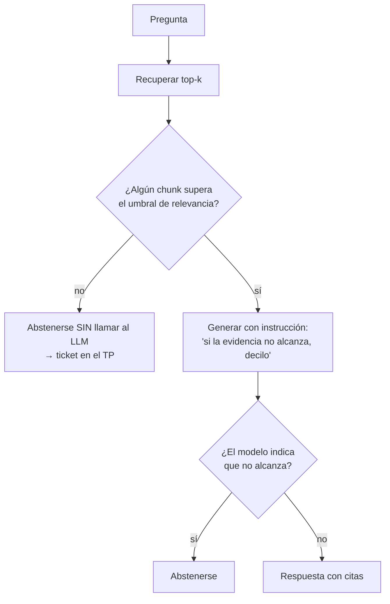

# Apunte — Clase 6: Arquitectura RAG

> **Cómo usar este apunte.** Es el marco teórico de la clase: el notebook muestra *cómo* se implementa; este documento explica *por qué* y de dónde sale cada idea. Las referencias entre corchetes remiten a la sección **Fuentes**, que está a continuación y explica qué contiene cada fuente y por qué se usa. 📄 = PDF descargable con `bibliography/descargar.sh` (ver [`bibliography/README.md`](../bibliography/README.md)).
>
> **Lectura obligatoria antes de la clase:** §1–2 de [1] (el paper que bautizó RAG) y la guía de contexto largo de [13].
> **Lectura recomendada después:** [3] (DPR), [7] (citas) y [16] (atribución).
>
> **Correspondencia con el notebook** (`clase-06.ipynb`): las secciones 1 a 9 del notebook corresponden a los §1 a §9 de este apunte, con el mismo número. El §0 (marco) no tiene celda propia.

---

## Fuentes

RAG tiene una historia corta pero densa: entre 2019 y 2021 un puñado de papers definió la idea de **memoria no paramétrica** para modelos de lenguaje; desde 2023 la práctica dominante es más simple (un LLM congelado con documentos en el prompt) y la investigación se movió a **cómo usa el modelo ese contexto**: atención a la posición, distracción, alucinación, citas y abstención. El apunte usa los papers fundacionales para el marco conceptual (§0–1), la literatura sobre uso del contexto para las decisiones de diseño (§4–7), y la documentación de proveedores para las prácticas recomendadas. 📄 = PDF descargable con `bibliography/descargar.sh`.

### Fundamentos

**[1] 📄 Lewis, P., Perez, E., Piktus, A., Petroni, F., Karpukhin, V., Goyal, N., Küttler, H., Lewis, M., Yih, W., Rocktäschel, T., Riedel, S. & Kiela, D. (2020). *Retrieval-Augmented Generation for Knowledge-Intensive NLP Tasks*. NeurIPS 2020. arXiv:2005.11401.** — `2020_lewis_2005.11401.pdf`
- *Qué contiene:* combina una **memoria paramétrica** (un modelo seq2seq preentrenado, BART) con una **memoria no paramétrica** (un índice vectorial denso de Wikipedia, accedido con el recuperador DPR [3]). Compara dos formulaciones — *RAG-Sequence* (el mismo documento condiciona toda la respuesta) y *RAG-Token* (cada token puede apoyarse en un documento distinto) — y entrena recuperador y generador de punta a punta. Destaca dos ventajas: dar **procedencia** de las respuestas y **actualizar el conocimiento** cambiando el índice, sin reentrenar.
- *Por qué está:* es el paper que dio nombre a la técnica y la fuente de la distinción paramétrico/no paramétrico, que es el marco de toda la clase (§0, §1). Lectura obligatoria (§1–2).

**[2] 📄 Guu, K., Lee, K., Tung, Z., Pasupat, P. & Chang, M.-W. (2020). *REALM: Retrieval-Augmented Language Model Pre-Training*. ICML 2020. arXiv:2002.08909.** — `2020_guu_2002.08909.pdf`
- *Qué contiene:* incorpora un recuperador **durante el preentrenamiento**: el modelo aprende a recuperar documentos que le ayudan a predecir palabras enmascaradas, tratando el documento recuperado como variable latente y propagando el gradiente hasta el recuperador.
- *Por qué está:* muestra el extremo "entrenado" del espectro de RAG; ayuda a entender qué resignamos al usar un LLM congelado (§1.3).

**[3] 📄 Karpukhin, V., Oğuz, B., Min, S., Lewis, P., Wu, L., Edunov, S., Chen, D. & Yih, W. (2020). *Dense Passage Retrieval for Open-Domain Question Answering*. EMNLP 2020. arXiv:2004.04906.** — `2020_karpukhin_2004.04906.pdf`
- *Qué contiene:* un recuperador de **doble codificador** (uno para preguntas, otro para pasajes) entrenado con pocos pares pregunta–pasaje y negativos dentro del lote; supera a un BM25 fuerte por 9–19 puntos absolutos de exactitud top-20.
- *Por qué está:* es el recuperador denso que usa [1] y la demostración de que los embeddings pueden superar a la búsqueda léxica, que es la base de las Clases 4–5 (§1.2).

**[4] 📄 Izacard, G. & Grave, E. (2021). *Leveraging Passage Retrieval with Generative Models for Open Domain Question Answering*. EACL 2021. arXiv:2007.01282.** — `2020_izacard_2007.01282.pdf`
- *Qué contiene:* *Fusion-in-Decoder*: cada pasaje recuperado se codifica por separado y el decodificador atiende a todos juntos; el desempeño **mejora significativamente al aumentar el número de pasajes**, evidencia de que el modelo generativo agrega evidencia de varias fuentes.
- *Por qué está:* da el contrapunto a [10] y [11]: más contexto puede ayudar (si el modelo está entrenado para eso) o perjudicar (§5).

**[5] 📄 Borgeaud, S. et al. (2022). *Improving language models by retrieving from trillions of tokens*. ICML 2022. arXiv:2112.04426.** — `2021_borgeaud_2112.04426.pdf`
- *Qué contiene:* RETRO condiciona un modelo autorregresivo en fragmentos recuperados de una base de 2 billones de tokens y obtiene desempeño comparable a GPT-3 con 25× menos parámetros.
- *Por qué está:* es la evidencia más fuerte de que la memoria no paramétrica puede **sustituir parámetros**: conocimiento en el índice en vez de en los pesos (§0).

**[6] 📄 Ram, O., Levine, Y., Dalmedigos, I., Muhlgay, D., Shashua, A., Leyton-Brown, K. & Shoham, Y. (2023). *In-Context Retrieval-Augmented Language Models*. TACL 2023. arXiv:2302.00083.** — `2023_ram_2302.00083.pdf`
- *Qué contiene:* propone *In-Context RALM*: dejar el modelo **sin modificar** y simplemente anteponer los documentos recuperados a la entrada, sin entrenamiento adicional; muestra que esa alternativa simple obtiene mejoras grandes.
- *Por qué está:* es exactamente lo que hacemos en el curso (un LLM comercial congelado + documentos en el prompt), y la justificación de que sea un diseño razonable y no un atajo (§1.3).

**[8] 📄 Petroni, F. et al. (2019). *Language Models as Knowledge Bases?* EMNLP 2019. arXiv:1909.01066.** — `2019_petroni_1909.01066.pdf`
- *Qué contiene:* muestra que modelos preentrenados responden preguntas factuales tipo "completar el espacio" sin ajuste, es decir, que almacenan conocimiento relacional en sus parámetros.
- *Por qué está:* establece la memoria paramétrica como objeto de estudio (§0).

**[9] 📄 Mallen, A., Asai, A., Zhong, V., Das, R., Khashabi, D. & Hajishirzi, H. (2023). *When Not to Trust Language Models: Investigating Effectiveness of Parametric and Non-Parametric Memories*. ACL 2023. arXiv:2212.10511.** — `2022_mallen_2212.10511.pdf`
- *Qué contiene:* con 14.000 preguntas (PopQA) muestra que los modelos fallan en conocimiento **poco popular** (la "cola larga"), que escalar el modelo casi no lo mejora, y que modelos con recuperación superan a modelos órdenes de magnitud más grandes; propone recuperar **solo cuando hace falta**.
- *Por qué está:* da el criterio cuantitativo de cuándo RAG agrega valor: conocimiento específico, raro o privado — como la documentación del TP (§0).

**[18] 📄 Gao, Y. et al. (2023). *Retrieval-Augmented Generation for Large Language Models: A Survey*. arXiv:2312.10997.** — `2023_gao_2312.10997.pdf`
- *Qué contiene:* (ver apunte de la Clase 7) taxonomía naive/advanced/modular RAG.
- *Por qué está:* ubica el RAG de esta clase como "naive RAG", el punto de partida que las Clases 7 y 8 mejoran (§2).

### Uso del contexto: posición, distracción, inyección

**[10] 📄 Liu, N. F. et al. (2024). *Lost in the Middle: How Language Models Use Long Contexts*. TACL. arXiv:2307.03172.** — `2023_liu_2307.03172.pdf`
- *Qué contiene:* (ver apunte de la Clase 7) curva en U: la información relevante se aprovecha mejor al principio o al final del contexto.
- *Por qué está:* justifica el orden de los chunks y el presupuesto de contexto (§5).

**[11] 📄 Shi, F. et al. (2023). *Large Language Models Can Be Easily Distracted by Irrelevant Context*. ICML 2023. arXiv:2302.00093.** — `2023_shi_2302.00093.pdf`
- *Qué contiene:* con GSM-IC muestra que agregar información irrelevante degrada mucho el desempeño, y que instruir al modelo a ignorar lo irrelevante es una mitigación efectiva.
- *Por qué está:* justifica filtrar por umbral (§6) e instruir explícitamente al modelo (§4).

**[12] 📄 Greshake, K. et al. (2023). *Not what you've signed up for: Compromising Real-World LLM-Integrated Applications with Indirect Prompt Injection*. AISec '23. arXiv:2302.12173.** — `2023_greshake_2302.12173.pdf`
- *Qué contiene:* (ver apunte de la Clase 9) inyección de instrucciones a través de datos recuperados.
- *Por qué está:* un RAG es, por construcción, un sistema que pone texto de terceros en el prompt; es la amenaza que motiva la delimitación del §4.

**[14] 📄 Wallace, E., Xiao, K., Leike, R., Weng, L., Heidecke, J. & Beutel, A. (2024). *The Instruction Hierarchy: Training LLMs to Prioritize Privileged Instructions*. arXiv:2404.13208.** — `2024_wallace_2404.13208.pdf`
- *Qué contiene:* argumenta que una vulnerabilidad de fondo es que los modelos tratan con la misma prioridad las instrucciones del sistema y el texto de usuarios o de terceros, y propone entrenar una **jerarquía de instrucciones** (sistema > usuario > datos de herramientas) que mejora la robustez.
- *Por qué está:* explica *por qué* separar instrucciones (system prompt) de datos (evidencia) ayuda, y por qué no es una garantía (§4.2).

### Alucinación, atribución y abstención

**[15] 📄 Huang, L. et al. (2023). *A Survey on Hallucination in Large Language Models: Principles, Taxonomy, Challenges, and Open Questions*. ACM TOIS. arXiv:2311.05232.** — `2023_huang_2311.05232.pdf`
- *Qué contiene:* taxonomía de la alucinación — de **factualidad** (contradice el mundo) y de **fidelidad** (contradice las instrucciones o el contexto provisto) —, sus causas (datos, entrenamiento, inferencia), detección, mitigación, y un análisis de los límites de RAG para combatirla.
- *Por qué está:* da las definiciones precisas que usa el §6 y que la Clase 8 operacionaliza como métricas.

**[16] 📄 Rashkin, H. et al. (2023). *Measuring Attribution in Natural Language Generation Models*. Computational Linguistics. arXiv:2112.12870.** — `2021_rashkin_2112.12870.pdf`
- *Qué contiene:* el marco AIS (*Attributable to Identified Sources*): un enunciado es atribuible a una fuente si un lector razonable, leyendo la fuente, aceptaría que "según la fuente, …" el enunciado es verdadero; define protocolos de evaluación humana.
- *Por qué está:* da la definición formal de "respuesta sustentada" y de "cita correcta" (§6, §7).

**[7] 📄 Gao, T., Yen, H., Yu, J. & Chen, D. (2023). *Enabling Large Language Models to Generate Text with Citations*. EMNLP 2023. arXiv:2305.14627.** — `2023_gao_2305.14627.pdf`
- *Qué contiene:* ALCE, el primer benchmark de generación con citas; mide fluidez, corrección y **calidad de cita** (recall y precision de citas); incluso los mejores modelos carecen de sustento completo de citas cerca del 50% de las veces en ELI5.
- *Por qué está:* da las métricas para evaluar las citas del §7 y muestra que "pedirle citas al modelo" no alcanza sin verificación.

**[17] 📄 Kadavath, S. et al. (2022). *Language Models (Mostly) Know What They Know*. arXiv:2207.05221.** — `2022_kadavath_2207.05221.pdf`
- *Qué contiene:* muestra que modelos grandes están razonablemente **calibrados** en preguntas de opción múltiple con el formato adecuado, y que se les puede entrenar a predecir si saben la respuesta.
- *Por qué está:* fundamenta (con matices) la abstención pedida al modelo, además del umbral de recuperación (§6.3).

**[19] 📄 Geifman, Y. & El-Yaniv, R. (2017). *Selective Classification for Deep Neural Networks*. NeurIPS 2017. arXiv:1705.08500.** — `2017_geifman_1705.08500.pdf`
- *Qué contiene:* clasificación **selectiva** (con opción de rechazo): el sistema se abstiene en los casos dudosos para garantizar un nivel de riesgo, intercambiando **cobertura** por **riesgo**.
- *Por qué está:* da el marco formal de la abstención: "no sé" no es una falla, es un punto de operación en la curva cobertura–riesgo (§6.2).

### Documentación de proveedores

**[13] Anthropic. *Long context prompting tips* y *Reduce hallucinations*.** https://docs.anthropic.com/en/docs/build-with-claude/prompt-engineering/long-context-tips — https://docs.anthropic.com/en/docs/test-and-evaluate/strengthen-guardrails/reduce-hallucinations
- *Qué contiene:* poner los documentos largos **al principio** y la pregunta **al final**; estructurar documentos con etiquetas XML con metadatos; pedir citas textuales antes de responder; permitir explícitamente que el modelo diga "no sé"; restringir al conocimiento provisto.
- *Por qué está:* son las prácticas que el notebook aplica en el diseño del prompt (§4) y en la abstención (§6). Lectura obligatoria (la de contexto largo).

**[20] Anthropic. *Citations*.** https://docs.anthropic.com/en/docs/build-with-claude/citations
- *Qué contiene:* una función de la API que devuelve, junto con la respuesta, las citas a fragmentos exactos de los documentos provistos.
- *Por qué está:* muestra la alternativa "nativa" a las citas por convención del prompt que implementamos (§7.3).

---

## 0. Marco: dos memorias

Un LLM "sabe" cosas porque las vio en el preentrenamiento: ese conocimiento está distribuido en sus parámetros. Petroni et al. [8] lo mostraron preguntándole a modelos preentrenados hechos tipo "Dante nació en ___". Lewis et al. [1] llaman a eso **memoria paramétrica**, y le contraponen una **memoria no paramétrica**: un índice de documentos externo que el sistema consulta en el momento.

| | Memoria paramétrica | Memoria no paramétrica |
|---|---|---|
| Dónde vive | En los pesos del modelo | En un índice de documentos |
| Cómo se actualiza | Reentrenando (caro, lento) | Re-indexando (barato, inmediato) |
| Procedencia | No se puede saber de dónde salió un dato | Cada respuesta se apoya en documentos identificables |
| Conocimiento privado | Imposible (salvo fine-tuning) | Natural: se indexan los documentos propios |
| Cola larga | Falla en lo poco frecuente [9] | Igual de buena para lo raro que para lo común |

Mallen et al. [9] cuantificaron cuándo conviene cada una: los modelos responden bien sobre entidades **populares** y mal sobre la **cola larga**, y escalar el modelo casi no lo corrige; un modelo con recuperación supera a modelos órdenes de magnitud más grandes en esas preguntas. RETRO [5] llevó la idea al extremo: con una base de 2 billones de tokens, un modelo 25× más chico igualó a GPT-3. **La documentación técnica de un producto, la base de conocimiento de una empresa o las políticas internas son, por definición, cola larga o conocimiento privado**: el caso de uso de RAG.

---

## 1. Arquitectura RAG y el flujo de 4 pasos

### 1.1 Las dos mitades

### 1.2 Formalización

Lewis et al. [1] tratan el documento recuperado $z$ como una **variable latente**. Con un recuperador $p_\eta(z \mid x)$ y un generador $p_\theta(y \mid x, z)$:

$$
\text{RAG-Sequence:}\quad p(y \mid x) \approx \sum_{z \in \text{top-}k} p_\eta(z \mid x)\; \prod_{i} p_\theta(y_i \mid x, z, y_{<i})
$$

$$
\text{RAG-Token:}\quad p(y \mid x) \approx \prod_{i} \sum_{z \in \text{top-}k} p_\eta(z \mid x)\; p_\theta(y_i \mid x, z, y_{<i})
$$

En *RAG-Sequence* un mismo documento sustenta toda la respuesta; en *RAG-Token* cada token puede apoyarse en un documento distinto. El recuperador es un **doble codificador** (DPR [3]): $p_\eta(z \mid x) \propto \exp\big(\mathbf{d}(z)^\top \mathbf{q}(x)\big)$, el producto interno entre el embedding del documento y el de la consulta — exactamente la búsqueda por similitud de la Clase 5.

### 1.3 Lo que hacemos en el curso: RAG en contexto

En [1] y en REALM [2] recuperador y generador se **entrenan juntos**. Fusion-in-Decoder [4] entrena el generador para combinar muchos pasajes. En la práctica actual con modelos comerciales no podemos tocar los pesos: usamos el LLM **congelado** y ponemos los documentos en el prompt. Ram et al. [6] llamaron a esto *In-Context RALM* y mostraron que, pese a su simpleza, da mejoras grandes. La consecuencia de diseño es que **toda la "integración" entre recuperación y generación pasa por el prompt**: por eso las secciones 4 a 7 importan tanto.

---

## 2. Por qué construirlo explícito

Hay frameworks (LangChain, LlamaIndex) que arman un pipeline RAG en pocas líneas. En el curso lo construimos a mano por tres razones:

1. **Depuración** — las Clases 7 y 8 diagnostican fallas por etapa; para eso hay que poder inspeccionar cada etapa (qué se recuperó, qué entró al prompt, qué se generó).
2. **Control del contexto** — el texto exacto que recibe el modelo determina la calidad; las abstracciones de alto nivel tienden a ocultarlo (ver la discusión de frameworks en el apunte de la Clase 10, §7).
3. **Es poco código** — recuperar, armar el contexto, armar el prompt y llamar al modelo son cuatro funciones.

Este RAG es lo que el survey de Gao et al. [18] llama *naive RAG*: el punto de partida que las técnicas de la Clase 7 mejoran.

---

## 3. Implementación base

El pipeline se descompone en funciones con contratos claros, de modo que cada pieza se pueda cambiar y testear sola:

| Función | Entrada → salida | Puede cambiar por… |
|---|---|---|
| `recuperar` | consulta, k → chunks con distancia y metadata | Híbrida, reranking (Clase 8) |
| `armar_contexto` | chunks → texto numerado con fuentes | Presupuesto, orden, compresión (Clase 7) |
| `armar_prompt` | consulta, contexto → mensajes | Otro diseño de prompt |
| `generar` | mensajes → texto | Otro proveedor (`LLMProvider`, Clase 3) |

La primera versión del notebook (`rag_v1`) pega el contexto y la pregunta sin estructura: funciona en los casos fáciles y es frágil en todos los demás. Las secciones siguientes la endurecen.

---

## 4. Diseño del prompt con evidencia recuperada

### 4.1 Estructura

Las prácticas que recomienda Anthropic para contexto largo [13], y que el notebook aplica:

- **Documentos primero, pregunta al final.** Con contextos largos, ubicar la consulta al final mejora las respuestas [13]; además coincide con la observación de [10] de que el final del contexto es una posición privilegiada.
- **Delimitar con etiquetas** (`<evidencia>`, `<pregunta>`), y dentro de la evidencia numerar cada fragmento con su fuente. Hace inequívoco qué es dato y qué es instrucción, y habilita las citas (§7).
- **Instrucciones en el system prompt**: responder solo con la evidencia, citar, y decir explícitamente "no sé" si no alcanza [13].
- **Avisar que puede haber información irrelevante** y que hay que ignorarla: es una de las mitigaciones efectivas que encontraron Shi et al. [11].

### 4.2 Por qué delimitar protege (y por qué no alcanza)

Un RAG pone en el prompt texto que no escribimos: es la superficie de la **inyección de prompts indirecta** [12]. Wallace et al. [14] identifican la causa: los modelos tienden a tratar con la misma prioridad las instrucciones del sistema y el texto de terceros. Separar instrucciones (system prompt) de datos (evidencia delimitada) **aprovecha la jerarquía de instrucciones** con la que los modelos actuales se entrenan, pero no la garantiza: un modelo puede obedecer instrucciones dentro de los datos. Por eso, cuando el sistema además actúa (Clase 9), la defensa real está en el código: mínimo privilegio y validación.

---

## 5. Gestión de la ventana de contexto

### 5.1 El presupuesto

La ventana de contexto se mide en **tokens** y la comparten la entrada y la salida. Para una llamada:

$$
T_{\text{system}} + T_{\text{pregunta}} + \sum_{i=1}^{k} T_{\text{chunk}_i} + T_{\text{plantilla}} + T_{\text{salida máx}} \;\le\; W
$$

donde $W$ es la ventana del modelo. Incluso con ventanas enormes, el presupuesto se fija **muy por debajo** de $W$ por tres razones:

1. **Costo**: se paga por token de entrada en cada llamada; el contexto recuperado suele ser la mayor parte.
2. **Latencia**: el procesamiento de la entrada (*prefill*) crece con su longitud (Clase 1).
3. **Calidad**: más contexto no es mejor — la curva en U de *Lost in the Middle* [10] y la distracción por contexto irrelevante [11] muestran que agregar chunks marginales puede **empeorar** la respuesta.

FiD [4] muestra el contrapunto: un modelo **entrenado** para agregar muchos pasajes sí mejora con más. Con un LLM congelado no lo sabemos de antemano: hay que **medirlo** (Clase 8).

### 5.2 Qué descartar

Si el presupuesto se agota, se descartan los chunks de **menor ranking** — los que el recuperador consideró menos relevantes. El notebook usa caracteres como aproximación; en el TP conviene contar tokens con el tokenizador (Clase 4, chunking por tokens) y reservar explícitamente $T_{\text{salida máx}}$.

---

## 6. Respuestas sustentadas y manejo de ausencia de evidencia

### 6.1 Fidelidad vs. factualidad

La taxonomía de Huang et al. [15] distingue dos tipos de alucinación:

- **De factualidad**: la respuesta contradice el mundo real.
- **De fidelidad** (*faithfulness*): la respuesta contradice o va más allá del **contexto provisto** o de las instrucciones.

Un RAG busca, sobre todo, **fidelidad**: que cada afirmación sea **atribuible** a la evidencia. El marco AIS de Rashkin et al. [16] da la definición operativa: un enunciado es atribuible a una fuente si un lector razonable, leyendo la fuente, aceptaría que "según la fuente, [enunciado]". Notar que un RAG perfectamente fiel a un documento equivocado da una respuesta equivocada: la factualidad depende también de la calidad del corpus.

### 6.2 La abstención como punto de operación

Cuando la evidencia no alcanza, la respuesta correcta es **abstenerse** ("no encontré información suficiente") — en el TP, abrir un ticket. La teoría de la **clasificación selectiva** [19] formaliza la idea: un sistema que puede rechazar casos intercambia **cobertura** (qué fracción de preguntas responde) por **riesgo** (qué fracción de sus respuestas es incorrecta). No existe un umbral "correcto": existe una curva, y el umbral elige un punto de operación según el costo relativo de responder mal vs. no responder.

### 6.3 Dos capas de abstención

1. **Antes de generar — umbral de recuperación.** Si ningún chunk es suficientemente similar, no se llama al modelo: más barato, determinístico y sin riesgo de alucinación. El umbral **depende del modelo de embeddings y de la métrica** (ver el recuadro), así que se **calibra** con preguntas del dominio y fuera del dominio.
2. **Después de recuperar — el modelo decide.** El chunk puede ser similar pero no contener la respuesta. Se le pide al modelo que lo diga [13]. Kadavath et al. [17] muestran que los modelos grandes tienen cierta calibración sobre lo que saben, pero no es perfecta: esta capa reduce errores, no los elimina.

> **Recuadro — distancia vs. similitud en ChromaDB.** Chroma usa por defecto la distancia **L2 al cuadrado**, $d = \lVert a - b \rVert^2$ (menor = más parecido). Si los embeddings están normalizados ($\lVert a \rVert = \lVert b \rVert = 1$), vale $d = 2 - 2\cos(a,b)$, es decir $\cos = 1 - d/2$. Así, el umbral del notebook, $d < 1{,}5$, equivale a similitud coseno $> 0{,}25$. Que 0,25 alcance para "relevante" sorprende, pero es típico: con Cohere Embed v4 sobre el corpus de la clase, las preguntas del dominio quedan en $d \le 1{,}43$ ($\cos \ge 0{,}29$) y una fuera de dominio en $d \approx 1{,}66$ ($\cos \approx 0{,}17$). Los valores absolutos dependen del modelo; lo que se calibra es la **separación** entre ambos grupos. Si la colección se crea con espacio `cosine`, Chroma devuelve $d = 1 - \cos$. Antes de trasladar un umbral de un notebook a otro, verificar **qué métrica** usa la colección. (Desarrollo completo en el apunte de la Clase 5.)

---

## 7. Implementación de citas

### 7.1 Por qué citar

Las citas cumplen dos funciones: **verificabilidad** para el usuario (puede ir a la fuente) y **auditabilidad** para el sistema (se puede medir si la respuesta está sustentada). Es la "procedencia" que [1] presentaba como ventaja de la memoria no paramétrica.

### 7.2 Qué es una cita correcta

ALCE [7] define dos métricas, basadas en la noción de atribución de [16]:

- **Recall de citas**: ¿cada afirmación de la respuesta está respaldada por las fuentes que cita?
- **Precision de citas**: ¿cada cita es necesaria, o hay citas irrelevantes "de relleno"?

Su resultado es aleccionador: incluso los mejores modelos dejaban afirmaciones sin sustento completo de cita alrededor de la mitad de las veces en un conjunto de preguntas abiertas [7]. **Pedir citas en el prompt no garantiza citas correctas.**

### 7.3 Tres niveles de implementación

| Nivel | Cómo | Garantía |
|---|---|---|
| Convención en el prompt | Fragmentos numerados `[n]`; se pide citar | Ninguna: el modelo puede citar mal |
| Validación posterior | Extraer los `[n]` con una expresión regular; verificar que existan; listar solo las fuentes efectivamente citadas | Detecta citas inexistentes, no citas equivocadas |
| Citas nativas de la API | El proveedor devuelve citas a fragmentos exactos de los documentos [20] | Cada cita apunta a texto real del documento |

El juicio de si una cita *respalda* la afirmación se evalúa con un juez LLM o con humanos (Clase 8).

---

## 8. Registro de documentos y fragmentos utilizados

Para cada consulta conviene registrar, de forma estructurada: la consulta, los chunks **recuperados** con sus distancias, los chunks **que entraron al contexto** (después del umbral y del presupuesto), las citas efectivamente usadas, y la respuesta. Ese registro es lo que permite, en la Clase 7, saber si una falla es de **recuperación** (la evidencia no llegó), de **consolidación** (llegó y se descartó) o de **generación** (estaba y no se usó). Un detalle de corrección: el registro debe guardar la recuperación **que efectivamente se usó para generar**, no una segunda recuperación hecha "para loguear" — con índices que cambian o recuperadores no determinísticos, pueden diferir.

---

## 9. Pruebas sobre el dataset del proyecto

Un conjunto mínimo de pruebas cubre tres tipos de pregunta: **respondibles** (la respuesta está en un chunk), **ambiguas o parciales** (la evidencia alcanza a medias) y **fuera de dominio** (la respuesta correcta es abstenerse). Este conjunto es la semilla del dataset de evaluación de la Clase 8, donde se miden recuperación, fidelidad y la tasa de abstención correcta.

---

## Preguntas de repaso

1. ¿Qué ventajas tiene la memoria no paramétrica sobre la paramétrica? ¿En qué tipo de preguntas es más útil, según [9]?
2. Explicá la diferencia entre RAG-Sequence y RAG-Token. ¿Cuál se parece más a lo que hacemos al poner varios chunks en un prompt?
3. Un modelo tiene ventana de 200.000 tokens. ¿Por qué no conviene llenar el contexto con todos los chunks posibles? Dá tres razones con fuentes.
4. ¿Qué es una alucinación de fidelidad? ¿Puede un RAG fiel dar una respuesta falsa?
5. Explicá la abstención con el marco de cobertura–riesgo [19]. ¿Qué pasa con ambas al subir el umbral de similitud?
6. Una colección de Chroma usa la distancia por defecto y los embeddings están normalizados. ¿A qué similitud coseno corresponde un umbral de distancia de 1,0?
7. ¿Qué miden la recall y la precision de citas? ¿Qué nivel de implementación de citas detecta una cita a un fragmento que existe pero que no respalda la afirmación?
