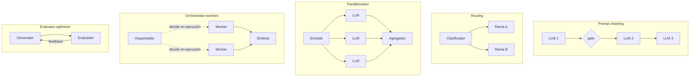
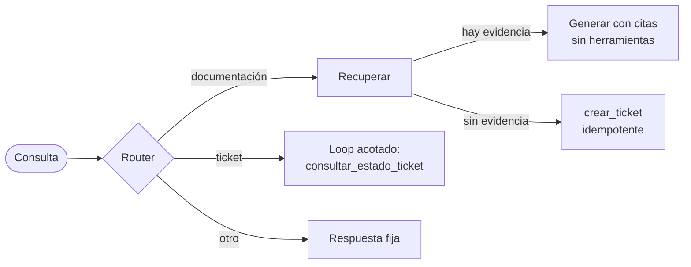
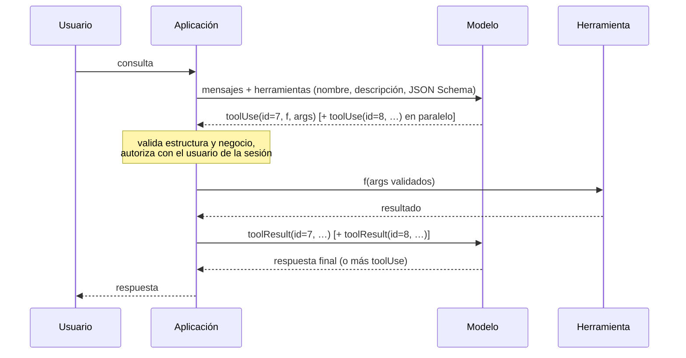
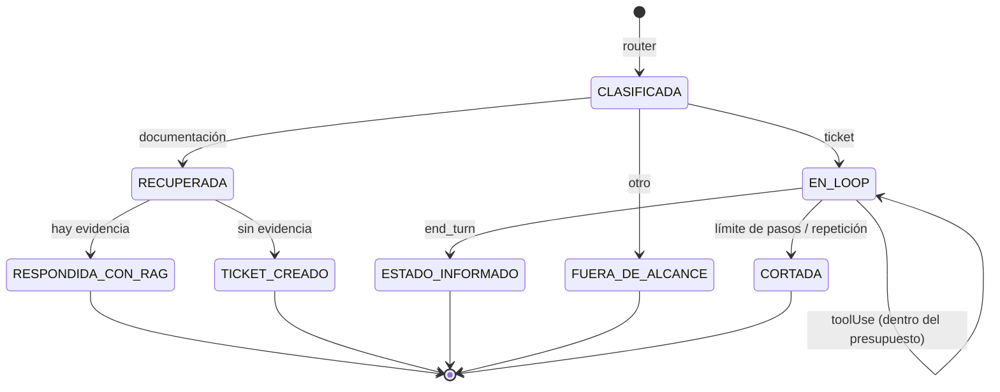
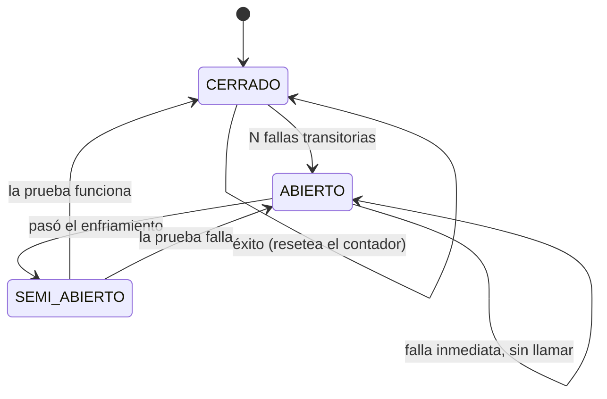
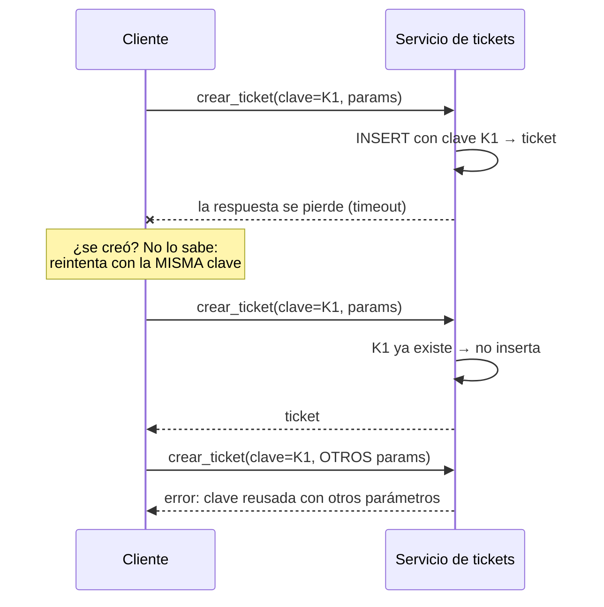

# Apunte — Clase 9: Herramientas y workflows agénticos

> **Cómo usar este apunte.** Es el marco teórico de la clase: el notebook muestra *cómo* se implementa; este documento explica *por qué* funciona así y de dónde sale cada idea. Las referencias entre corchetes ([1], [2]…) remiten a la sección **Fuentes**, que está a continuación y explica qué contiene cada fuente y por qué se usa. Los papers marcados con 📄 se pueden bajar localmente con `bibliography/descargar.sh` (ver [`bibliography/README.md`](../bibliography/README.md)).
>
> **Lectura obligatoria antes de la clase:** [1] (completo, ~20 min) y la sección 1–3 de [5] (ReAct).
> **Lectura recomendada después de la clase:** [2], [11] y el capítulo 8 de [13].
>
> **Correspondencia con el notebook** (`clase-09.ipynb`). La numeración no es idéntica porque el apunte agrega teoría sin celda de código (§2) y el notebook separa en dos lo que acá es una sola sección. Cada sección del notebook indica entre paréntesis el § del apunte que le corresponde.
>
> | Notebook | Apunte |
> |---|---|
> | 1. LLM aumentado, workflow o agente | §1 (y §2: fundamentos de investigación, sin código) |
> | 2. Protocolo de tool calling y diseño de herramientas | §3 y §4 |
> | 3. Tool calling en otros proveedores | §3 (y fuentes [17]–[20]) |
> | 4. Validación de argumentos | §5 |
> | 5. Loop de herramientas con presupuesto | §6.2 |
> | 6. Estado y rutas (router, máquina de estados) | §6.1 y §1.3 |
> | 7. Timeouts, reintentos y circuit breaker | §7 |
> | 8. Idempotencia | §8 |
> | 9. Seguridad | §9 |
> | 10. Registro de decisiones | §10 |
> | 11. Evaluar el workflow (pass^k) | §11 |
> | 12. Síntesis con fallback · 13. Laboratorio | §12 |

---

## Fuentes

Este apunte se construye sobre cuatro tipos de material: (a) guías de ingeniería de quienes construyen agentes en producción, (b) los papers que originaron el tool calling y los agentes basados en LLM, (c) la literatura clásica de sistemas distribuidos — porque un agente que llama herramientas *es* un sistema distribuido — y (d) la documentación oficial de los proveedores. 📄 = PDF descargable con `bibliography/descargar.sh` (en `bibliography/papers/`).

### Agentes y tool calling

**[1] Schluntz, E. & Zhang, B. (2024). *Building effective agents*. Anthropic Engineering.** https://www.anthropic.com/engineering/building-effective-agents
- *Qué contiene:* distingue *workflows* (flujo definido en código) de *agentes* (flujo decidido por el modelo); define el "LLM aumentado" como bloque básico; cataloga cinco patrones de workflow (prompt chaining, routing, parallelization, orchestrator-workers, evaluator-optimizer) con criterios de cuándo usar cada uno; introduce la idea de diseñar una *agent-computer interface* (ACI) con el cuidado de una interfaz humana, incluyendo el principio poka-yoke; recomienda condiciones de parada explícitas.
- *Por qué está:* es la fuente de la taxonomía y el vocabulario que usa la clase (§1, §4, §6.2). Está escrita desde la experiencia de construir agentes con clientes reales, no desde un benchmark, y su tesis central — "empezar por la solución más simple" — es el criterio de diseño que aplicamos al TP. Lectura obligatoria.

**[2] Anthropic (2025). *Writing effective tools for agents — with agents*. Anthropic Engineering.** https://www.anthropic.com/engineering/writing-tools-for-agents
- *Qué contiene:* metodología para prototipar herramientas, evaluarlas con tareas realistas y mejorarlas iterativamente; principios de diseño: elegir qué herramientas existen (no envolver cada endpoint), namespacing, devolver contexto significativo, eficiencia de tokens (paginación, truncado, `response_format`), y redactar descripciones como prompts.
- *Por qué está:* complementa a [1] bajando la ACI a reglas concretas y verificadas con evaluaciones; es la base de §4 (diseño de herramientas) y justifica decisiones del notebook como usar `enum` y devolver errores accionables.

**[4] 📄 Yao, S., Shinn, N., Razavi, P. & Narasimhan, K. (2024). *τ-bench: A Benchmark for Tool-Agent-User Interaction in Real-World Domains*. arXiv:2406.12045.** — `2024_yao_2406.12045.pdf`
- *Qué contiene:* un benchmark donde un agente atiende a un usuario simulado por otro LLM, usando herramientas sobre una base de datos y respetando políticas de dominio (retail, aerolínea); evalúa comparando el estado final de la base con el esperado; introduce la métrica pass^k (éxito en las *k* repeticiones) y muestra que los agentes de la época eran inconsistentes.
- *Por qué está:* es el mejor argumento empírico de §11: para un sistema que *actúa*, lo que importa es el efecto sobre los datos y la consistencia entre ejecuciones, no la redacción. Conecta directamente con el sistema de tickets del TP.

**[5] 📄 Yao, S. et al. (2023). *ReAct: Synergizing Reasoning and Acting in Language Models*. ICLR 2023. arXiv:2210.03629.** — `2022_yao_2210.03629.pdf`
- *Qué contiene:* propone intercalar trazas de razonamiento ("Thought") con acciones ("Action") y observaciones del entorno; lo evalúa en QA multi-hop (HotpotQA), verificación (FEVER) y entornos interactivos (ALFWorld, WebShop), mostrando que supera a razonar solo o actuar solo.
- *Por qué está:* el loop modelo → herramienta → resultado → modelo que implementamos es el loop de ReAct; es el paper fundacional del agente basado en LLM (§2.1). Lectura obligatoria (§1–3).

**[6] 📄 Schick, T. et al. (2023). *Toolformer: Language Models Can Teach Themselves to Use Tools*. NeurIPS 2023. arXiv:2302.04761.** — `2023_schick_2302.04761.pdf`
- *Qué contiene:* un método auto-supervisado para que un modelo aprenda a insertar llamadas a APIs (calculadora, buscador, traductor, calendario), conservando solo las llamadas cuyo resultado reduce la pérdida sobre los tokens siguientes.
- *Por qué está:* da la intuición formal de *cuándo* conviene llamar a una herramienta (cuando su resultado hace más predecible la continuación correcta) y muestra que el tool calling es una capacidad aprendida, no un mecanismo determinístico (§2.2).

**[7] 📄 Patil, S. G., Zhang, T., Wang, X. & Gonzalez, J. E. (2023). *Gorilla: Large Language Model Connected with Massive APIs*. arXiv:2305.15334.** — `2023_patil_2305.15334.pdf`
- *Qué contiene:* documenta la alucinación de APIs (nombres y argumentos inexistentes), propone fine-tuning con recuperación de documentación y publica el benchmark APIBench.
- *Por qué está:* es la evidencia de que los argumentos que emite el modelo no son confiables y justifica la sección de validación (§2.3, §5).

**[8] 📄 Shinn, N. et al. (2023). *Reflexion: Language Agents with Verbal Reinforcement Learning*. NeurIPS 2023. arXiv:2303.11366.** — `2023_shinn_2303.11366.pdf`
- *Qué contiene:* el agente reflexiona en lenguaje natural sobre sus fallas, guarda esas reflexiones en memoria episódica y las usa en el siguiente intento, mejorando en programación, razonamiento y toma de decisiones sin actualizar pesos.
- *Por qué está:* fundamenta la práctica de devolverle al modelo el error de la herramienta para que se corrija (§5.3) y es el antecedente del patrón evaluator-optimizer (§1.3).

**[9] 📄 Wang, L. et al. (2023). *A Survey on Large Language Model based Autonomous Agents*. arXiv:2308.11432.** — `2023_wang_2308.11432.pdf`
- *Qué contiene:* revisión sistemática del área; propone una arquitectura unificada en cuatro módulos (perfil, memoria, planificación, acción) y repasa aplicaciones y métodos de evaluación.
- *Por qué está:* ubica lo que vemos hoy (acción y planificación rudimentaria) dentro del mapa completo del área y anticipa la Clase 10 (memoria, planificación) (§2.5). Sirve como índice para profundizar.

**[10] Weng, L. (2023). *LLM Powered Autonomous Agents*. Lil'Log.** https://lilianweng.github.io/posts/2023-06-23-agent/
- *Qué contiene:* introducción extensa y bien referenciada a agentes: planificación (descomposición de tareas, auto-reflexión), memoria (corto/largo plazo, MIPS) y uso de herramientas, con ejemplos de sistemas.
- *Por qué está:* es la lectura introductoria más citada del área y una alternativa más accesible que el survey [9] para quien quiera una visión general antes de leer papers.

### Sistemas distribuidos y confiabilidad

**[3] Amazon Builders' Library (2020). *Making retries safe with idempotent APIs*.** https://aws.amazon.com/builders-library/making-retries-safe-with-idempotent-APIs/
- *Qué contiene:* cómo AWS diseña APIs idempotentes con identificadores de petición provistos por el cliente; por qué el servidor debe devolver una respuesta "semánticamente equivalente" ante una petición repetida y rechazar la misma clave con parámetros distintos.
- *Por qué está:* es la fuente de §8.3 desde la perspectiva de un proveedor de infraestructura a gran escala; complementa a Stripe [21][22] con un caso distinto (creación de recursos).

**[11] Brooker, M. (2015). *Exponential Backoff And Jitter*. AWS Architecture Blog.** https://aws.amazon.com/blogs/architecture/exponential-backoff-and-jitter/
- *Qué contiene:* simulación de clientes en competencia que muestra que el backoff exponencial sin aleatoriedad produce oleadas sincronizadas, y compara variantes de jitter ("full", "equal", "decorrelated") por trabajo total y tiempo de finalización.
- *Por qué está:* es la referencia canónica de la fórmula de full jitter que usamos (§7.2) y muestra el porqué con datos, no solo la receta. Lectura recomendada.

**[12] Brooker, M. (2019). *Timeouts, retries, and backoff with jitter*. Amazon Builders' Library.** https://aws.amazon.com/builders-library/timeouts-retries-and-backoff-with-jitter/
- *Qué contiene:* cómo elegir timeouts (a partir de percentiles de latencia), por qué los reintentos amplifican la carga en sistemas por capas, la recomendación de reintentar en un único punto del stack y de limitar reintentos con un token bucket.
- *Por qué está:* fundamenta §7.3 (amplificación) y la decisión de diseño de que el reintento viva solo en el cliente del proveedor.

**[13] Kleppmann, M. (2017). *Designing Data-Intensive Applications*. O'Reilly.** — Libro comercial (no se distribuye).
- *Qué contiene:* el texto de referencia sobre sistemas de datos distribuidos. El cap. 8 ("The Trouble with Distributed Systems") analiza redes no confiables, timeouts y la imposibilidad de distinguir una petición perdida de una respuesta perdida; el cap. 11 trata semánticas de entrega y procesamiento exactly-once vía idempotencia.
- *Por qué está:* da el fundamento conceptual de §7.1 y §8.1: por qué un timeout significa "no sé" y por qué exactly-once se obtiene como at-least-once + idempotencia. Es el libro que conviene tener si se va a trabajar en backend.

**[14] Nygard, M. T. (2018). *Release It! Design and Deploy Production-Ready Software* (2.ª ed.). Pragmatic Bookshelf.** — Libro comercial.
- *Qué contiene:* catálogo de anti-patrones y patrones de estabilidad en producción, basado en incidentes reales: Circuit Breaker, Timeouts, Bulkheads, Fail Fast, Steady State, entre otros.
- *Por qué está:* es la fuente original que popularizó el circuit breaker en software (§7.5).

**[15] Fowler, M. (2014). *CircuitBreaker*.** https://martinfowler.com/bliki/CircuitBreaker.html
- *Qué contiene:* explicación breve del circuit breaker con su máquina de estados (cerrado/abierto/semi-abierto) y código de ejemplo.
- *Por qué está:* resumen gratuito y accesible de lo que [14] desarrolla en profundidad; alcanza para §7.5.

**[21] Leach, B. (2017). *Designing robust and predictable APIs with idempotency*. Stripe Blog.** https://stripe.com/blog/idempotency
- *Qué contiene:* por qué las fallas de red hacen inevitables los reintentos, cómo las claves de idempotencia permiten reintentar operaciones de pago sin cobrar dos veces, y la combinación con backoff exponencial y jitter.
- *Por qué está:* es el ejemplo de la industria más claro de una operación no idempotente por naturaleza (cobrar) hecha segura con claves (§8.3) — la analogía directa de "crear ticket".

**[22] Stripe. *Idempotent requests* (documentación de API).** https://docs.stripe.com/api/idempotent_requests
- *Qué contiene:* la especificación concreta del header `Idempotency-Key`: qué se guarda, por cuánto tiempo, y qué pasa si se reusa una clave con parámetros distintos.
- *Por qué está:* muestra cómo se ve el contrato de idempotencia en una API real en producción, para contrastar con nuestra implementación en SQLite.

### Seguridad

**[16] 📄 Greshake, K. et al. (2023). *Not what you've signed up for: Compromising Real-World LLM-Integrated Applications with Indirect Prompt Injection*. AISec '23. arXiv:2302.12173.** — `2023_greshake_2302.12173.pdf`
- *Qué contiene:* define la inyección de prompts *indirecta* (instrucciones escondidas en datos que el sistema recupera, no en el mensaje del usuario), propone una taxonomía de amenazas y demuestra ataques sobre aplicaciones reales con herramientas (exfiltración de datos, manipulación de acciones).
- *Por qué está:* convierte la preocupación de seguridad de §5 y §9 en evidencia concreta. Es especialmente relevante para nosotros porque un RAG con herramientas lee documentos que no controlamos.

**[23] Hardy, N. (1988). *The Confused Deputy (or why capabilities might have been invented)*. ACM SIGOPS Operating Systems Review, 22(4), 36–38.**
- *Qué contiene:* paper corto que describe cómo un programa con privilegios legítimos es inducido por un tercero a usarlos indebidamente, y argumenta a favor de los sistemas basados en capacidades.
- *Por qué está:* da el nombre y el marco conceptual (de seguridad clásica, previo a los LLMs) al riesgo principal de un agente con herramientas (§9.1). Mostrar que el problema es de 1988 ayuda a entender que no es "un problema de IA" sino de diseño de permisos.

### Documentación de proveedores

**[17] Anthropic. *Tool use with Claude*.** https://docs.anthropic.com/en/docs/agents-and-tools/tool-use/overview
**[18] OpenAI. *Function calling*.** https://platform.openai.com/docs/guides/function-calling
**[19] Google. *Function calling with the Gemini API*.** https://ai.google.dev/gemini-api/docs/function-calling
**[20] AWS. *Use a tool to complete an Amazon Bedrock model response* (Converse API).** https://docs.aws.amazon.com/bedrock/latest/userguide/tool-use.html
- *Qué contienen:* la especificación del protocolo de tool calling de cada proveedor: formato de definición de herramientas (JSON Schema), formato de la llamada y del resultado, identificadores, llamadas paralelas y control de elección (`tool_choice`).
- *Por qué están:* el curso es agnóstico de proveedor; estas son las fuentes primarias para §3 y para la sección 3 del notebook ("tool calling en otros proveedores"). Ante cualquier discrepancia entre este apunte y una API, manda la documentación oficial vigente.

---

## 1. Del LLM "aumentado" al agente

### 1.1 Tres sistemas distintos

Hasta la Clase 8 construimos un sistema que *responde*: recibe una pregunta, recupera evidencia y genera una respuesta. Desde esta clase el sistema empieza a *actuar*: crea un ticket, consulta su estado, lo escala. Conviene separar con precisión tres tipos de sistema, siguiendo la taxonomía de Anthropic [1]:

| Sistema | Quién decide el siguiente paso | Ejemplo en el TP |
|---|---|---|
| **LLM aumentado** | Nadie: es una sola llamada al modelo, con acceso a recuperación, herramientas y memoria | El RAG de las clases 6–8 |
| **Workflow** | El **código**: "LLMs y herramientas orquestados a través de caminos de código predefinidos" [1] | "Si el RAG no encontró evidencia → `crear_ticket`" |
| **Agente** | El **modelo**: "LLMs que dirigen dinámicamente sus propios procesos y uso de herramientas" [1] | Un asistente que decide por sí mismo si consultar, crear o escalar |

La distinción no es de tecnología (los tres usan la misma API de *tool calling*) sino de **dónde vive el flujo de control**. En un workflow, el grafo de estados lo escribimos nosotros y el modelo solo llena huecos (clasificar, extraer, redactar). En un agente, el grafo emerge en tiempo de ejecución a partir de las decisiones del modelo.

### 1.2 Cuándo *no* usar un agente

La recomendación de [1] es explícita: "encontrar la solución más simple posible, y solo aumentar la complejidad cuando haga falta". Un agente cambia **latencia y costo** (más llamadas, más tokens) y **predictibilidad** (más caminos posibles, más difícil de testear) por **flexibilidad**. Ese intercambio solo conviene cuando:

1. el número de pasos no se puede predecir de antemano,
2. el camino depende de información que solo aparece durante la ejecución, y
3. existe una forma confiable de verificar el resultado (tests, validaciones, aprobación humana).

Si alguna de las tres no se cumple, un workflow (o un único LLM aumentado) suele ser mejor ingeniería. Esta es una de las ideas que más se repite en la industria y es la que más se ignora.

### 1.3 Los cinco patrones de workflow

Anthropic [1] cataloga cinco patrones que aparecen una y otra vez. Vale la pena conocerlos por nombre porque son el vocabulario común del área:

1. **Prompt chaining** (encadenamiento): la tarea se descompone en pasos fijos; la salida de uno es la entrada del siguiente, con *gates* (chequeos programáticos) entre pasos. Intercambia latencia por precisión: cada llamada resuelve un problema más fácil.
2. **Routing** (enrutamiento): un clasificador (LLM o tradicional) decide a qué rama especializada va cada entrada. Permite optimizar prompts y modelos por categoría — por ejemplo, preguntas fáciles a un modelo chico.
3. **Parallelization** (paralelización): en dos variantes — *sectioning* (subtareas independientes en paralelo) y *voting* (la misma tarea varias veces para obtener diversidad o consenso).
4. **Orchestrator-workers**: un LLM central descompone dinámicamente la tarea, delega en workers y sintetiza. Se diferencia de la paralelización en que las subtareas **no** están predefinidas.
5. **Evaluator-optimizer**: un LLM genera, otro evalúa y devuelve feedback, en loop. Útil cuando hay criterios de evaluación claros y el refinamiento iterativo agrega valor medible — es la versión "workflow" de Reflexion [8].

**Conexión con el TP.** El flujo de tickets del TP es un workflow de *routing*: un clasificador (un LLM con salida forzada a un `enum`) decide si la consulta es sobre documentación, sobre un ticket, u otra cosa, y el código elige la rama. Dentro de la rama de documentación, el resultado del RAG decide entre responder y crear un ticket. Solo la rama de tickets contiene un pequeño loop agéntico, acotado a una herramienta de lectura. No es un agente, y no necesita serlo.

Sin el router, una consulta como "¿cómo va mi ticket 1?" pasaría por el RAG, no encontraría evidencia en la documentación y **abriría un ticket nuevo**: un error de diseño fácil de cometer.

---

## 2. Fundamentos de investigación

El tool calling de las APIs comerciales es la cristalización de una línea de investigación de 2022–2023. Estos son los cuatro trabajos que conviene conocer:

### 2.1 ReAct: razonar y actuar intercalados [5]

Yao et al. (2022) proponen que el modelo genere **trazas de razonamiento** ("Thought") intercaladas con **acciones** ("Action") cuyas **observaciones** ("Observation") vuelven al contexto. El razonamiento ayuda a planificar y a manejar excepciones; las acciones permiten obtener información externa que corrige alucinaciones. Evaluado en preguntas multi-hop (HotpotQA), verificación de hechos (FEVER) y entornos interactivos (ALFWorld, WebShop), ReAct supera tanto a "solo razonar" (chain-of-thought) como a "solo actuar".

El loop que implementamos en el notebook — llamar al modelo, ejecutar el `toolUse`, devolver el `toolResult`, repetir — **es** el loop de ReAct, con la diferencia de que hoy el "Thought" puede quedar implícito dentro del modelo y la "Action" viaja en un campo estructurado en vez de texto libre.

### 2.2 Toolformer: el modelo aprende cuándo llamar [6]

Schick et al. (2023) muestran que un modelo puede aprender **de forma auto-supervisada** a insertar llamadas a APIs (calculadora, buscador, traductor, calendario): se generan candidatos de llamadas, se ejecutan, y se conservan para el fine-tuning solo aquellas cuyo resultado **reduce la pérdida** de predicción de los tokens siguientes. La idea clave: una herramienta es útil si su resultado hace más predecible la continuación correcta. Los modelos comerciales actuales se entrenan explícitamente para tool calling (con datos supervisados y RLHF), pero el criterio de Toolformer sigue siendo la mejor intuición de *por qué* el modelo decide llamar o no.

### 2.3 Gorilla: alucinación de APIs [7]

Patil et al. (2023) documentan un modo de falla específico: el modelo **inventa** nombres de funciones o argumentos plausibles pero inexistentes. Proponen entrenar con recuperación de documentación (*retriever-aware training*) y publican APIBench. Lección práctica para nosotros: **nunca confiar en que el nombre o los argumentos que emite el modelo existen o son válidos** — de ahí la sección de validación (§4).

### 2.4 Reflexion: aprender del error sin cambiar pesos [8]

Shinn et al. (2023) agregan una etapa de auto-reflexión verbal: tras un intento fallido, el modelo escribe en lenguaje natural qué salió mal y lo guarda en una memoria episódica que condiciona el siguiente intento ("refuerzo verbal"). Es el ancestro del patrón evaluator-optimizer y de la práctica de devolverle al modelo el **mensaje de error** de una herramienta en lugar de abortar.

### 2.5 Una arquitectura de referencia

El survey de Wang et al. [9] organiza los agentes basados en LLM en cuatro módulos: **perfil** (rol/persona), **memoria** (corto y largo plazo), **planificación** (con o sin feedback del entorno) y **acción** (herramientas). Lilian Weng [10] propone una descomposición casi idéntica (planificación, memoria, uso de herramientas) y es la lectura introductoria más citada del área. En esta clase nos ocupamos de **acción** y de una forma rudimentaria de **planificación** (el workflow); la memoria y la planificación más rica vuelven en la Clase 10.

---

## 3. El protocolo de tool calling

### 3.1 Qué pasa realmente en una llamada

Un punto que confunde mucho: **el modelo nunca ejecuta nada**. El protocolo, igual en todos los proveedores grandes [17][18][19][20], es:

1. La aplicación envía, junto con los mensajes, una lista de herramientas: **nombre**, **descripción** en lenguaje natural y **esquema de parámetros** en JSON Schema (el mismo de la Clase 3).
2. El modelo, en lugar de (o además de) texto, devuelve un bloque estructurado "quiero llamar a `f` con estos argumentos", con un **identificador** único de la llamada.
3. La **aplicación** valida, ejecuta (o no) la función, y devuelve el resultado en un mensaje con el **mismo identificador**.
4. El modelo continúa con el resultado en contexto.

El identificador es lo que permite **llamadas paralelas**: el modelo puede pedir varias herramientas en un mismo turno, y la aplicación devuelve varios resultados que se emparejan por id.

### 3.2 Control de la elección

Todas las APIs permiten forzar el comportamiento con un parámetro de tipo `tool_choice` (los nombres varían): **auto** (el modelo decide), **any/required** (debe llamar a alguna) o **una herramienta específica**. Forzar una herramienta específica es exactamente el truco de "structured outputs vía tool calling" de la Clase 3.

### 3.3 La herramienta es un contrato

La descripción y el esquema son lo **único** que el modelo sabe de la herramienta. Son, literalmente, un prompt. Esto tiene dos consecuencias:

- una descripción ambigua produce llamadas ambiguas, igual que un prompt ambiguo;
- el esquema define la **superficie de ataque**: todo argumento que el esquema permite, el modelo lo puede emitir — incluso si el usuario (o un documento recuperado) lo manipuló.

---

## 4. Diseño de herramientas: la interfaz agente-computadora (ACI)

[1] propone pensar en una **ACI** (*agent-computer interface*) con el mismo cuidado que se pone en una interfaz humano-computadora (HCI). [2] sistematiza los principios a partir de evaluaciones internas. Los resumimos:

1. **Elegir bien qué herramientas existen.** No envolver cada endpoint de una API. Una herramienta debería corresponder a una *tarea* del agente, no a una *operación* del backend. Ejemplo: mejor `programar_reunion` que `listar_usuarios` + `listar_eventos` + `crear_evento`.
2. **Namespacing.** Con decenas de herramientas, agrupar por prefijo (`tickets_crear`, `tickets_consultar`) reduce confusiones; [2] reporta que incluso la elección prefijo vs. sufijo tiene efectos medibles.
3. **Devolver contexto significativo.** Nombres legibles en vez de UUIDs opacos; campos que el modelo efectivamente necesita para el próximo paso. Un parámetro `response_format` con valores `"concise"`/`"detailed"` deja que el agente elija.
4. **Eficiencia de tokens.** Toda respuesta que pueda crecer necesita paginación, filtrado o truncado con valores por defecto sensatos — el resultado de la herramienta vuelve al contexto y compite con todo lo demás (Clase 6).
5. **Errores accionables.** Un error de validación debería decir *qué* estuvo mal y *cómo* corregirlo ("`prioridad` debe ser una de: baja, media, alta"), no devolver un stack trace.
6. **Poka-yoke.** Término de la manufactura japonesa: diseñar para que el error sea imposible. [1] cuenta que cambiar una herramienta para exigir rutas absolutas eliminó una clase entera de errores. En nuestro caso: usar `enum` en el esquema en vez de un `string` libre.
7. **Evaluar las herramientas** con tareas realistas y medir: tasa de éxito, número de llamadas, tokens consumidos, errores (ver §9 y Clase 8).

---

## 5. Validación: el argumento es input no confiable

### 5.1 Frontera de confianza

Los argumentos que emite el modelo deben tratarse exactamente como un formulario enviado por un usuario anónimo de internet: **input no confiable**. Tres razones independientes:

- el modelo puede **alucinar** valores (Gorilla [7]);
- el modelo puede ser **manipulado**: un documento recuperado o un mensaje de usuario puede contener instrucciones que el modelo siga (*prompt injection* indirecta [16]);
- aun sin error ni ataque, el modelo produce texto probabilístico — los JSON mal formados son raros con las APIs actuales, pero los **valores semánticamente inválidos** (un id de ticket que no existe, una fecha en el pasado) son frecuentes.

### 5.2 Dos niveles de validación

| Nivel | Qué verifica | Herramienta |
|---|---|---|
| **Sintáctico/estructural** | Tipos, campos obligatorios, enums, rangos | Pydantic / JSON Schema (Clase 3) |
| **Semántico/de negocio** | Que el ticket exista, que el usuario pueda verlo, que la transición de estado sea legal | Código de dominio, consultas a la DB |

### 5.3 Qué hacer cuando falla

Hay dos estrategias, y conviene elegir explícitamente:

- **Devolver el error al modelo** como `toolResult` con estado de error, para que se auto-corrija (es la lógica de Reflexion [8] aplicada a un paso). Funciona bien para errores de formato.
- **Cortar el flujo** y escalar a un humano o responder con un fallback. Obligatorio cuando el error sugiere manipulación o cuando la acción es de escritura con efectos irreversibles.

En ambos casos, **el número de reintentos de auto-corrección debe estar acotado** (§6).

---

## 6. Estado, transiciones y terminación

### 6.1 El workflow como máquina de estados

Un workflow se modela con precisión como una **máquina de estados finitos** (FSM): un conjunto de estados $S$, un estado inicial $s_0$, un conjunto de estados finales $F \subseteq S$, y una función de transición $\delta : S \times E \to S$ donde $E$ son los eventos (resultado del RAG, resultado de una herramienta, decisión del modelo). Cada transición puede tener una **guarda** (condición booleana). En el notebook, el `EstadoEjecucion` es la representación explícita de "en qué estado estoy y qué aprendí hasta ahora".

Modelar así tiene ventajas concretas: se puede **dibujar** el grafo, **enumerar** los caminos posibles para testearlos, y **verificar** propiedades ("no existe un camino que escale un ticket sin haberlo creado"). Frameworks como LangGraph (Clase 10) son, esencialmente, una librería para declarar este grafo.

Un agente, en cambio, es una **política** $\pi(a_t \mid h_t)$: dada la historia $h_t$ (mensajes, resultados de herramientas), el modelo elige la acción $a_t$. El conjunto de historias posibles no es finito ni enumerable — por eso los agentes son más difíciles de testear que los workflows.

### 6.2 Por qué hace falta un límite de pasos

No existe forma general de demostrar que un loop "modelo → herramienta → modelo" termina: el modelo puede pedir la misma herramienta indefinidamente, oscilar entre dos estados, o reintentar una acción que siempre falla. (Es una instancia práctica del problema de la parada: no podemos decidir en general si un programa arbitrario termina, y la política del modelo es, a estos efectos, un programa arbitrario.) La solución de ingeniería es imponer **condiciones de parada** externas [1]:

- **presupuesto de pasos** (máximo de iteraciones),
- **presupuesto de tokens o de costo**,
- **timeout de pared** (tiempo total),
- **detección de repetición** (misma herramienta con mismos argumentos $n$ veces seguidas).

Al agotar el presupuesto, el sistema debe terminar en un **estado final definido** (por ejemplo, "no pude resolverlo, se abrió un ticket"), nunca colgarse ni fallar silenciosamente.

---

## 7. Fallas parciales: timeouts, reintentos y backoff

### 7.1 El problema de fondo

En un sistema distribuido — y llamar a una API de LLM, o a una base de datos remota, ya lo es — una petición puede fallar de una forma que no existe en un programa local: **no sabemos si se ejecutó**. Kleppmann [13, cap. 8] lo describe con precisión: si enviamos una petición y no llega respuesta, puede ser que (a) la petición se perdió, (b) el servidor la está procesando lentamente, (c) el servidor la procesó y la respuesta se perdió. **Desde el cliente, los tres casos son indistinguibles.** Un timeout no significa "no pasó"; significa "no sé".

### 7.2 Reintentos con backoff exponencial y jitter

Reintentar inmediatamente después de una falla por sobrecarga empeora la sobrecarga. La solución estándar es el **backoff exponencial**: esperar $t_n = \text{base} \cdot 2^n$ antes del intento $n$, con un tope. Pero si muchos clientes fallan a la vez, todos reintentan *sincronizados* en $t_1, t_2, \dots$ — una manada que golpea al servidor en oleadas. Brooker [11] muestra por simulación que agregar aleatoriedad (**jitter**) dispersa la carga, y recomienda *full jitter*:

$$
t_n = \text{uniforme}\big(0,\ \min(\text{tope},\ \text{base}\cdot 2^n)\big)
$$

que reduce sustancialmente el trabajo total del servidor frente al backoff sin jitter.

### 7.3 Amplificación de reintentos

Si una petición atraviesa $L$ capas y cada una reintenta $r$ veces, una falla en el fondo genera hasta $(r+1)^L$ intentos. Con 3 capas y 3 reintentos: $4^3 = 64$ peticiones por cada petición original. El Amazon Builders' Library [12] lo llama amplificación y recomienda **reintentar en un único punto del stack**, y limitar los reintentos localmente con un **token bucket** (cada reintento consume un token; los tokens se reponen a tasa fija). En el notebook, el reintento vive en un solo lugar: el cliente del proveedor.

### 7.4 ¿Qué errores se reintentan?

| Tipo | Ejemplos | ¿Reintentar? |
|---|---|---|
| **Transitorio** | Throttling (429), 5xx, timeout de red | Sí, con backoff + jitter |
| **Permanente** | 400 (request inválido), 401/403 (credenciales), modelo inexistente | **No** — reintentar no cambia nada |
| **Ambiguo** | Timeout en una operación de **escritura** | Solo si la operación es **idempotente** (§8) |

### 7.5 Circuit breaker y fallbacks

Cuando una dependencia está caída, reintentar indefinidamente desperdicia recursos y agrava el problema. El **circuit breaker** (Nygard [14]; Fowler [15]) es una máquina de estados con tres estados: **cerrado** (las peticiones pasan; se cuentan las fallas), **abierto** (tras superar un umbral de fallas, las peticiones fallan inmediatamente sin llamar a la dependencia, durante un tiempo de enfriamiento) y **semi-abierto** (se deja pasar una petición de prueba; si funciona, se cierra; si falla, vuelve a abrirse).

Solo los errores **transitorios** deben contar como fallas: un error de validación (400) dice que el pedido estaba mal, no que el servicio esté caído. Y el breaker va **afuera** de los reintentos, para que una llamada lógica (con todos sus reintentos) cuente como un solo evento.

Un **fallback** es la respuesta degradada cuando la vía principal no está disponible: otro modelo u otro proveedor (posible gracias a la abstracción `LLMProvider` de la Clase 3), una respuesta en caché, o — en el TP — abrir un ticket en vez de responder.

---

## 8. Semántica de entrega e idempotencia

### 8.1 Tres garantías posibles

Combinando §7.1 y §7.2 aparece una pregunta fundamental: si reintentamos, ¿cuántas veces se ejecuta la operación?

- **At-most-once** (a lo sumo una vez): no reintentar nunca. Si hubo timeout, la operación puede haberse perdido.
- **At-least-once** (al menos una vez): reintentar hasta tener confirmación. La operación puede ejecutarse **más de una vez**.
- **Exactly-once** (exactamente una vez): lo que queremos — pero en un sistema con fallas de red no se puede garantizar solo desde el transporte.

La forma práctica de obtener exactly-once *en efecto* es **at-least-once + idempotencia** del lado del servidor: se reintenta todo lo que haga falta, y el servidor garantiza que los duplicados no producen efectos adicionales [13].

### 8.2 Definición

Matemáticamente, una función $f$ es idempotente si $f(f(x)) = f(x)$. En APIs, la definición operativa es: **ejecutar la misma petición $n \geq 1$ veces produce el mismo efecto que ejecutarla una vez**. Algunas operaciones son idempotentes por naturaleza (`GET`, "poner el estado en CERRADO", `DELETE` de un id), otras no ("crear ticket", "cobrar $100", "incrementar contador").

### 8.3 Claves de idempotencia

Para operaciones que no son idempotentes por naturaleza, el patrón estándar (Stripe [21][22], AWS [3]) es:

1. El **cliente** genera un identificador único por *intento lógico* de operación (no por intento de red) — la **clave de idempotencia**.
2. El cliente envía la clave junto con la petición, y la **reusa en todos los reintentos**.
3. El **servidor** guarda la clave junto con el resultado. Si recibe una clave ya vista, **no ejecuta** de nuevo: devuelve el resultado guardado (AWS habla de devolver una respuesta "semánticamente equivalente" [3]).
4. Si llega la misma clave con **parámetros distintos**, es un error del cliente y debe rechazarse — de lo contrario un bug podría hacer que dos operaciones distintas se confundan.

En SQLite (el sistema de tickets del TP), esto se implementa con una restricción `UNIQUE` sobre la columna de clave y una transacción: el `INSERT` duplicado falla atómicamente, y en ese caso se lee y devuelve la fila existente. **La garantía la da la base de datos, no el código Python** — un `if not existe: insertar` sin transacción tiene una condición de carrera.

### 8.4 ¿De dónde sale la clave en un sistema con LLM?

Sutil e importante: si el **modelo** genera la clave, cada reintento del loop puede producir una clave nueva y la idempotencia no sirve. La clave debe derivarse de forma **determinística** de algo estable: el id de la conversación + el id del turno, o un hash del contenido normalizado de la pregunta. Así, si el usuario reenvía la misma pregunta por un error de red, no se crea un segundo ticket.

---

## 9. Seguridad: las herramientas son capacidades

### 9.1 El diputado confundido

En 1988, Norm Hardy describió el **problema del diputado confundido** [23]: un programa con privilegios legítimos (el "diputado") es engañado por un tercero sin esos privilegios para usarlos en su nombre. Un agente con herramientas es un diputado ideal: tiene permisos (escribir en la DB de tickets, mandar emails), y su comportamiento puede ser influido por **texto que no controlamos** — el mensaje del usuario y, peor, los **documentos recuperados**. Greshake et al. [16] demuestran ataques reales de *prompt injection indirecta*: instrucciones escondidas en páginas web o documentos que, al ser leídas por un sistema con herramientas, lo inducen a exfiltrar datos o ejecutar acciones.

### 9.2 Principios de mitigación

1. **Mínimo privilegio.** Cada herramienta con el permiso mínimo necesario. Separar herramientas de **lectura** (`consultar_estado_ticket`) de herramientas de **escritura** (`escalar_ticket`), y dar acceso a las segundas solo cuando haga falta.
2. **La autorización la decide el código, no el modelo.** El modelo propone; el código verifica que *este usuario* puede *esta acción* sobre *este recurso*.
3. **Aprobación humana para acciones irreversibles o de alto impacto** (*human-in-the-loop*). Es el checkpoint 10 del TP y el centro de la Clase 10.
4. **Tratar los resultados de herramientas como datos, no como instrucciones** — delimitarlos en el prompt (Clase 2) y no darles autoridad de sistema.
5. **Auditar** (§10): si algo sale mal, tiene que poder reconstruirse qué decidió el modelo y por qué.

---

## 10. Registro de decisiones: observabilidad del flujo

Un sistema que actúa necesita un **registro de auditoría** (*audit log*), distinto del log de debugging. Para cada paso conviene registrar, en formato estructurado (JSON, una línea por evento):

- un **identificador de traza** común a toda la ejecución y un id por paso,
- el **estado** antes y después,
- la **decisión** (qué herramienta, con qué argumentos — ya validados),
- el **resultado** (o el error) y la **latencia**,
- los **tokens** y el costo estimado (Clase 3).

Esto sirve para tres cosas distintas: **debugging** (reconstruir un caso que falló), **auditoría** (quién hizo qué, con qué autorización) y **evaluación** (calcular métricas sobre muchas ejecuciones — Clase 8). Los estándares de la industria para esto (OpenTelemetry y sus convenciones semánticas para GenAI) vuelven en la Clase 11.

---

## 11. Evaluar agentes: la confiabilidad no es la media

Yao et al. presentan **τ-bench** [4]: un benchmark donde el agente interactúa con un usuario simulado (otro LLM) y con herramientas de un dominio (atención al cliente de retail y de aerolíneas), con **políticas de dominio** que debe respetar. Dos aportes conceptuales importan para nosotros:

1. La evaluación compara el **estado final de la base de datos** con el estado esperado — no la redacción de la respuesta. Para un agente que actúa, el criterio de éxito es el **efecto**, no el texto.
2. Introducen la métrica **pass^k**: la probabilidad de que el agente resuelva la tarea en **las $k$ ejecuciones** independientes (no en alguna). Mientras pass@k mide "¿puede hacerlo alguna vez?", pass^k mide "¿lo hace siempre?". Los autores reportan que incluso los mejores modelos de la época resolvían menos de la mitad de las tareas y que pass^8 caía por debajo del 25% en retail: **los agentes son inconsistentes**. Para un sistema que toca datos reales, la consistencia es lo que importa.

Si la tasa de éxito por intento es $p$ y los intentos fueran independientes, pass^k $= p^k$: con $p = 0{,}9$, pass^8 $\approx 0{,}43$. Esto da una intuición de por qué los workflows (que reducen la varianza fijando el camino) suelen ser preferibles a los agentes en procesos de negocio.

---

## 12. Síntesis para el TP

| Concepto | Dónde aparece en el TP |
|---|---|
| Workflow de routing [1] | Router → (RAG → ¿hay evidencia? → responder / `crear_ticket`) · (loop de tickets) · (fuera de alcance) |
| Loop ReAct acotado [5] | Rama de tickets: todas las llamadas por turno, presupuesto de pasos, detección de repeticiones |
| Contrato de herramienta (JSON Schema) | `crear_ticket`, `consultar_estado_ticket`, `escalar_ticket` |
| Validación en dos niveles | Pydantic + "¿el ticket existe? ¿la transición es legal?" |
| Límite de pasos | Presupuesto máximo en el loop de herramientas |
| Reintentos con backoff + jitter [11] | Cliente del proveedor (un solo punto [12]) |
| Idempotencia [21][3] | Clave determinística + `UNIQUE` en SQLite al crear tickets |
| Herramientas de lectura vs. escritura [23] | Checkpoint 9 (lectura) vs. checkpoint 10 (escritura con aprobación) |
| Registro de auditoría | Log estructurado por paso con id de traza |

---

## Preguntas de repaso

1. ¿Qué diferencia hay entre un workflow y un agente según [1]? Dé un ejemplo de tarea donde un agente sea claramente peor elección.
2. Explique por qué un timeout en una operación de escritura no permite concluir que la operación no se ejecutó. ¿Qué mecanismo permite reintentarla de forma segura?
3. Un sistema tiene 3 capas y cada una reintenta 2 veces. ¿Cuántas peticiones puede recibir el servicio del fondo por cada petición original? ¿Qué recomienda [12]?
4. ¿Por qué la clave de idempotencia no debería generarla el modelo?
5. Si un agente resuelve una tarea con probabilidad 0,8 por intento, ¿cuál es su pass^5 suponiendo independencia? ¿Qué nos dice eso sobre usarlo en un proceso de negocio?
6. Describa un escenario de "diputado confundido" en el sistema de tickets del TP y cómo lo mitigaría.
